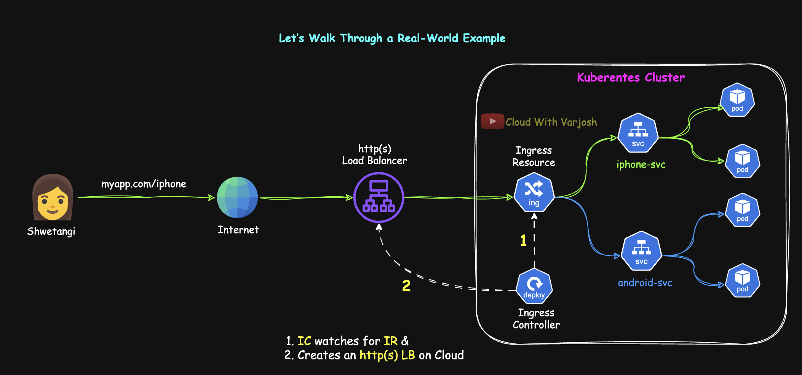

# 69 · Ingress: HTTP(S) Routing Into the Cluster

> **Level:** ★★ intermediate
>
> **You will learn:** why NodePort and LoadBalancer Services aren't enough for production web traffic; what an **Ingress** resource is (Layer 7 routing rules) and what an **Ingress controller** does; the real request flow from browser to Pod; cloud-native vs in-cluster controllers; the Ingress spec (rules, hosts, `pathType`, default backend, TLS, `ingressClassName`/IngressClass); the state of the ecosystem (**ingress-nginx retired**, the Ingress API frozen, **Gateway API** as the successor); and a local lab on kind.
>
> **You need:** topics 30–32 (Services, kube-proxy), 33 (DNS), 50–51 (TLS and certificates).

---

## ⚡ Core: the 10-minute version

**The idea.** An **Ingress** is a set of HTTP routing rules:
- by **host** (`shop.example.com`) or **path** (`/api`);
- to Services;
- with TLS ended at the edge.

The rules do nothing until an **Ingress controller** (Traefik, the AWS Load Balancer Controller…) implements them. One controller and one load balancer can then serve many apps. Note: the Ingress API is **frozen**, the popular **ingress-nginx is retired**, and **Gateway API** (topic 72) is the successor.

**Picture it.** A directory board in a building lobby (the Ingress) read by the receptionist (the controller) who sends visitors to the right floor.

**The one thing to know.**

```yaml
apiVersion: networking.k8s.io/v1
kind: Ingress
metadata: { name: web }
spec:
  ingressClassName: traefik
  rules:
  - http:
      paths:
      - { path: /api, pathType: Prefix, backend: { service: { name: api, port: { number: 80 } } } }
      - { path: /,    pathType: Prefix, backend: { service: { name: web, port: { number: 80 } } } }
```

**Try it now:**
1. Follow this topic's kind + Traefik lab.
2. `curl localhost:8080/api` and `curl localhost:8080/` reach different Services.

**You've got it if you can:** explain Ingress vs Ingress controller, and `pathType: Prefix`.

> 📖 **That's the core.** On a first pass, do the mini-lab and move on to the next topic. Everything below is the **full reference**: come back for the details, the edge cases, interview answers and exam-level depth.

---

## What it is

An **Ingress** is a Kubernetes **API object** (`networking.k8s.io/v1`) that declares how **external HTTP(S) traffic** is routed to **Services** inside the cluster. It's a set of **Layer 7** (application-layer) rules based on **hostnames**, **URL paths** and **TLS** settings. It enables:
- **path-based routing**: `/android` → `android-svc`;
- **host-based routing**: `iphone.myapp.com` → `iphone-svc`;
- **TLS termination at the edge** (not in every app);
- **one central entry point** for all HTTP(S) traffic.

An **Ingress resource is declarative only**: just YAML. Nothing routes traffic until an **Ingress controller** implements it.

An **Ingress controller** is a component (usually running in the cluster) that **watches Ingress resources** and **turns their rules into real load-balancer configuration**: listeners on 80/443, routing rules by host/path, health checks, backend (target) management. **Ingress says *what* should happen; the controller decides *how*.**

(Day 49 notes that "L7 load balancer" is the common term, but Ingress itself only covers **HTTP and HTTPS**, so "HTTP(S) load balancer" is more precise.)

---

## Why it exists

### Services alone fall short

- **NodePort** (topic 31) is fine for dev/test, but nodes scale in and out in real clusters; exposing changing node IPs and high ports (30000–32767) to users is impractical.
- **LoadBalancer** Services get a cloud load balancer, but:
  - it's usually **Layer 4** (TCP/UDP): no routing by path or host;
  - **one cloud load balancer per Service**: expensive and hard to manage with dozens of microservices;
  - **TLS must be handled in each app** (a plain L4 balancer passes encrypted bytes through).

> ℹ️ **Note:** some L4 load balancers **can** terminate TLS (e.g. an AWS NLB with a TLS listener and an ACM certificate), but they still can't route by **path or host**; that needs L7.

### What we want

- **HTTP(S)-aware routing** (`/android`, `/iphone`, `iphone.myapp.com`);
- **one load balancer** for many applications (cost, simplicity);
- **declarative, version-controlled** routing rules in your manifests.

That's Ingress.

---

## Analogy

A big office building with one **reception desk** (the load balancer + controller) instead of a separate street door for every company (one LoadBalancer per Service). The **directory board** (the Ingress resource) says "Acme Corp → floor 3, Globex → floor 7; parcels for `/billing` → room 301". The receptionist (controller) reads the board and directs visitors; the board itself doesn't walk anyone anywhere. Checking IDs at reception (TLS termination) means each company doesn't need its own guard.

---

## How it works inside

### The real-world flow



Shwetangi opens `myapp.com/iphone`:

1. Her browser resolves `myapp.com` (DNS) and the request reaches an **external load balancer**.
2. That load balancer exists **because of the Ingress controller**:
   - a **cloud-native controller** (AWS Load Balancer Controller, GKE Ingress) **provisions a cloud L7 load balancer** (e.g. an AWS ALB) and configures its rules;
   - a **third-party in-cluster controller** (NGINX-based, HAProxy, Traefik, Envoy-based) runs as Pods and is exposed by a **`Service` of type `LoadBalancer`** (an L4 balancer that forwards all traffic to the controller Pods).
3. The controller **reads the Ingress**: "`/iphone` → `iphone-svc`".
4. It either **programs the cloud load balancer** (cloud-native) or **routes the request itself** (in-cluster proxy).
5. Traffic reaches the matching **Service** (`iphone-svc`) and one of its **Pods** (most controllers actually send straight to **Pod IPs** taken from EndpointSlices, skipping kube-proxy, to support sticky sessions and better load balancing).

**The Ingress resource is never a hop in the traffic path**: it's configuration the controller watches.

### Cloud-native vs in-cluster controllers

**Cloud-native (e.g. AWS Load Balancer Controller; topics 70–71):** from your Ingress manifest, it provisions an **external L7 ALB**. TLS termination, routing and load balancing happen **outside the cluster**, in the managed service.

**In-cluster (NGINX-based, HAProxy, Traefik, Contour/Envoy…):** the proxy runs **inside** the cluster and is exposed via a `LoadBalancer` Service (an L4 balancer) or NodePorts. The controller Pods do **TLS termination**, apply the **routing rules**, and forward to Services/Pods. All logic stays **inside** the cluster.

> ℹ️ **Note:** the original notes said "you must **manually** create a Layer 4 Load Balancer using a `Service: LoadBalancer`". In practice the controller's **Helm chart or install manifest creates that Service** for you. On bare metal (no cloud), `type: LoadBalancer` needs **MetalLB** or a similar provider; otherwise use NodePorts or `hostNetwork` on dedicated edge nodes.

### Popular controllers

| Controller | Notes |
|---|---|
| **AWS Load Balancer Controller** | Provisions ALBs (Ingress) and NLBs (Services) on EKS; deep AWS integration |
| **NGINX Ingress Controller** (`kubernetes/ingress-nginx`, community) | Was the most widely used. ⚠️ **Retired**: maintenance ended in March 2026, so no more releases or security fixes. Migrate (see below) |
| **F5 NGINX Ingress Controller** (`nginxinc/kubernetes-ingress`) | A different, F5-maintained NGINX controller (open-source + commercial); also **NGINX Gateway Fabric** for Gateway API (topic 73) |
| **HAProxy Ingress** | High performance, low latency |
| **Traefik** | Cloud-native, automatic Let's Encrypt TLS, dynamic config; supports Ingress and Gateway API |
| **Contour** / **Envoy Gateway** | Envoy-based; advanced traffic control, multi-team; Envoy Gateway focuses on Gateway API |
| **Istio ingress gateway** | Part of the Istio mesh: policies, mTLS, fine-grained traffic management (topic 74) |
| **GKE Ingress**, **Azure Application Gateway for Containers** | Cloud-native, like the AWS controller |

All support the standard Ingress API, but their **operational models and extras** (annotations, CRDs) differ. Choose by cloud, scale and security needs.

> ℹ️ **Note:** the **Ingress API is stable (GA) but frozen**: no new features will be added. New capabilities go into **Gateway API** (topics 72–73), which most controllers now implement. The community **ingress-nginx** project was **retired** (announced November 2025, best-effort maintenance until March 2026). Existing clusters keep working but get no security fixes, so plan a migration to Gateway API or another maintained Ingress controller. ingress-nginx annotations like `nginx.ingress.kubernetes.io/rewrite-target` don't carry over to other controllers.

### The Ingress spec

```yaml
apiVersion: networking.k8s.io/v1
kind: Ingress
metadata:
  name: shop
  namespace: shop
spec:
  ingressClassName: traefik            # which controller implements this Ingress
  tls:
  - hosts: [shop.example.com]
    secretName: shop-tls               # kubernetes.io/tls Secret (tls.crt/tls.key) in the SAME namespace
  defaultBackend:                      # requests that match no rule (optional)
    service: { name: default-svc, port: { number: 80 } }
  rules:
  - host: shop.example.com             # host-based (omit host = any host)
    http:
      paths:
      - path: /iphone
        pathType: Prefix               # matches /iphone, /iphone/, /iphone/x (not /iphones)
        backend:
          service:
            name: iphone-svc           # Service in the SAME namespace
            port: { number: 80 }       # or { name: http }
      - path: /
        pathType: Prefix               # catch-all for this host
        backend:
          service: { name: desktop-svc, port: { number: 80 } }
```

- **`pathType`** (required): `Exact` (only that exact path), `Prefix` (by path **elements**, split on `/`), or `ImplementationSpecific` (controller decides; e.g. regexes). The **longest matching path wins**; `Exact` beats `Prefix` on a tie.
- **`host`**: an exact name or a wildcard like `*.example.com` (one level only).
- **Backends must be in the Ingress's namespace** (no cross-namespace references; one of Gateway API's improvements).
- **TLS**: the controller terminates HTTPS with the Secret's certificate (often created by **cert-manager** from a `Certificate` or an Ingress annotation; topic 71).
- **`ingressClassName`** selects the controller via an **IngressClass** object. One IngressClass can be marked default (`ingressclass.kubernetes.io/is-default-class: "true"`; the `DefaultIngressClass` admission plugin applies it; topic 58). The old annotation `kubernetes.io/ingress.class` is **deprecated**.
- **`status.loadBalancer.ingress`** shows the address (IP/hostname) the controller publishes: `kubectl get ingress` → `ADDRESS`.
- Anything else (rewrites, timeouts, auth, rate limits, canaries, CORS) is **controller-specific annotations/CRDs**, which aren't validated or portable. That's a main motivation for Gateway API.

### What's ahead (Day 49, corrected numbering)

Day 49 lists the series as "Part 1… Part 2… Part 3". It's actually **Day 49** (concepts, this topic), **Day 50** (EKS cluster + path-based routing with the AWS Load Balancer Controller; topic 70) and **Day 51** (TLS with ACM + Route 53 custom domain, and name-based routing on one ALB; topic 71).

---

## Commands / YAML

### Local lab: Ingress on kind with Traefik

kind config with host ports mapped to fixed NodePorts:

```yaml
# kind-ingress.yaml
kind: Cluster
apiVersion: kind.x-k8s.io/v1alpha4
nodes:
- role: control-plane
  extraPortMappings:
  - { containerPort: 30080, hostPort: 8080 }     # http://localhost:8080
  - { containerPort: 30443, hostPort: 8443 }     # https://localhost:8443
- role: worker
```

```bash
kind create cluster --name ing --config kind-ingress.yaml
helm repo add traefik https://traefik.github.io/charts && helm repo update
helm install traefik traefik/traefik -n traefik --create-namespace \
  --set service.type=NodePort \
  --set ports.web.nodePort=30080 --set ports.websecure.nodePort=30443 \
  --set nodeSelector."kubernetes\.io/hostname"=ing-control-plane \
  --set "tolerations[0].key=node-role.kubernetes.io/control-plane" --set "tolerations[0].effect=NoSchedule"
kubectl get ingressclass
```

```
NAME      CONTROLLER                      PARAMETERS   AGE
traefik   traefik.io/ingress-controller   <none>       30s
```

(Pinning Traefik to the control-plane node isn't strictly needed with NodePorts, which work on every node, but mirrors common kind setups. Values names can change between chart versions: check `helm show values traefik/traefik`.)

Three apps and one Ingress:

```bash
for app in iphone android desktop; do
  kubectl create deployment $app --image=hashicorp/http-echo:1.0 -- /http-echo -text="hello from $app" -listen=:5678
  kubectl expose deployment $app --name=$app-svc --port=80 --target-port=5678
done
```

```yaml
apiVersion: networking.k8s.io/v1
kind: Ingress
metadata:
  name: devices
spec:
  ingressClassName: traefik
  rules:
  - http:
      paths:
      - { path: /iphone,  pathType: Prefix, backend: { service: { name: iphone-svc,  port: { number: 80 } } } }
      - { path: /android, pathType: Prefix, backend: { service: { name: android-svc, port: { number: 80 } } } }
      - { path: /,        pathType: Prefix, backend: { service: { name: desktop-svc, port: { number: 80 } } } }
```

```bash
kubectl apply -f devices-ingress.yaml
kubectl get ingress devices
curl -s localhost:8080/iphone; curl -s localhost:8080/android; curl -s localhost:8080/anything
```

```
NAME      CLASS     HOSTS   ADDRESS   PORTS   AGE
devices   traefik   *                 80      10s
hello from iphone
hello from android
hello from desktop
```

Host-based routing locally (no DNS needed):

```bash
curl -s -H "Host: iphone.example.com" localhost:8080/
```

### Inspect

```bash
kubectl describe ingress devices
kubectl get ingress -A
kubectl logs -n traefik deploy/traefik | tail
```

`describe` shows each rule and the **backend Pod IPs**, e.g. `/iphone  iphone-svc:80 (10.244.1.5:5678)`. An empty list (`<error: endpoints … not found>` or no IPs) means the Service has no ready Pods.

---

## Hands-on lab

1. Build the kind + Traefik lab; test the three paths.
2. Change `/iphone` to `pathType: Exact` and try `/iphone/x`; then add an `Exact` and a `Prefix` rule for the same path and see which wins.
3. Add host rules for `iphone.example.com` and `android.example.com` and test with `curl -H "Host: …"`.
4. TLS: create a self-signed cert (`openssl req -x509 -nodes -newkey rsa:2048 -keyout tls.key -out tls.crt -subj "/CN=shop.example.com" -addext "subjectAltName=DNS:shop.example.com" -days 30`), `kubectl create secret tls shop-tls --cert=tls.crt --key=tls.key`, add a `tls:` block, then `curl -k --resolve shop.example.com:8443:127.0.0.1 https://shop.example.com:8443/`.
5. Scale `iphone` to 0 and see the controller's error (Traefik: `503`/`404`) and the empty backends in `describe`.
6. Clean up: `kind delete cluster --name ing`.

---

## Where you'll use it

- **Every web-facing cluster**: one entry point for many services, TLS at the edge.
- **Managed clouds**: AWS ALB via the Load Balancer Controller, GKE Ingress, Azure Application Gateway.
- **Migrations**: from ingress-nginx to Gateway API or another controller.
- **CKA**: write an Ingress with paths/hosts/TLS and `ingressClassName`; debug why it doesn't route.

---

## When it breaks

| Symptom | Cause | Fix |
|---|---|---|
| `ADDRESS` stays empty | No controller for that class, or its LoadBalancer Service is pending | `kubectl get ingressclass`; check controller Pods/Service |
| `404` from the controller | No rule matches (host header, path, `pathType`) | `describe ingress`; test with the right `Host` header |
| `503` / `502` | Service has no ready endpoints, wrong port, or app not listening | `kubectl get endpointslices`; fix selector/port/readiness |
| Ingress ignored | Missing/wrong `ingressClassName` and no default class | Set the class |
| TLS shows the controller's default "fake" certificate | Secret missing, in another namespace, or host doesn't match | Create the TLS Secret in the Ingress's namespace; match `hosts` |
| Paths rewritten wrongly / app gets `/iphone` prefix | Apps expect `/`; rewrites are controller-specific | Use the controller's rewrite feature, or serve under the prefix |
| Annotations do nothing after switching controller | Annotations are controller-specific | Translate them (or move to Gateway API filters) |
| Security scanner flags ingress-nginx | Retired project, unpatched CVEs | Migrate |

---

## Quick recap

- **Ingress** = declarative **L7 HTTP(S) routing** (host, path, TLS) to Services in the same namespace; **an Ingress controller** implements it. The Ingress object is never a traffic hop.
- Why: one load balancer for many services, path/host routing, central TLS, version-controlled rules.
- Cloud-native controllers program external L7 load balancers (ALB); in-cluster controllers are proxies behind an L4 `LoadBalancer` Service.
- Spec essentials: `ingressClassName`, `rules[].host`, `paths[].path` + **`pathType`** (`Exact`/`Prefix`/`ImplementationSpecific`), `backend.service`, `tls[].secretName`, `defaultBackend`.
- The Ingress API is frozen; **ingress-nginx is retired**; **Gateway API** is the successor.

### Interview questions

1. **Q: What's the difference between an Ingress and an Ingress controller?**
   A: The Ingress is a declarative API object containing routing rules; the controller is the running component that watches Ingresses and configures a real proxy or cloud load balancer to implement them. Without a controller an Ingress does nothing.
2. **Q: Why use Ingress instead of a LoadBalancer Service per app?**
   A: A single (L7) load balancer can route many hosts and paths to different Services, terminate TLS centrally, and cut cost and management overhead, whereas each LoadBalancer Service typically creates its own L4 load balancer without path/host routing.
3. **Q: An Ingress returns 503. How do you debug it?**
   A: Check `kubectl describe ingress` for backends with endpoints, verify the Service selector and ports and the Pods' readiness, look at EndpointSlices, then the controller's logs.

---

## Appendix: notes on the original course material

This topic was rebuilt from the original CKA course notes. This appendix keeps the audit trail out of your way while you learn.

### Sources

Day 49 (introduction; why Ingress; what we're looking for; what Ingress is; what an Ingress controller is; real-world flow; cloud-native vs third-party controllers; popular controllers; what's ahead; conclusion; references). The EKS demos of Days 50–51 are topics 70–71.
