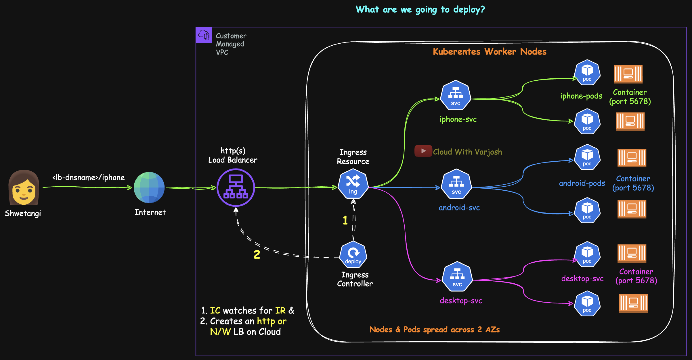
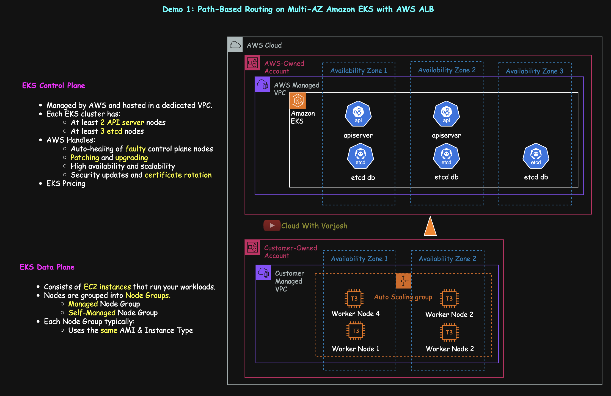
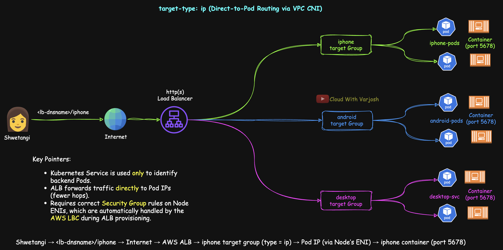
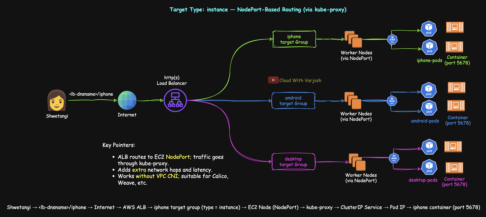

# 70 · Ingress on Amazon EKS: Path-Based Routing with the AWS Load Balancer Controller

> **Level:** ★★★ advanced
>
> **You will learn:** a production-style Ingress on a multi-AZ **EKS** cluster: building the cluster with `eksctl`; giving the **AWS Load Balancer Controller** (LBC) AWS permissions through an IAM-linked ServiceAccount (IRSA) or EKS Pod Identity; installing it with Helm; three zone-spread microfrontends; an Ingress whose **annotations** become an **ALB** with listeners, rules, target groups and health checks; **`target-type: ip` vs `instance`**; IngressClasses and running several controllers; verification in kubectl and the AWS console; and cleanup without orphaned load balancers.
>
> **You need:** topics 46 (topology spread), 55 (ServiceAccounts, workload identity), 65 (Helm), 69 (Ingress concepts). An AWS account (this lab costs money while running).

---

## ⚡ Core: the 10-minute version

**The idea.** On Amazon EKS, the **AWS Load Balancer Controller** turns an Ingress (class `alb`) into a real **Application Load Balancer**: listeners, path rules, target groups, health checks, all driven by **annotations**. It needs AWS permissions, given to its ServiceAccount through IAM (IRSA or EKS Pod Identity). With `target-type: ip`, the ALB sends traffic straight to **Pod IPs**.

**Picture it.** A contractor with a company credit card: you hand it a floor plan (the Ingress), and it builds the reception desk (the ALB) in AWS.

**The one thing to know.**

```yaml
metadata:
  annotations:
    alb.ingress.kubernetes.io/scheme: internet-facing
    alb.ingress.kubernetes.io/target-type: ip
spec:
  ingressClassName: alb
```

```bash
kubectl get ingress    # ADDRESS = the ALB's DNS name, after ~3 minutes
```

**Try it now** (costs money; needs an AWS account):
1. Follow the lab: eksctl cluster → IAM policy → IRSA ServiceAccount → Helm install → apps → Ingress.
2. Curl the ALB's paths.
3. **Delete the Ingress before the cluster**, so the ALB isn't orphaned.

**You've got it if you can:** explain `target-type: ip` vs `instance`, and how the controller gets AWS permissions.

> 📖 **That's the core.** On a first pass, do the mini-lab and move on to the next topic. Everything below is the **full reference**: come back for the details, the edge cases, interview answers and exam-level depth.

---

## What it is

A complete, real-world **path-based routing** setup: one application `app1` in namespace `app1-ns`, with three **frontend microservices** (for iPhone, Android and desktop users), exposed through **one** internet-facing **AWS Application Load Balancer (ALB)** that's created and configured automatically from a Kubernetes **Ingress** by the **AWS Load Balancer Controller**.



1. Three Services in `app1-ns`: `iphone-svc` (`/iphone`), `android-svc` (`/android`), `desktop-svc` (`/` and anything unmatched).
2. An **Ingress** mapping paths to Services.
3. The **AWS Load Balancer Controller** watches Ingresses and provisions an **ALB** plus listener rules and target groups.
4. **Traffic:** Shwetangi requests `<alb-dns-name>/iphone` → the ALB matches the path rule → sends **directly to Pod IPs** on port 5678 (`target-type: ip`, possible thanks to the **VPC CNI**), skipping NodePorts.
5. Everything is spread across **two Availability Zones** for fault tolerance.

The Ingress isn't in the traffic path: it's the blueprint the controller turns into AWS resources.

**Real-world routing:** users don't type these paths. The **Android app** (from the Play Store) is coded to call `myapp.com/android`; the **iPhone app** calls `myapp.com/iphone`; **browser users** visiting `myapp.com` hit the catch-all `/` → `desktop-svc`. One domain, cleanly separated by platform.

---

## Why it exists

This is the standard pattern for exposing many HTTP services on AWS: **one ALB** instead of one load balancer per Service, health checks per service, managed TLS later (topic 71), WAF/Shield integration, and everything declared in Kubernetes YAML.

---

## Analogy

The LBC is a **building contractor with a company credit card** (IAM permissions). You hand it a floor plan (the Ingress): "front door on port 80; visitors for `/iphone` go to room A". It goes to AWS and **builds** the reception (ALB), the signposts (listener rules), the room lists (target groups) and the doorman's checklist (health checks), and keeps them updated as rooms (Pods) open and close.

---

## How it works inside

### Cluster configuration



- Region **us-east-2 (Ohio)**, AZs **us-east-2a** and **us-east-2b**.
- **4 × `t3.small`** worker nodes in a managed node group (4 so `topologySpreadConstraints` have room to work; 2 is enough for basic Ingress; `t3.small` was eligible for AWS's free-tier credits).
- Nodes in **private subnets** (no public IPs); the ALB lives in **public subnets** (eksctl tags them `kubernetes.io/role/elb=1` so the LBC can find them; internal ALBs use subnets tagged `kubernetes.io/role/internal-elb=1`).

### The AWS Load Balancer Controller

- A Deployment (2 replicas) in `kube-system` that watches **Ingresses** (class `alb`) → **ALBs**, and **Services of type LoadBalancer** → **NLBs** (topic 31), plus its CRDs (`TargetGroupBinding`, `IngressClassParams`).
- It calls AWS APIs (ELBv2, EC2), so its Pods need **AWS credentials**: given via **IRSA** (IAM Roles for Service Accounts: the SA is annotated with an IAM role ARN; the Pod's projected SA token is exchanged with AWS STS for temporary credentials; topic 55) or **EKS Pod Identity** (the newer, simpler mechanism: an association between the SA and a role, no OIDC provider setup).
- Previously called the **ALB Ingress Controller**; the name changed when it gained NLB support. Old articles and annotations still use the old name.
- (EKS **Auto Mode** includes a built-in load-balancing capability, so you don't install the LBC yourself there; the Ingress concepts are identical.)

### Target types

**`target-type: ip`: direct to Pods**



- The ALB registers **Pod IPs** in its target groups. Possible because the **AWS VPC CNI** gives each Pod a real, routable VPC IP (a secondary IP on the node's ENI, Elastic Network Interface).
- The Service is used **only to discover** the Pods (via EndpointSlices); it doesn't forward traffic.
- Fewer hops, **Pod-level health checks**, works with sticky sessions and Fargate.
- Security-group rules allowing ALB → Pod/node traffic are **managed automatically** by the LBC.

```
Shwetangi → <alb-dns>/iphone → Internet → ALB → iphone target group (type ip) → Pod IP (on the node's ENI) → container :5678
```

**`target-type: instance`: via NodePorts**



- The ALB registers **EC2 nodes** and sends to the Service's **NodePort**; **kube-proxy** then forwards to a Pod (possibly on another node, another hop). The Service must be `NodePort` (or `LoadBalancer`).
- More hops, **node-level** health checks only, and the client may land on a node without the Pod.
- **Works without the VPC CNI**: needed with overlay CNIs like Calico or Cilium in overlay mode (Day 50 also lists Weave, which is unmaintained), where Pod IPs aren't routable from the VPC.

```
Shwetangi → <alb-dns>/iphone → Internet → ALB → target group (type instance) → node:NodePort → kube-proxy → Pod IP → container :5678
```

### IngressClass and multiple controllers

An **IngressClass** selects which controller implements an Ingress, much as a StorageClass selects a provisioner. The LBC's Helm chart creates class **`alb`** (controller `ingress.k8s.aws/alb`). It matters when several controllers coexist, or to set a default.

Why run more than one controller:
1. **Protocol-specific routing**: e.g. HAProxy for raw TCP/UDP needs, ALB for HTTP(S) apps.
2. **Multi-tenant isolation**: team A prefers an NGINX-based controller, team B wants ALB's AWS integration.
3. **Environment/regional segmentation**: relaxed rules for staging on one controller, strict compliance for prod on another.

(Also: an **internal** and an **internet-facing** entry point. With the LBC you can do that with one controller and two IngressClasses/`IngressClassParams`, or the `group.name` annotation to share one ALB across several Ingresses.)

---

## Commands / YAML

### Prerequisites

- Comfortable with Services (topics 30–31).
- Tools: **AWS CLI** (configured credentials), **eksctl**, **helm**, kubectl.

### Step 1: create the EKS cluster (`Day 50/eks-config.yaml`)

```yaml
apiVersion: eksctl.io/v1alpha5
kind: ClusterConfig
metadata:
  name: cwvj-ingress-demo
  region: us-east-2                  # Ohio
  tags:                              # tags applied to the AWS resources eksctl creates
    owner: varun-joshi
    bu: cwvj
    project: ingress-demo
availabilityZones: [us-east-2a, us-east-2b]
iam:
  withOIDC: true                     # create the cluster's IAM OIDC provider (required for IRSA)
managedNodeGroups:
  - name: cwvj-eks-priv-ng
    instanceType: t3.small
    minSize: 4
    maxSize: 4                       # fixed size, no autoscaling
    privateNetworking: true          # nodes only in private subnets
    volumeSize: 20                   # GiB root EBS volume per node
    iam:
      withAddonPolicies:             # attach AWS policies to the NODE role
        autoScaler: true
        externalDNS: false
        certManager: yes
        ebs: false
        fsx: false
        efs: false
        albIngress: true
        xRay: false
        cloudWatch: false
    labels:
      lifecycle: ec2-autoscaler      # custom node label
```

> ℹ️ **Note:** `withAddonPolicies` (e.g. `albIngress: true`, `certManager`, `autoScaler`) attaches those permissions to the **node IAM role**, so **every Pod on those nodes** can use them via the instance metadata service. The demo **also** gives the LBC its own role through IRSA (step 2.2), which is the right way. For least privilege, drop the add-on policies from the node group and rely on IRSA/Pod Identity per controller (and limit Pod access to instance metadata with an IMDS hop limit of 1).

```bash
eksctl create cluster -f "Day 50/eks-config.yaml"          # ~15–20 minutes
kubectl get nodes -L topology.kubernetes.io/zone
```

```
NAME                                           STATUS   ROLES    AGE   VERSION   ZONE
ip-192-168-101-12.us-east-2.compute.internal   Ready    <none>   5m    v1.3x.x   us-east-2a
ip-192-168-120-40.us-east-2.compute.internal   Ready    <none>   5m    v1.3x.x   us-east-2a
ip-192-168-140-77.us-east-2.compute.internal   Ready    <none>   5m    v1.3x.x   us-east-2b
ip-192-168-160-90.us-east-2.compute.internal   Ready    <none>   5m    v1.3x.x   us-east-2b
```

(Day 50 uses `kubectl get nodes --show-labels | grep topology.kubernetes.io/zone`; `-L` prints the label as a column.) Two nodes per AZ, as needed for the topology demo.

### Step 2: install the AWS Load Balancer Controller

**2.1 IAM policy** (the repo's `Day 50/iam_policy.json` is a downloaded copy):

```bash
curl -O https://raw.githubusercontent.com/kubernetes-sigs/aws-load-balancer-controller/v2.13.3/docs/install/iam_policy.json
aws iam create-policy --policy-name AWSLoadBalancerControllerIAMPolicy --policy-document file://iam_policy.json
```

This grants ELB, EC2 (security groups, subnets), WAF/Shield and ACM read permissions the controller needs. Use the policy file **matching your controller version**.

**2.2 An IAM-backed ServiceAccount (IRSA)**

```bash
eksctl create iamserviceaccount \
  --cluster=cwvj-ingress-demo \
  --namespace=kube-system \
  --name=aws-load-balancer-controller \
  --attach-policy-arn=arn:aws:iam::<YOUR_ACCOUNT_ID>:policy/AWSLoadBalancerControllerIAMPolicy \
  --override-existing-serviceaccounts \
  --region us-east-2 \
  --approve
```

- Creates an **IAM role** (via a CloudFormation stack) whose trust policy accepts tokens for **this** SA from the cluster's OIDC provider, with the policy attached.
- Creates/annotates the Kubernetes ServiceAccount with that role.

```bash
kubectl get sa -n kube-system aws-load-balancer-controller -o yaml
```

```yaml
apiVersion: v1
kind: ServiceAccount
metadata:
  name: aws-load-balancer-controller
  namespace: kube-system
  annotations:
    eks.amazonaws.com/role-arn: arn:aws:iam::<YOUR_ACCOUNT_ID>:role/<ROLE_NAME_CREATED_BY_EKSCTL>
```

The annotation lets the controller Pods **assume the IAM role** (the EKS Pod Identity webhook injects `AWS_ROLE_ARN` and a projected token with audience `sts.amazonaws.com`). (Use your own account ID, from `aws sts get-caller-identity`, and the role name `eksctl` printed.)

**2.3 Helm install**

```bash
helm repo add eks https://aws.github.io/eks-charts
helm repo update eks
helm search repo eks/aws-load-balancer-controller --versions | head    # optional: list versions
helm install aws-load-balancer-controller eks/aws-load-balancer-controller \
  -n kube-system \
  --set clusterName=cwvj-ingress-demo \
  --set serviceAccount.create=false \
  --set serviceAccount.name=aws-load-balancer-controller \
  --version 1.13.0
```

- `serviceAccount.create=false`: use the SA eksctl made (with the role annotation) instead of creating a new one.
- On private-only node groups without NAT or with restricted metadata access, also set `--set region=us-east-2 --set vpcId=<vpc-id>`.
- It's in `kube-system`, so `helm list` (current namespace) won't show it: use `helm list -n kube-system` or `-A`.

```bash
kubectl get deployment -n kube-system aws-load-balancer-controller
kubectl describe pods -n kube-system -l app.kubernetes.io/name=aws-load-balancer-controller | grep "Service Account"
```

```
NAME                           READY   UP-TO-DATE   AVAILABLE   AGE
aws-load-balancer-controller   2/2     2            2           84s
Service Account:  aws-load-balancer-controller
```

The Pods use the IAM-linked SA, so they can create ALBs, target groups and rules.

References: AWS docs "Install AWS Load Balancer Controller with Helm"; github.com/kubernetes-sigs/aws-load-balancer-controller.

### Step 3: namespace and the three apps

```yaml
# 01-ns.yaml
apiVersion: v1
kind: Namespace
metadata:
  name: app1-ns          # scoping, management, RBAC
```

```bash
kubectl apply -f "Day 50/demo1/01-ns.yaml"
kubectl config set-context --current --namespace=app1-ns
```

```yaml
# 02-iphone.yaml (android and desktop are the same pattern)
apiVersion: apps/v1
kind: Deployment
metadata:
  name: iphone-deploy
  namespace: app1-ns
spec:
  replicas: 2
  selector: { matchLabels: { app: iphone-page } }
  template:
    metadata: { labels: { app: iphone-page } }
    spec:
      topologySpreadConstraints:                 # spread replicas across AZs (topic 46)
      - maxSkew: 1
        topologyKey: topology.kubernetes.io/zone
        whenUnsatisfiable: ScheduleAnyway
        labelSelector: { matchLabels: { app: iphone-page } }
      containers:
      - name: python-http
        image: python:alpine
        command: ["/bin/sh", "-c"]
        args:
          - |
            mkdir -p /iphone && echo '<html>
              <head><title>iPhone Users</title></head>
              <body>
                <h1>iPhone Users</h1>
                <p>Welcome to Cloud With VarJosh</p>
              </body>
            </html>' > /iphone/index.html && cd / && python3 -m http.server 5678
        ports:
        - containerPort: 5678
---
apiVersion: v1
kind: Service
metadata:
  name: iphone-svc
  namespace: app1-ns
  annotations:
    alb.ingress.kubernetes.io/healthcheck-path: /iphone/index.html   # per-service ALB health check path
spec:
  selector: { app: iphone-page }
  ports:
  - { protocol: TCP, port: 80, targetPort: 5678 }
```

- `python:alpine` serves the files under `/` with Python's built-in HTTP server on **5678**; the page lives at **`/iphone/index.html`**, matching the **path** the ALB forwards unchanged (ALB does no path rewriting).
- `topologySpreadConstraints` with `maxSkew: 1` across `topology.kubernetes.io/zone` keeps replicas balanced between AZs.
- The Service is a plain **ClusterIP** (port 80 → 5678); with `target-type: ip` it's only used to find Pods.
- The **health-check path annotation on the Service** overrides the Ingress-level default for that target group: each app's health check hits its own page (important when one ALB serves several apps).
- `03-android.yaml`: same with `android-page`, `/android/index.html`. `04-desktop.yaml`: `desktop-page`, writes `/index.html` at the root, health check `/index.html` (the catch-all).

```bash
kubectl apply -f "Day 50/demo1/02-iphone.yaml" -f "Day 50/demo1/03-android.yaml" -f "Day 50/demo1/04-desktop.yaml"
kubectl get deployments; kubectl get services
kubectl get pods -o wide --sort-by='.spec.nodeName'
```

Each Deployment's two Pods land in **different AZs**.

### Step 4: the Ingress (`Day 50/demo1/05-ingress.yaml`)

```yaml
apiVersion: networking.k8s.io/v1                 # Ingress is GA since v1.19
kind: Ingress
metadata:
  name: ingress-demo1
  namespace: app1-ns
  annotations:
    alb.ingress.kubernetes.io/scheme: internet-facing      # public ALB ('internal' = private)
    alb.ingress.kubernetes.io/load-balancer-name: cwvj-ingress-demo1   # name in the AWS console
    alb.ingress.kubernetes.io/target-type: ip              # register Pod IPs (VPC CNI)
    alb.ingress.kubernetes.io/listen-ports: '[{"HTTP": 80}]'   # JSON list of listeners
    alb.ingress.kubernetes.io/healthcheck-protocol: HTTP
    alb.ingress.kubernetes.io/healthcheck-port: traffic-port   # same port traffic uses
    alb.ingress.kubernetes.io/healthcheck-interval-seconds: '15'
    alb.ingress.kubernetes.io/healthcheck-timeout-seconds: '5'
    alb.ingress.kubernetes.io/healthy-threshold-count: '2'
    alb.ingress.kubernetes.io/unhealthy-threshold-count: '2'
    alb.ingress.kubernetes.io/success-codes: '200'
spec:
  ingressClassName: alb                          # handled by the AWS Load Balancer Controller
  rules:
    - http:                                      # no host: matches any hostname
        paths:
          - path: /iphone
            pathType: Prefix                     # /iphone, /iphone/, /iphone/...
            backend: { service: { name: iphone-svc, port: { number: 80 } } }
          - path: /android
            pathType: Prefix
            backend: { service: { name: android-svc, port: { number: 80 } } }
          - path: /
            pathType: Prefix                     # catch-all
            backend: { service: { name: desktop-svc, port: { number: 80 } } }
```

```bash
kubectl apply -f "Day 50/demo1/05-ingress.yaml"
kubectl get ingressclass
kubectl get ingress
```

```
NAME   CONTROLLER            PARAMETERS   AGE
alb    ingress.k8s.aws/alb   <none>       3h38m

NAME            CLASS   HOSTS   ADDRESS                                                    PORTS   AGE
ingress-demo1   alb     *       cwvj-ingress-demo1-351634829.us-east-2.elb.amazonaws.com   80      33s
```

From this one object the controller creates: an ALB with a **listener** on 80, **listener rules** per path, one **target group** per Service (type ip, with Pod IPs registered and kept in sync), and **health checks**. Allow **~3 minutes** for provisioning and for targets to become healthy (EC2 → Load Balancers).

### Step 5: end-to-end verification

```bash
ALB=$(kubectl get ingress ingress-demo1 -o jsonpath='{.status.loadBalancer.ingress[0].hostname}')
curl -sL http://$ALB/iphone | grep -o '<h1>.*</h1>'
curl -sL http://$ALB/android | grep -o '<h1>.*</h1>'
curl -sL http://$ALB/ | grep -o '<h1>.*</h1>'
```

```
<h1>iPhone Users</h1>
<h1>Android Users</h1>
<h1>Desktop Users</h1>
```

(In a browser, each page shows the heading and "Welcome to Cloud With VarJosh". `-L` follows Python's redirect from `/iphone` to `/iphone/`.) Any other path (`/foo`) goes to the **desktop** catch-all and gets a 404 from Python, because there's no `/foo` file.

```bash
kubectl describe ingress ingress-demo1
```

Look for: class `alb`, the ALB address, rules → backends with Pod IPs, and events like `Normal  SuccessfullyReconciled  … Successfully reconciled`.

**In the AWS console** (EC2 → Load Balancers → `cwvj-ingress-demo1`):
- scheme `internet-facing`;
- a listener on **80** with rules for `/iphone*`, `/android*` and a default;
- **three target groups** (type **ip**) with healthy Pod IP targets;
- health-check paths per target group matching the Service annotations.

The ALB was fully built from Kubernetes YAML.

### Step 6: cleanup

```bash
cd "Day 50/demo1" && kubectl delete -f .
# or explicitly:
kubectl delete ingress ingress-demo1          # FIRST: the controller deletes the ALB, target groups, SG rules
kubectl delete svc iphone-svc android-svc desktop-svc
kubectl delete deploy iphone-deploy android-deploy desktop-deploy
kubectl delete ns app1-ns
```

Delete the **Ingress while the controller is still running**, or the ALB is orphaned in AWS (and keeps costing money). Topic 71 reuses this cluster; when you're completely done:

```bash
helm uninstall aws-load-balancer-controller -n kube-system
eksctl delete cluster --name cwvj-ingress-demo
```

Check EC2 → Load Balancers and Target Groups are empty afterwards.

---

## Hands-on lab

1. Build the cluster, install the LBC, deploy the three apps and the Ingress; test all paths.
2. Scale `iphone-deploy` to 4 and watch new Pod IPs appear in the target group (`kubectl get targetgroupbindings -A`, console); scale to 0 and see `503` for `/iphone`.
3. Switch to `target-type: instance` (change the Services to `NodePort`), re-apply and compare target groups (nodes instead of Pods).
4. Add a second Ingress with `alb.ingress.kubernetes.io/group.name: shared` on both, and see them merge into one ALB.
5. **Clean up** everything (costs!).

(No AWS account? Do the same routing on kind with topic 69's Traefik lab: the Ingress `rules` are identical; only the annotations and class differ.)

---

## Where you'll use it

- **EKS production**: nearly every HTTP workload on EKS is exposed this way (or via Gateway API with the same controller).
- **Cost control**: share ALBs with `group.name`; avoid one load balancer per Service.
- **Security**: WAF (`alb.ingress.kubernetes.io/wafv2-acl-arn`), Shield, security groups, internal vs internet-facing.
- **Interviews**: `ip` vs `instance` targets, IRSA/Pod Identity, how an Ingress becomes an ALB.

---

## When it breaks

| Symptom | Cause | Fix |
|---|---|---|
| Ingress `ADDRESS` stays empty | Controller not running, wrong `ingressClassName`, IAM errors | `kubectl logs -n kube-system deploy/aws-load-balancer-controller`; check SA annotation and policy |
| Logs: `AccessDenied … elasticloadbalancing:CreateLoadBalancer` | Policy missing/old, IRSA misconfigured | Re-create the policy for your version; check the role trust policy |
| `couldn't auto-discover subnets` | Public subnets not tagged `kubernetes.io/role/elb=1` | Tag the subnets (eksctl does it for clusters it creates) |
| `503` from the ALB | No healthy targets: failing health checks, no ready Pods | Check health-check path/port; Pod readiness |
| `404` from the app | Path forwarded unchanged and the app doesn't serve it | Serve content under the prefix, or use a rewrite (ALB can't rewrite paths in plain Ingress) |
| Targets "unhealthy" with `target-type: instance` | Service isn't NodePort; node security groups block NodePort range | Use NodePort or switch to `ip` |
| ALB still exists after the cluster is gone | Ingress not deleted before the controller | Delete the ALB, target groups and security groups manually |
| Slow 502s during rollouts | Pods removed before ALB deregisters them | Add a `preStop` sleep and readiness gates (`elbv2.k8s.aws/pod-readiness-gate-inject=enabled` namespace label) |

---

## Quick recap

- EKS + **AWS Load Balancer Controller** turns an Ingress (class `alb`) into an **ALB** with listeners, path rules, target groups and health checks, all driven by **annotations**.
- The controller needs AWS permissions: IAM policy + **IRSA** (`eks.amazonaws.com/role-arn` SA annotation) or **EKS Pod Identity**; installed with Helm (`serviceAccount.create=false` to reuse the SA).
- **`target-type: ip`** sends straight to Pod IPs (VPC CNI, fewer hops, Pod health checks); **`instance`** goes through NodePorts and kube-proxy (any CNI).
- IngressClass selects the controller; several controllers can coexist.
- Clean up by deleting the **Ingress first** to avoid orphaned ALBs.

### Interview questions

1. **Q: What's the difference between ALB `target-type: ip` and `instance`?**
   A: `ip` registers Pod IPs directly (requires routable Pod IPs, e.g. VPC CNI), giving fewer hops and per-Pod health checks; `instance` registers nodes and sends traffic to the Service's NodePort, from where kube-proxy forwards to a Pod: more hops, works with any CNI.
2. **Q: How does the AWS Load Balancer Controller get permission to create ALBs?**
   A: Through an IAM role bound to its ServiceAccount, via IRSA (the SA is annotated with the role ARN, and its projected token is exchanged with STS through the cluster's OIDC provider) or EKS Pod Identity, with the controller's IAM policy attached.
3. **Q: Why did deleting the cluster leave a load balancer behind, and how do you prevent it?**
   A: The ALB is an AWS resource created by the controller; if the controller is removed before the Ingress, nobody deletes it. Delete Ingresses (and LoadBalancer Services) first, and verify in AWS afterwards.

---

## Appendix: notes on the original course material

This topic was rebuilt from the original CKA course notes. This appendix keeps the audit trail out of your way while you learn.

### Sources

Day 50 (introduction; demo 1: what we'll deploy, real-world routing for `/iphone`, `/android` and desktop default; cluster configuration; prerequisites; step 1 provision EKS; step 2 install LBC: 2.1 IAM policy, 2.2 IAM-backed ServiceAccount, 2.3 Helm install; step 3 namespace and the three Deployments/Services with explanations, verification; step 4 the Ingress; ALB target types `ip` and `instance` with key pointers; IngressClass; multiple controllers (three scenarios); step 5 end-to-end verification, describe, AWS console; step 6 cleanup; conclusion; references), files `Day 50/eks-config.yaml`, `Day 50/iam_policy.json`, `Day 50/demo1/01-ns.yaml` … `05-ingress.yaml`.
