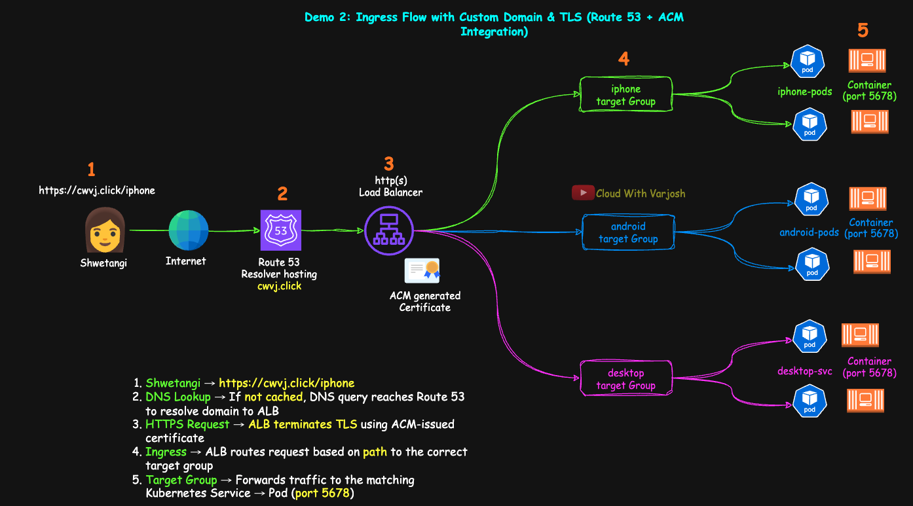
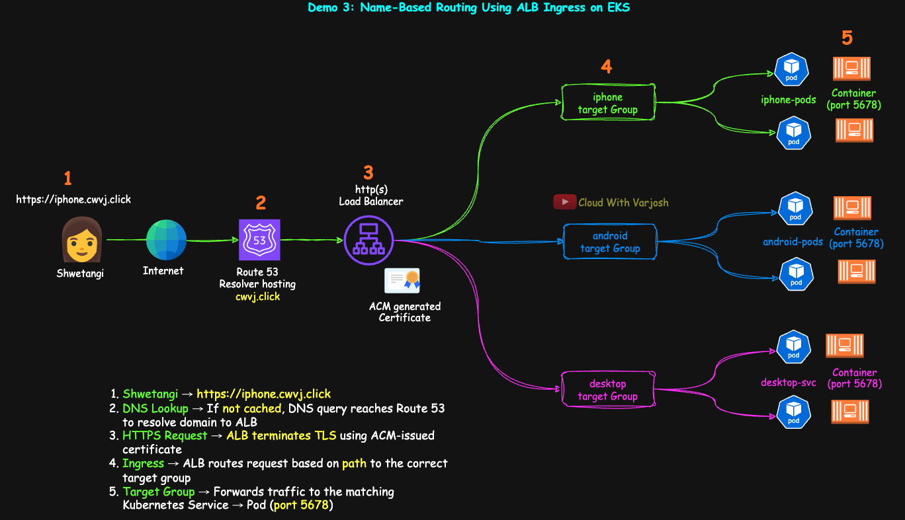

# 71 · Ingress TLS and Host-Based (Name-Based) Routing

> **Level:** ★★★ advanced
>
> **You will learn:** how HTTPS reaches your apps through an Ingress; TLS termination at the load balancer with **ACM** certificates (EKS) vs Kubernetes **TLS Secrets** (in-cluster controllers); HTTP→HTTPS redirects; custom domains with **Route 53** alias records (and **ExternalDNS** to automate them); apex vs wildcard certificates and SNI; **host-based routing** (`iphone.cwvj.click`, `android.cwvj.click`); and **cert-manager** with Let's Encrypt for automatic certificates anywhere.
>
> **You need:** topics 50–51 (TLS, certificates, SAN, CAs), 69, 70 (the EKS cluster and LBC). DNS basics (A/CNAME records, hosted zones).

---

## ⚡ Core: the 10-minute version

**The idea.** Production Ingress adds:
- **HTTPS**: a certificate on the load balancer (ACM on AWS, or a Kubernetes TLS Secret made by **cert-manager** elsewhere), plus an HTTP→HTTPS redirect;
- **custom domains**: DNS records pointing at the load balancer, automated by ExternalDNS;
- **host-based routing**: `iphone.example.com` → one app, `android.example.com` → another, all on one load balancer.

A wildcard certificate (`*.example.com`) **doesn't** cover the bare `example.com`.

**Picture it.** One concierge desk serving several businesses, showing the right official ID for each one (SNI picks the certificate).

**The one thing to know.**

```yaml
spec:
  tls:
  - hosts: [iphone.example.com, android.example.com]
    secretName: devices-tls              # cert-manager can create this for you
  rules:
  - host: iphone.example.com
    http: { paths: [ { path: /, pathType: Prefix, backend: { service: { name: iphone-svc, port: { number: 80 } } } } ] }
  - host: android.example.com
    http: { paths: [ { path: /, pathType: Prefix, backend: { service: { name: android-svc, port: { number: 80 } } } } ] }
```

**Try it now:** follow the local cert-manager + Traefik lab, then:

```bash
curl -k --resolve iphone.example.com:8443:127.0.0.1 https://iphone.example.com:8443/
```

**You've got it if you can:** explain TLS termination at the edge, SNI, and the wildcard-vs-apex trap.

> 📖 **That's the core.** On a first pass, do the mini-lab and move on to the next topic. Everything below is the **full reference**: come back for the details, the edge cases, interview answers and exam-level depth.

---

## What it is

Two production upgrades to topic 70's path-based setup:
1. **Demo 2: TLS + a custom domain.** A real domain (`cwvj.click`, registered in **Route 53**), a public **TLS certificate** from **AWS Certificate Manager (ACM)**, an ALB that serves **HTTPS on 443** and **redirects HTTP → HTTPS**.
2. **Demo 3: host-based (name-based) routing.** Different **hostnames** go to different Services through the **same ALB**: `iphone.cwvj.click` → iPhone app, `android.cwvj.click` → Android app, `cwvj.click` → desktop.

**TLS termination at the edge**: the load balancer decrypts HTTPS (proving its identity with the certificate), then forwards plain HTTP (or re-encrypted HTTPS) to Pods. Apps don't each need certificates.

**SNI (Server Name Indication)**: the client sends the hostname it wants in the TLS handshake, so one load balancer/IP can present **different certificates for different hostnames**.

---

## Why it exists

Browsers mark HTTP sites "Not secure"; credentials and cookies must be encrypted; and compliance requires TLS. Users need **memorable domain names**, not `cwvj-ingress-demo2-123.us-east-2.elb.amazonaws.com`. And **host-based routing** lets many products/teams share one load balancer and one IP while appearing as separate sites, which is how most SaaS apps are exposed.

---

## Analogy

The ALB is a **hotel concierge desk** shared by several businesses in one building. The **certificate** is the desk's **official ID card** proving to visitors that this really is "cwvj.click" (the hotel can show the right card for each business: SNI). The **Route 53 record** is the **street-directory entry** pointing the name "cwvj.click" to the building's address. **Host-based rules** are the concierge sending visitors who ask for "iPhone Co." to floor 2 and "Android Ltd." to floor 3. **HTTP→HTTPS redirect**: anyone coming through the unlocked side door is politely sent round to the front.

---

## How it works inside

### The HTTPS flow on EKS (Demo 2)



1. Browser → DNS: `cwvj.click` → Route 53 **alias A record** → the ALB's addresses.
2. Browser connects to **443**, sends SNI `cwvj.click`; the ALB presents the **ACM certificate** for `cwvj.click`; the browser validates it (trusted CA, name matches, dates).
3. The ALB decrypts, evaluates **listener rules** (paths/hosts from the Ingress), forwards **HTTP** to Pod IPs (`target-type: ip`).
4. A request to **port 80** gets a **301 redirect** to `https://…` (the `ssl-redirect` annotation).

ACM certificates are **free**, **auto-renewed** by AWS, and their private keys **never leave AWS**: you can only use them on AWS services like ALB/NLB/CloudFront. They must be in the **same region** as the ALB.

### The in-cluster way: TLS Secrets and cert-manager

With in-cluster controllers (Traefik, NGINX-based, Envoy-based), the certificate and key live in a **`kubernetes.io/tls` Secret** referenced from the Ingress's `spec.tls` (topic 69). **cert-manager** automates that:
- you create an **Issuer/ClusterIssuer** (e.g. **Let's Encrypt** via the **ACME** protocol: Automated Certificate Management Environment);
- cert-manager proves domain control (**HTTP-01**: serve a token at `/.well-known/acme-challenge/…` through your Ingress; or **DNS-01**: create a TXT record, required for **wildcards**);
- stores the certificate in the Secret and **renews** it before expiry (Let's Encrypt certificates last 90 days or less).

### Apex vs wildcard certificates

- `cwvj.click` = the **apex** (root) domain.
- `*.cwvj.click` = a **wildcard**: matches **one** label: `iphone.cwvj.click`, `android.cwvj.click`, but **not** `cwvj.click` itself, nor `a.b.cwvj.click`.
- **Wildcard note:** if your certificate only covers `*.cwvj.click`, browsers **won't trust** `https://cwvj.click`. Re-issue it covering **both** `*.cwvj.click` and `cwvj.click` (one certificate with two **SANs**, Subject Alternative Names; topic 51) or attach two certificates.

### Host-based routing (Demo 3)



The ALB gets one rule per `host` from the Ingress: `Host is iphone.cwvj.click` → iphone target group, etc. Requests whose host matches no rule get the ALB's default action (a fixed 404 from the LBC unless you set a `defaultBackend`).

### DNS: alias records and ExternalDNS

- An **alias record** is Route 53's AWS-specific record type that points a name (even the **apex**, where a CNAME isn't allowed) at an AWS resource like an ALB, and follows its changing IPs automatically.
- **ExternalDNS** is a controller that **creates and updates DNS records** (Route 53, Cloudflare, Azure DNS, Google Cloud DNS…) from the hosts in your Ingresses, Gateway routes and LoadBalancer Services. Manual records are good for learning; ExternalDNS is the production way.

---

## Commands / YAML

### Prerequisites

- **DNS resolution** and hosted zones (Day 51 links a separate DNS lecture).
- Ingress part 1 (topic 69) and part 2 (topic 70): **the same EKS cluster with the LBC** (`Day 51/eks-config.yaml` and `iam_policy.json` are copies of Day 50's).
- Cost: Route 53 domain registration is **paid** (a `.click` domain is about **$3/year**); a hosted zone ~$0.50/month.

### Demo 2: TLS and a custom domain

**Step 1: domain and certificate**
1. **Route 53 → Domains → Register** (e.g. `cwvj.click`). Route 53 creates a **hosted zone** with **4 name servers**.
2. **ACM → Request a certificate → Request a public certificate**, domain `cwvj.click` (better: add `*.cwvj.click` as a second name right away).
3. **DNS validation** → let ACM **create the validation CNAME records** in Route 53.
4. ACM validates ownership and **issues** the certificate (minutes). Copy its **ARN**.

CLI equivalent:

```bash
aws acm request-certificate --domain-name cwvj.click --subject-alternative-names '*.cwvj.click' \
  --validation-method DNS --region us-east-2
aws acm describe-certificate --certificate-arn <arn> --region us-east-2 --query 'Certificate.Status'
```

**Step 2: HTTPS Ingress** (`Day 51/demo2/05-ingress.yaml`; Deployments/Services are the same as Day 50's: path-based, pages under `/iphone/` and `/android/`)

```yaml
apiVersion: networking.k8s.io/v1
kind: Ingress
metadata:
  name: ingress-demo2
  namespace: app1-ns
  annotations:
    alb.ingress.kubernetes.io/scheme: internet-facing
    alb.ingress.kubernetes.io/load-balancer-name: cwvj-ingress-demo2
    alb.ingress.kubernetes.io/target-type: ip
    alb.ingress.kubernetes.io/listen-ports: '[{"HTTPS":443}, {"HTTP":80}]'     # both listeners
    alb.ingress.kubernetes.io/certificate-arn: arn:aws:acm:us-east-2:<ACCOUNT_ID>:certificate/<ID>
    alb.ingress.kubernetes.io/ssl-redirect: '443'                             # HTTP 80 → 301 to HTTPS 443
    alb.ingress.kubernetes.io/healthcheck-protocol: HTTP
    alb.ingress.kubernetes.io/healthcheck-port: traffic-port
    alb.ingress.kubernetes.io/healthcheck-interval-seconds: '15'
    alb.ingress.kubernetes.io/healthcheck-timeout-seconds: '5'
    alb.ingress.kubernetes.io/healthy-threshold-count: '2'
    alb.ingress.kubernetes.io/unhealthy-threshold-count: '2'
    alb.ingress.kubernetes.io/success-codes: '200'
spec:
  ingressClassName: alb
  rules:
    - http:
        paths:
          - { path: /iphone,  pathType: Prefix, backend: { service: { name: iphone-svc,  port: { number: 80 } } } }
          - { path: /android, pathType: Prefix, backend: { service: { name: android-svc, port: { number: 80 } } } }
          - { path: /,        pathType: Prefix, backend: { service: { name: desktop-svc, port: { number: 80 } } } }
```

- `certificate-arn`: the ACM certificate the HTTPS listener presents (comma-separate several ARNs; the first is the default, others are selected by SNI).
- If you list hosts in `spec.rules[].host` or `spec.tls[].hosts`, the LBC can **auto-discover** matching ACM certificates and you can omit `certificate-arn`.
- `alb.ingress.kubernetes.io/ssl-policy` chooses the TLS versions/ciphers (pick a TLS 1.2+/1.3 policy).
- Day 51 and the repo file use different certificate ARNs (`6ab64476…` in the README, `e6e6b107…` in the file); both are the author's account. Use yours.

```bash
cd "Day 51/demo2" && kubectl apply -f .
kubectl get ingress ingress-demo2 -n app1-ns
```

**Step 3: Route 53 alias record for the apex**
1. **Route 53 → Hosted zones → `cwvj.click` → Create record**.
2. Record name: **blank** (apex).
3. **Alias: on** → **Alias to Application and Classic Load Balancer** → region **us-east-2** → choose the ALB (name contains `cwvj-ingress-demo2`).
4. **Create records**.

`https://cwvj.click` (and its paths) now resolves to the ALB.

```bash
dig +short cwvj.click
```

**Step 4: verification**

```
https://cwvj.click/          → Desktop Users / Welcome to Cloud With VarJosh
https://cwvj.click/iphone/   → iPhone Users
https://cwvj.click/android/  → Android Users
```

```bash
curl -sI http://cwvj.click/ | head -3          # HTTP/1.1 301 Moved Permanently; Location: https://cwvj.click:443/
curl -sv https://cwvj.click/ 2>&1 | grep -E 'subject:|issuer:|SSL connection'
```

```
* SSL connection using TLSv1.3 / TLS_AES_128_GCM_SHA256
*  subject: CN=cwvj.click
*  issuer: C=US; O=Amazon; CN=Amazon RSA 2048 M03
```

Check:
- HTTP requests **redirect** to HTTPS (`ssl-redirect`);
- the browser padlock → certificate → subject is your domain, issued by Amazon;
- **EC2 → Load Balancers → Listeners → HTTPS:443 → View/edit rules**: your ACM certificate attached and the path rules from the Ingress.

**Step 5: cleanup (if not continuing straight to Demo 3)**
1. `kubectl delete -f .` in `demo2/` (the Ingress deletion makes the LBC remove the ALB; watch EC2 → Load Balancers).
2. Delete the **ACM certificate** (only once nothing uses it).
3. Delete the **alias A record** in Route 53. ⚠️ Keep the **hosted zone and domain** for Demo 3.
4. Keep the cluster (`cwvj-ingress-demo`) for Demo 3, or `eksctl delete cluster --name cwvj-ingress-demo` when finished.

### Demo 3: name-based routing

**Step 1: certificates**: ACM public certificates for the **apex** `cwvj.click` and the **wildcard** `*.cwvj.click` (Day 51 requests two; one certificate with both names is simpler), DNS-validated via Route 53.

**Step 2: apps serve at `/`** (`Day 51/demo3/02-iphone.yaml` etc.): with host routing, each app gets requests for `/`, so the page is written to **`/index.html`** at the root, and the Service health check becomes `/index.html`:

```yaml
      containers:
      - name: python-http
        image: python:alpine
        command: ["/bin/sh", "-c"]
        args:
          - |
            echo '<html>
              <head><title>iPhone Users</title></head>
              <body>
                <h1>iPhone Users</h1>
                <p>Welcome to Cloud With VarJosh</p>
              </body>
            </html>' > /index.html && python3 -m http.server 5678
        ports:
        - containerPort: 5678
---
apiVersion: v1
kind: Service
metadata:
  name: iphone-svc
  namespace: app1-ns
  annotations:
    alb.ingress.kubernetes.io/healthcheck-path: /index.html
spec:
  selector: { app: iphone-page }
  ports: [{ protocol: TCP, port: 80, targetPort: 5678 }]
```

(The repo files keep the `topologySpreadConstraints` and a leftover, harmless `mkdir -p /iphone` from Demo 2. Android and desktop: same change.)

**Step 3: host-based Ingress** (`Day 51/demo3/05-ingress.yaml`)

```yaml
apiVersion: networking.k8s.io/v1
kind: Ingress
metadata:
  name: ingress-demo3
  namespace: app1-ns
  annotations:
    alb.ingress.kubernetes.io/scheme: internet-facing
    alb.ingress.kubernetes.io/load-balancer-name: cwvj-ingress-demo3
    alb.ingress.kubernetes.io/target-type: ip
    alb.ingress.kubernetes.io/listen-ports: '[{"HTTPS":443}, {"HTTP":80}]'
    alb.ingress.kubernetes.io/healthcheck-protocol: HTTP
    alb.ingress.kubernetes.io/healthcheck-port: traffic-port
    alb.ingress.kubernetes.io/healthcheck-interval-seconds: '15'
    alb.ingress.kubernetes.io/healthcheck-timeout-seconds: '5'
    alb.ingress.kubernetes.io/healthy-threshold-count: '2'
    alb.ingress.kubernetes.io/unhealthy-threshold-count: '2'
    alb.ingress.kubernetes.io/success-codes: '200'
    alb.ingress.kubernetes.io/certificate-arn: >-
      arn:aws:acm:us-east-2:<ACCOUNT_ID>:certificate/<APEX_ID>,arn:aws:acm:us-east-2:<ACCOUNT_ID>:certificate/<WILDCARD_ID>
    alb.ingress.kubernetes.io/ssl-redirect: '443'
spec:
  ingressClassName: alb
  rules:
    - host: iphone.cwvj.click
      http:
        paths:
          - { path: /, pathType: Prefix, backend: { service: { name: iphone-svc, port: { number: 80 } } } }
    - host: android.cwvj.click
      http:
        paths:
          - { path: /, pathType: Prefix, backend: { service: { name: android-svc, port: { number: 80 } } } }
    - host: cwvj.click
      http:
        paths:
          - { path: /, pathType: Prefix, backend: { service: { name: desktop-svc, port: { number: 80 } } } }
```

**Explanation:**
- Both ACM certificates are attached (apex + wildcard); the ALB picks one per request by **SNI**.
- Each rule's **`host`** matches one hostname; `/` under each host goes to that app (which now serves at `/`).

> ⚠️ **Fix to the original** ([C1](#c1)): the repo's `demo3/05-ingress.yaml` has **one** certificate ARN, with a comment saying "We have supplied 2 certs; 1 for cwvj.click and another for *.cwvj.click". With a single ARN, that one certificate must contain **both** names as SANs; otherwise either the subdomains or the apex will fail validation in browsers. The README's version lists two comma-separated ARNs.

```bash
cd "Day 51/demo3" && kubectl apply -f .
```

**Step 4: Route 53 alias records**: `iphone.cwvj.click`, `android.cwvj.click` and `cwvj.click` → the demo3 ALB (or one wildcard alias `*.cwvj.click` + the apex). **Automate with ExternalDNS** in production:

```yaml
metadata:
  annotations:
    external-dns.alpha.kubernetes.io/hostname: iphone.cwvj.click,android.cwvj.click,cwvj.click   # or let it read rules[].host
```

**Step 5: verification**

```bash
for h in iphone.cwvj.click android.cwvj.click cwvj.click; do curl -s https://$h/ | grep -o '<h1>.*</h1>'; done
```

```
<h1>iPhone Users</h1>
<h1>Android Users</h1>
<h1>Desktop Users</h1>
```

In the console, the HTTPS:443 listener rules show **host-header** conditions per hostname.

**Step 6: cleanup**
1. `kubectl delete -f .` in `demo3/`.
2. Delete both ACM certificates.
3. Delete the three Route 53 records.
4. When done with everything: `helm uninstall aws-load-balancer-controller -n kube-system`, then `eksctl delete cluster --name cwvj-ingress-demo --region us-east-2`. Verify no load balancers or target groups remain.

### Local equivalent: cert-manager + Traefik on kind (no domain needed)

```bash
helm install cert-manager oci://quay.io/jetstack/charts/cert-manager -n cert-manager --create-namespace --set crds.enabled=true
```

```yaml
apiVersion: cert-manager.io/v1
kind: ClusterIssuer
metadata: { name: selfsigned }
spec: { selfSigned: {} }
---
apiVersion: networking.k8s.io/v1
kind: Ingress
metadata:
  name: devices-tls
  annotations:
    cert-manager.io/cluster-issuer: selfsigned       # cert-manager creates the Certificate + Secret for spec.tls
spec:
  ingressClassName: traefik
  tls:
  - hosts: [iphone.example.com, android.example.com]
    secretName: devices-tls
  rules:
  - host: iphone.example.com
    http: { paths: [ { path: /, pathType: Prefix, backend: { service: { name: iphone-svc, port: { number: 80 } } } } ] }
  - host: android.example.com
    http: { paths: [ { path: /, pathType: Prefix, backend: { service: { name: android-svc, port: { number: 80 } } } } ] }
```

```bash
kubectl get certificate,secret devices-tls
curl -sk --resolve iphone.example.com:8443:127.0.0.1 https://iphone.example.com:8443/
curl -svk --resolve android.example.com:8443:127.0.0.1 https://android.example.com:8443/ 2>&1 | grep subjectAltName
```

For real domains, swap the issuer for **Let's Encrypt** (`acme` with `http01` via your ingress class, or `dns01` with Route 53/Cloudflare credentials for wildcards), and use the staging server while testing to avoid rate limits.

---

## Hands-on lab

1. On EKS: do Demo 2 and Demo 3 (with your own domain); check redirects, certificates and host rules.
2. Request a **wildcard-only** certificate, attach only that one, and see `https://cwvj.click` fail validation (`curl` → `SSL: no alternative certificate subject name matches`).
3. Install ExternalDNS (IRSA with a Route 53 policy) and delete your manual records; let it recreate them from the Ingress hosts.
4. Locally: the cert-manager + Traefik lab above; then a self-made CA issuer (`ca:` issuer with your topic-51 CA) and trust it with `curl --cacert`.
5. Clean up all AWS resources (certificates, records, ALBs, cluster).

---

## Where you'll use it

- **Every public web app**: HTTPS with managed or automated certificates, redirects, custom domains.
- **Multi-product / multi-tenant SaaS**: host-based routing (`tenant1.app.com`), wildcard certificates.
- **Platform automation**: cert-manager + ExternalDNS + Ingress/Gateway = self-service DNS and TLS for teams.
- **Security reviews**: TLS policies (TLS 1.2+), HSTS, no plaintext listeners.

---

## When it breaks

| Symptom | Cause | Fix |
|---|---|---|
| Browser: `NET::ERR_CERT_COMMON_NAME_INVALID` | Certificate doesn't cover the hostname (apex vs wildcard, `a.b.domain`) | Add the right SANs |
| HTTPS listener not created | `listen-ports` lacks HTTPS, or the certificate ARN is wrong / in another region / not yet issued | Fix annotations; issue the cert in the ALB's region |
| `curl` to the domain times out | DNS not pointing at the ALB (record missing, propagation, wrong ALB after re-create) | `dig`; update the alias (ExternalDNS avoids drift) |
| Redirect loop | App also redirects HTTP→HTTPS but receives HTTP from the ALB | Trust `X-Forwarded-Proto` in the app; redirect only at the edge |
| `404` for a host | No rule for that host (typo, missing `www`) | Add the host rule |
| Certificate stuck `Pending validation` (ACM) | Validation CNAMEs missing | Create them (ACM button), check the hosted zone is the domain's authoritative zone |
| cert-manager `Certificate` not Ready | ACME challenge failing (wrong ingress class, firewall, DNS creds) | `kubectl describe certificate,order,challenge` |
| Traefik/NGINX serves a default self-signed cert | TLS Secret missing/in another namespace/host mismatch | Check `spec.tls` hosts and Secret |

---

## Quick recap

- TLS terminates at the **edge**: ALB with **ACM** certificates (`certificate-arn`, `listen-ports` 443, `ssl-redirect`), or in-cluster controllers with **TLS Secrets** (automated by **cert-manager**/Let's Encrypt).
- Wildcards match one label and **not** the apex: certify both `domain` and `*.domain`; SNI selects among several certificates.
- Route 53 **alias** records (allowed at the apex) point names at the ALB; **ExternalDNS** automates DNS.
- **Host-based routing**: `rules[].host` per hostname, each app serving at `/`, all on one load balancer.

### Interview questions

1. **Q: Where should TLS terminate for an Ingress, and what are the options for certificates?**
   A: Usually at the load balancer/ingress layer: on AWS ALB with ACM certificates (free, auto-renewed), or in an in-cluster controller using a TLS Secret managed by cert-manager (e.g. Let's Encrypt). Re-encryption to Pods or mesh mTLS can be added for end-to-end encryption.
2. **Q: Why doesn't a `*.example.com` certificate work for `example.com`?**
   A: A wildcard matches exactly one label in that position, so it covers `www.example.com` but not the apex; include `example.com` as an additional SAN.
3. **Q: How do you route `api.example.com` and `www.example.com` to different Services with one load balancer?**
   A: Use host-based rules in the Ingress (`rules[].host`), point both DNS names at the load balancer, and present a certificate covering both names (SNI).

---

## Appendix: notes on the original course material

This topic was rebuilt from the original CKA course notes. This appendix keeps the audit trail out of your way while you learn.

### Sources

Day 51 (introduction; prerequisites: DNS resolution and Ingress parts 1–2; demo 2: TLS and custom domain: step 1 domain + ACM certificate, step 2 HTTPS Ingress, step 3 Route 53 alias, step 4 verification, wildcard note, step 5 cleanup; demo 3: name-based routing: step 1 certificates, step 2 updated Deployments/Services, step 3 host-based Ingress and explanation, step 4 Route 53 records and the ExternalDNS note, step 5 verification, step 6 cleanup; conclusion; references), files `Day 51/eks-config.yaml`, `Day 51/iam_policy.json`, `Day 51/demo2/01-ns.yaml` … `05-ingress.yaml`, `Day 51/demo3/01-ns.yaml` … `05-ingress.yaml`.

### Corrections to the original notes

Each entry shows what the original said and what's true now. In the topic above, each correction appears as a ✅ **Correct today** line or a ⚠️ **Fix to the original** box, linked to its entry here.

<a id="c1"></a>**C1 · Corrected (Day 51, repo file).** the repo's `demo3/05-ingress.yaml` has **one** certificate ARN, with a comment saying "We have supplied 2 certs; 1 for cwvj.click and another for *.cwvj.click". With a single ARN, that one certificate must contain **both** names as SANs; otherwise either the subdomains or the apex will fail validation in browsers. The README's version lists two comma-separated ARNs.
