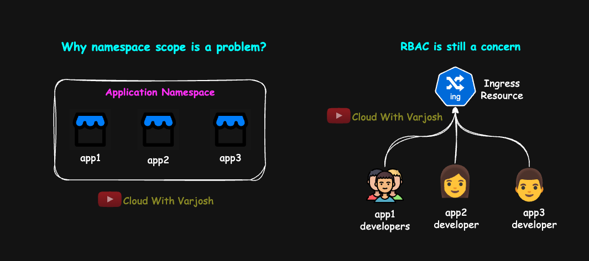
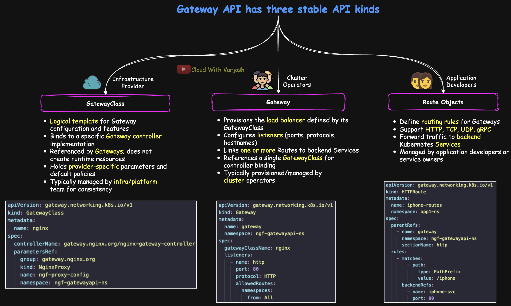
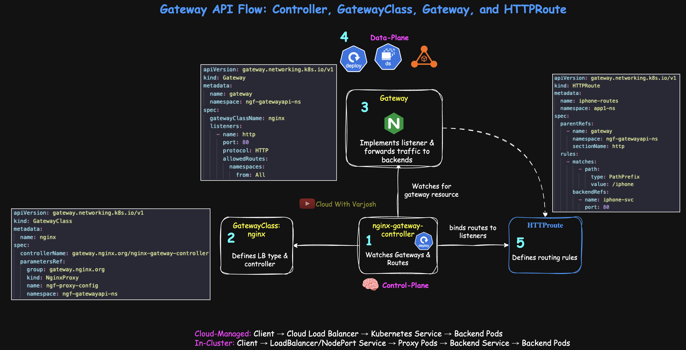

# 72 · Gateway API: Concepts and Resource Model

> **Level:** ★★★ advanced
>
> **You will learn:** what Ingress does and doesn't do (its native scope, controller-specific annotations, no validation); what's missing (cross-namespace routing, delegation/RBAC, protocols, traffic features); what **Gateway API** is (SIG-Network's standard, installed as CRDs); the role-oriented resources **GatewayClass**, **Gateway**, **xRoutes** (HTTPRoute, GRPCRoute, TLS/TCP/UDP) and **ReferenceGrant**; `parentRefs`, listeners and `allowedRoutes`; spec-level traffic features (matching, weights, filters, rewrites, redirects, timeouts); control plane vs data plane; cloud-managed vs in-cluster implementations; release channels and conformance; and how to migrate from Ingress.
>
> **You need:** topics 66 (CRDs/controllers), 69–71 (Ingress).

---

## ⚡ Core: the 10-minute version

**The idea.** **Gateway API** is the successor to Ingress. It splits one object into **roles**:
- a **GatewayClass** ("which kind of load balancer", owned by the infrastructure team);
- a **Gateway** (an actual entry point with listeners, owned by the platform team);
- **Routes** (`HTTPRoute`, `GRPCRoute`) that app teams write **in their own namespaces** and attach to a Gateway.

Weighted canaries, header matching, redirects, rewrites and timeouts are **standard fields**, not vendor annotations. **ReferenceGrant** controls cross-namespace references.

**Picture it.** A building management system: facilities define the door types, the building manager installs a door and decides who may post signs, and each tenant maintains its own signs.

**The one thing to know.**

```yaml
apiVersion: gateway.networking.k8s.io/v1
kind: HTTPRoute
metadata: { name: shop, namespace: team-shop }
spec:
  parentRefs: [ { name: shared-gw, namespace: infra } ]     # attach to the platform's Gateway
  rules:
  - matches: [ { path: { type: PathPrefix, value: /api } } ]
    backendRefs: [ { name: api-v1, port: 80, weight: 90 }, { name: api-v2, port: 80, weight: 10 } ]
```

**Try it now:** after topic 73's lab, run `kubectl describe httproute <name>` and read the `Accepted` and `ResolvedRefs` conditions.

**You've got it if you can:** name the three resource roles, and explain what Gateway API fixes compared with Ingress.

> 📖 **That's the core.** On a first pass, do the mini-lab and move on to the next topic. Everything below is the **full reference**: come back for the details, the edge cases, interview answers and exam-level depth.

---

## What it is

**Gateway API** is a **Kubernetes-standard set of APIs** for service networking, built by **SIG-Network**. (A **SIG**, Special Interest Group, is a Kubernetes community group owning one area; SIG-Network owns Services, Ingress and Gateway API, keeping them standard, portable and vendor-neutral.) It's the **successor to Ingress**: more expressive, extensible and **role-oriented**.

It's **not built into** a fresh cluster: you install its **CRDs** (topic 66) plus a **compatible controller** (an "implementation"). It:
- separates **infrastructure** (Gateways) from **application routing** (Routes);
- enables **multi-tenancy** with API-level delegation and isolation;
- supports **several protocols** (HTTP/HTTPS, gRPC, and TLS/TCP/UDP in the experimental channel);
- moves advanced traffic features **into the spec**, so they're portable and validated, instead of controller-specific annotations.

---

## Why it exists

### What we know about Ingress

1. **Native but minimal.** Ingress is built in and does **HTTP(S) host- and path-based routing**. That's all. No traffic splitting, no other protocols. It's a generic interface that controllers implement.
2. **Advanced features come from the controller.** SSL redirects, custom health checks, rate limiting, canary/weighted splitting, TCP/UDP: all via **controller-specific annotations or CRDs**, varying by vendor. In topics 70–71 the AWS LBC read annotations to configure SSL redirects, health checks and target types.
3. **Annotations are common practice**: the AWS LBC alone has dozens (SSL policy, health checks, redirects/rewrites, weighted target groups for canaries). The API server treats annotations as **opaque metadata**: it validates the object's schema but **not the annotation keys or values**.

### What's missing

**1. Cross-namespace routing, multi-tenancy, RBAC**



- **(a) Namespace scope:** an Ingress can only reference **Services in its own namespace**. To expose `app1`…`app10` through one Ingress they'd all have to share a namespace, against the best practice of a namespace per app/team.
- **(b) Shared write access:** if many teams share one Ingress, **every team needs write access** to it and can break the others' routes. Ingress has **no API-level way to delegate** a host or path to a team. Separate Ingresses per team helps, but whether they can share one load balancer is **implementation-dependent**.

> Note: some controllers solve both, e.g. the AWS LBC's **IngressGroup** (`group.name`) lets Ingresses from **different namespaces** share **one ALB**, with each team owning its own Ingress. But that's **controller-specific**, not portable.

**2. Protocol and feature scope**: Ingress is HTTP(S) host/path routing only. No native **TCP**, **UDP** or **gRPC** routing (gRPC is an open-source, high-performance RPC (remote procedure call) protocol running over **HTTP/2**, letting services call each other across languages and platforms). No first-class:
- HTTP→HTTPS redirects;
- weighted/canary splitting;
- header-, query- or method-based matching;
- (health checks, rate limiting: also controller extras).

Using annotations for these means **lock-in**: switching controllers means re-checking support and rewriting annotations.

**3. Annotations aren't validated**: an annotation for ALB weighted forwarding means nothing to Traefik or an NGINX-based controller. A **typo** or unsupported value is **silently ignored**: a hidden misconfiguration. Manifests become tightly coupled to one controller.

---

## Analogy

Ingress is a **single shared whiteboard** at an office entrance where everyone writes directions; anyone can erase anyone's lines, and fancy instructions are scribbled in each receptionist's private shorthand (annotations). Gateway API is a **proper building management system**: the **facilities company** defines what kinds of entrances are available (GatewayClass: "glass revolving door", "loading dock"); the **building manager** installs a specific entrance and decides which tenants may post signs there (Gateway + `allowedRoutes`); each **tenant** maintains its **own signs** in its own office (Routes in their namespace); and borrowing a room in another tenant's space needs that tenant's **written permission** (ReferenceGrant).

---

## How it works inside

### Resource model and roles



| Resource | Scope | What it is | Typical owner |
|---|---|---|---|
| **GatewayClass** | Cluster | A **class** of gateways, handled by one controller (`spec.controllerName`); optional `parametersRef` for vendor settings. Like a **StorageClass**: "what kind of load balancer/data plane". Creates nothing by itself | **Infrastructure provider** / platform team |
| **Gateway** | Namespace | An **instance** of traffic-handling infrastructure (a cloud LB or proxy Pods) with **listeners** (port, protocol, hostname, TLS) and rules for which Routes may attach. **Creating it usually provisions the load balancer** | **Cluster operator** / platform team |
| **HTTPRoute**, **GRPCRoute** (+ experimental **TLSRoute**, **TCPRoute**, **UDPRoute**) | Namespace | Routing rules: attach to a Gateway listener (`parentRefs`), **match** requests, apply **filters**, send to **backends** (`backendRefs`, usually Services) | **Application developers** / service owners |
| **ReferenceGrant** | Namespace | Lets objects in **another** namespace reference things in **this** one (e.g. a Route in `team-a` → a Service in `shared`; a Gateway → a TLS Secret elsewhere) | Owner of the **target** namespace |

> ✅ **Correct today** ([C1](#c1)): in the **Standard** (stable) channel, the GA kinds are **GatewayClass, Gateway, HTTPRoute and GRPCRoute**, plus **ReferenceGrant** (beta, standard channel) and newer additions such as **BackendTLSPolicy**. **TCPRoute** and **UDPRoute** are still in the **Experimental** channel (TLSRoute has been moving towards standard): available, but their APIs may change. Check the version you install.

### Attaching routes: `parentRefs`, listeners, `allowedRoutes`

- A Route attaches with `spec.parentRefs: [{name: <gateway>, namespace: <ns>, sectionName: <listener>}]`.
- The Gateway's listener says who may attach: `allowedRoutes.namespaces.from: Same | All | Selector` (+ `kinds`). Both sides must agree (**bidirectional trust**): app teams can't hijack a Gateway they weren't invited to, and the platform team doesn't have to edit Routes.
- Hostnames: the listener's `hostname` (e.g. `*.example.com`) and the Route's `hostnames` must intersect.
- Each Route's **`status.parents[].conditions`** (`Accepted`, `ResolvedRefs`) tells you whether it attached and whether its backends resolved: real feedback that annotations never gave.

### Traffic features in the spec

| Feature | How in HTTPRoute |
|---|---|
| Path matching | `matches: - path: {type: PathPrefix / Exact / RegularExpression, value: /iphone}` |
| Header / query / method matching | `matches: - headers: [...]`, `queryParams`, `method: POST` |
| Weighted / canary splitting | `backendRefs: [{name: v1, weight: 90}, {name: v2, weight: 10}]` |
| Redirects (e.g. HTTP→HTTPS) | `filters: - type: RequestRedirect, requestRedirect: {scheme: https, statusCode: 301}` |
| Path/host rewrites | `filters: - type: URLRewrite, urlRewrite: {path: {type: ReplacePrefixMatch, replacePrefixMatch: /}}` |
| Header modification | `RequestHeaderModifier` / `ResponseHeaderModifier` |
| Mirroring | `RequestMirror` |
| Timeouts | `timeouts: {request: 10s, backendRequest: 2s}` |
| Retries, session persistence, CORS | Newer additions; some still experimental depending on version |
| Health checks, rate limiting, auth | **Implementation-specific** policy CRDs (attached via "policy attachment"), not core |

These are **portable** across **conformant** implementations and **validated** by the API server (CRD schemas + CEL rules). Controllers can still add extensions, but the core is consistent.

**Safe cross-namespace routing**: `allowedRoutes` on the Gateway and `ReferenceGrant` on the target namespace give **explicit, controlled permission**, with no non-standard workarounds.

### The flow, with NGINX Gateway Fabric as the example



1. **The controller watches.** The `nginx-gateway-fabric` controller (a Deployment) watches `GatewayClass`, `Gateway` and `HTTPRoute` objects and reconciles on every change.
2. **GatewayClass = the LB type + responsible controller.** Cluster-scoped, purely logical (runs no code). Here GatewayClass `nginx` points at NGINX Gateway Fabric (`controllerName: gateway.nginx.org/nginx-gateway-controller`).
3. **Gateway = listeners and forwarding.** When the controller sees a Gateway for its class, it configures listeners (HTTP 80, HTTPS 443…) and **provisions the data plane**: a cloud LB (cloud-managed implementations) or proxy Pods (in-cluster).
4. **Data plane** forwards the actual traffic to Services/Pods.
   - **Control plane**: decides and reconciles (the controller watching resources and configuring the proxies). E.g. the NGF controller updates NGINX when you apply a new route.
   - **Data plane**: forwards and processes packets per the rules (an AWS ALB, or NGINX/Envoy Pods).
5. **HTTPRoute** references the Gateway (`parentRefs`), defines **matches** (e.g. `PathPrefix: /iphone`) and **backendRefs** (Services + ports). The controller binds it to the listener so traffic flows.

The exact mechanics depend on the implementation.

**One-line flows:**

```
Cloud-managed: Client → cloud load balancer → (Service's) Pods
In-cluster:    Client → LoadBalancer/NodePort Service → proxy Pods → backend Pods (found via the Service)
```

### Cloud-managed vs in-cluster data planes

**Cloud-managed** (AWS, GCP, Azure gateway controllers): the controller runs in the cluster but **only programs an external, cloud-managed load balancer** (listeners, routing, TLS, backends). The cloud LB carries all traffic; the controller is never in the traffic path.
- **AWS**: the AWS Gateway API Controller provisions **VPC Lattice** services; the **AWS Load Balancer Controller** also implements Gateway API with **ALB/NLB** data planes in recent versions.
- **GCP**: the GKE Gateway controller provisions **Google Cloud Load Balancers** (external/internal, single- or multi-cluster).
- **Azure**: **Application Gateway for Containers**.

**In-cluster** (NGINX Gateway Fabric, Envoy Gateway, Istio, Cilium, Traefik, Kong, HAProxy…): the controller writes configuration for **proxy Pods** (Deployments/DaemonSets) that are the data plane: L4/L7 load balancing, TLS termination, routing. The proxies are exposed by a **`LoadBalancer`** Service (cloud) or **`NodePort`** (on-prem/kind).

> ℹ️ **Note:** the original notes said "some lightweight/demo setups may skip a dedicated proxy tier… relying on kube-proxy/L4 forwarding". kube-proxy can't do HTTP routing, so a real Gateway API implementation always has an L7 data plane. Some just run it **inside the controller Pod** or share one proxy for many Gateways, instead of a separate Deployment per Gateway. (NGINX Gateway Fabric 2.x creates a **separate NGINX Deployment + Service per Gateway**; 1.x ran NGINX in the same Pod as the controller.)

| Scenario | Controller | Data plane | Examples |
|---|---|---|---|
| **Cloud-managed** | In cluster | External cloud LB | AWS VPC Lattice / ALB / NLB, GKE (GCLB), Azure App Gateway for Containers |
| **In-cluster** | In cluster | Proxy Pods in cluster | NGINX Gateway Fabric, Envoy Gateway, Istio, Cilium, Traefik, Kong, HAProxy |

**Mental model:** controller = **control plane** (watches resources, writes config, triggers reloads); data plane = **where packets flow** (cloud LB or proxy Pods); the controller is **never on the hot path**.

### Release channels, conformance and versions

- Gateway API is versioned **separately** from Kubernetes (`v1.x` CRD bundles). Install the **standard** channel for production; **experimental** adds alpha kinds/fields.
- **Conformance tests** and **profiles** (Core, Extended, Implementation-specific) state what an implementation supports; check the implementation's conformance report.
- Some implementations **require a specific CRD version**; install what the controller's docs say (topic 73 shows why).

### Gateway API and service meshes (GAMMA)

The same Route types can configure **east-west** (service-to-service) traffic in a mesh: an HTTPRoute with a **Service** as its `parentRef` (the GAMMA initiative). Istio, Linkerd and Cilium support it (topic 74).

### Migrating from Ingress

- **ingress2gateway** (a SIG-Network tool) converts Ingress (and some controller annotations) into Gateway/HTTPRoute YAML.
- Run both side by side: new Gateway with its own address, move DNS gradually, then delete the Ingress.
- Map annotations to filters/policies: e.g. `ssl-redirect` → `RequestRedirect`, `rewrite-target` → `URLRewrite`, canary weights → `backendRefs[].weight`.

---

## Commands / YAML

### Install the CRDs and inspect

```bash
kubectl apply --server-side -f https://github.com/kubernetes-sigs/gateway-api/releases/download/v1.3.0/standard-install.yaml
kubectl api-resources --api-group=gateway.networking.k8s.io
```

```
NAME              SHORTNAMES   APIVERSION                           NAMESPACED   KIND
backendtlspolicies btlspolicy  gateway.networking.k8s.io/v1         true         BackendTLSPolicy
gatewayclasses    gc           gateway.networking.k8s.io/v1         false        GatewayClass
gateways          gtw          gateway.networking.k8s.io/v1         true         Gateway
grpcroutes                     gateway.networking.k8s.io/v1         true         GRPCRoute
httproutes                     gateway.networking.k8s.io/v1         true         HTTPRoute
referencegrants   refgrant     gateway.networking.k8s.io/v1beta1    true         ReferenceGrant
```

(Exact kinds/versions depend on the release you install; pick the version your controller supports.)

### A multi-team example

```yaml
apiVersion: gateway.networking.k8s.io/v1
kind: GatewayClass
metadata: { name: nginx }
spec:
  controllerName: gateway.nginx.org/nginx-gateway-controller
---
apiVersion: gateway.networking.k8s.io/v1
kind: Gateway
metadata: { name: shared-gw, namespace: infra }
spec:
  gatewayClassName: nginx
  listeners:
  - name: https
    protocol: HTTPS
    port: 443
    hostname: "*.example.com"
    tls:
      mode: Terminate
      certificateRefs: [{ name: wildcard-example-com }]       # Secret in 'infra'
    allowedRoutes:
      namespaces:
        from: Selector
        selector: { matchLabels: { gateway-access: "true" } }   # only labelled team namespaces
  - name: http
    protocol: HTTP
    port: 80
    allowedRoutes: { namespaces: { from: Same } }
---
apiVersion: gateway.networking.k8s.io/v1                       # HTTP → HTTPS, owned by the platform team
kind: HTTPRoute
metadata: { name: redirect-to-https, namespace: infra }
spec:
  parentRefs: [{ name: shared-gw, sectionName: http }]
  rules:
  - filters:
    - type: RequestRedirect
      requestRedirect: { scheme: https, statusCode: 301 }
---
apiVersion: gateway.networking.k8s.io/v1                       # owned by team-shop, in ITS namespace
kind: HTTPRoute
metadata: { name: shop, namespace: team-shop }
spec:
  parentRefs: [{ name: shared-gw, namespace: infra, sectionName: https }]
  hostnames: ["shop.example.com"]
  rules:
  - matches: [{ path: { type: PathPrefix, value: /api } }]
    backendRefs:
    - { name: api-v1, port: 80, weight: 90 }                  # canary: 10% to v2
    - { name: api-v2, port: 80, weight: 10 }
  - matches: [{ path: { type: PathPrefix, value: / } }]
    backendRefs: [{ name: web, port: 80 }]
```

```bash
kubectl get gateway -n infra
kubectl get httproute -A
kubectl describe httproute shop -n team-shop | sed -n '/Status:/,$p'
```

```
NAME        CLASS   ADDRESS        PROGRAMMED   AGE
shared-gw   nginx   203.0.113.10   True         2m

Status:
  Parents:
    Conditions:
      Reason:   Accepted
      Status:   True
      Type:     Accepted
      Reason:   ResolvedRefs
      Status:   True
      Type:     ResolvedRefs
    Controller Name:  gateway.nginx.org/nginx-gateway-controller
    Parent Ref:  { Name: shared-gw, Namespace: infra, Section Name: https }
```

### ReferenceGrant: route to a Service in another namespace

```yaml
apiVersion: gateway.networking.k8s.io/v1beta1
kind: ReferenceGrant
metadata: { name: allow-shop-routes, namespace: shared-services }   # lives in the TARGET namespace
spec:
  from: [{ group: gateway.networking.k8s.io, kind: HTTPRoute, namespace: team-shop }]
  to:   [{ group: "", kind: Service, name: payments }]
```

Without it, the Route's status shows `ResolvedRefs: False, Reason: RefNotPermitted`.

---

## Hands-on lab

Do topic 73's demo first; then:
1. Create two team namespaces; label only one with `gateway-access=true`; attach an HTTPRoute from each and read both Routes' `status`.
2. Add a weighted canary (90/10) and measure with a loop: `for i in $(seq 100); do curl -s …; done | sort | uniq -c`.
3. Route to a Service in another namespace: see `RefNotPermitted`, then add a ReferenceGrant.
4. Add a header match (`x-beta: "true"` → v2) and an HTTP→HTTPS redirect route.
5. Run `ingress2gateway print --providers ingress-nginx --input-file my-ingress.yaml` on topic 69's Ingress and compare.

---

## Where you'll use it

- **New clusters and migrations off ingress-nginx**: Gateway API is the standard going forward.
- **Multi-team platforms**: platform owns GatewayClass/Gateway; teams own Routes.
- **Progressive delivery**: weights and header matches for canaries (Argo Rollouts and Flagger use Gateway API).
- **Meshes** (GAMMA), **gRPC** services, and (experimental) TCP/UDP.
- **CKA**: Gateway API resources appear in the current curriculum: create a Gateway and HTTPRoute.

---

## When it breaks

| Symptom | Cause | Fix |
|---|---|---|
| `no matches for kind "Gateway"` | CRDs not installed | Install the Gateway API CRDs (the version your controller needs) |
| GatewayClass `Accepted: False` / Gateway never `Programmed` | No controller for that `controllerName`, or CRD/controller version mismatch | Check controller Pods/logs; versions |
| Route `Accepted: False, NotAllowedByListeners` | Namespace not allowed by `allowedRoutes`, wrong `sectionName`, hostname doesn't intersect | Fix labels/listener/hostnames |
| `ResolvedRefs: False, RefNotPermitted` | Cross-namespace backend without ReferenceGrant | Add a ReferenceGrant in the target namespace |
| `ResolvedRefs: False, BackendNotFound` | Wrong Service name/port | Fix `backendRefs` |
| Gateway `ADDRESS` empty | Data-plane Service `LoadBalancer` pending (no cloud LB / MetalLB) | Use NodePort on kind, or install MetalLB |
| Feature "doesn't work" | Not supported by your implementation (Extended/experimental) | Check its conformance report |

---

## Quick recap

- Ingress = minimal HTTP(S) host/path routing; everything else is unvalidated, non-portable annotations; no cross-namespace delegation.
- **Gateway API** (SIG-Network, CRDs + an implementation): **GatewayClass** (kind of LB, controller; infra provider) → **Gateway** (listeners, provisions the LB; platform) → **Routes** (HTTPRoute/GRPCRoute GA; TCP/UDP experimental; app teams) + **ReferenceGrant** for cross-namespace refs.
- Attach with `parentRefs` + listener `allowedRoutes`; read Route `status` conditions.
- Spec features: rich matching, weights, redirects, rewrites, header modifiers, mirroring, timeouts, validated and portable.
- Control plane (controller) programs a data plane: cloud LB (cloud-managed) or proxy Pods (in-cluster).

### Interview questions

1. **Q: What problems does Gateway API solve compared with Ingress?**
   A: Role separation and safe multi-team delegation (GatewayClass/Gateway vs Routes, allowedRoutes, ReferenceGrant), cross-namespace routing, more protocols (gRPC; TCP/UDP experimental), and standard, validated traffic features (weights, header matching, redirects, rewrites, timeouts) instead of controller-specific annotations.
2. **Q: Who owns a GatewayClass, a Gateway and an HTTPRoute?**
   A: Typically the infrastructure provider/platform team owns the GatewayClass, the cluster operator/platform team owns Gateways (listeners, TLS, which namespaces may attach), and application teams own Routes in their own namespaces.
3. **Q: An HTTPRoute isn't routing traffic. Where do you look first?**
   A: The Route's `status.parents` conditions: `Accepted` (did it attach to the Gateway listener: allowedRoutes, sectionName, hostnames) and `ResolvedRefs` (do backends exist and are cross-namespace refs permitted), then the Gateway's `Programmed` condition and the controller logs.

---

## Appendix: notes on the original course material

This topic was rebuilt from the original CKA course notes. This appendix keeps the audit trail out of your way while you learn.

### Sources

Day 52 (introduction; prerequisites; what we know about Ingress: native but minimal, features from controllers, controller-specific annotations; what's missing: cross-namespace/multi-tenancy/RBAC and the IngressGroup note, protocol and feature scope and the gRPC note, annotations and lack of validation; what Gateway API is and the SIG note; resource model and role alignment: GatewayClass, Gateway, Routes; protocol flexibility and advanced traffic management; flow with NGINX Gateway Fabric: controller, GatewayClass, Gateway, data plane, control vs data plane, HTTPRoute, one-line flows; cloud-managed vs in-cluster setups, key differences, mental model; conclusion; references). The demo (Day 53) is topic 73.

### Corrections to the original notes

Each entry shows what the original said and what's true now. In the topic above, each correction appears as a ✅ **Correct today** line or a ⚠️ **Fix to the original** box, linked to its entry here.

<a id="c1"></a>**C1 · Corrected (Day 52).** "Gateway API has **three** stable API kinds" (GatewayClass, Gateway, Routes) and Route types "**HTTPRoute, TCPRoute, UDPRoute, and GRPCRoute**". **Now:** in the **Standard** (stable) channel, the GA kinds are **GatewayClass, Gateway, HTTPRoute and GRPCRoute**, plus **ReferenceGrant** (beta, standard channel) and newer additions such as **BackendTLSPolicy**. **TCPRoute** and **UDPRoute** are still in the **Experimental** channel (TLSRoute has been moving towards standard): available, but their APIs may change. Check the version you install.
