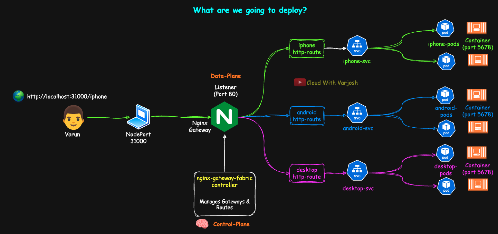

# 73 · Gateway API Hands-On: NGINX Gateway Fabric on kind

> **Level:** ★★ intermediate
>
> **You will learn:** to run a complete Gateway API setup locally: a kind cluster with a host port mapping; installing the Gateway API **CRDs** at the version your controller needs; installing **NGINX Gateway Fabric** (NGF) with Helm and exposing its data plane on a fixed **NodePort**; three backend apps; a **Gateway** with an HTTP listener; **HTTPRoutes** for `/iphone`, `/android` and `/`; verification of every layer (GatewayClass, Gateway conditions, data-plane Service, Route status, proxy logs); and extensions (header matching, weights, redirects, HTTPS).
>
> **You need:** topics 11 (kind), 65 (Helm), 72 (Gateway API concepts).

---

## ⚡ Core: the 10-minute version

**The idea.** Run Gateway API end to end on kind:
1. Install the Gateway API **CRDs**, matching your controller's version.
2. Install **NGINX Gateway Fabric** with Helm. It creates the `nginx` GatewayClass, and for each Gateway an NGINX data-plane Deployment exposed on a NodePort.
3. Create a **Gateway** with an HTTP listener.
4. Create **HTTPRoutes** for `/iphone`, `/android` and `/`.
5. Curl `localhost`.

The status conditions tell you at every step whether each piece is working.

**Picture it.** Opening a franchise branch: the brand exists (GatewayClass), you rent a shop front (Gateway), and departments put up their signs (HTTPRoutes).

**The one thing to know.**

```bash
kubectl get gatewayclass                         # ACCEPTED True
kubectl get gateway -A                           # PROGRAMMED True
kubectl get httproute -A
kubectl describe httproute iphone-routes -n app1-ns | sed -n '/Status:/,$p'    # Accepted / ResolvedRefs
curl -sL localhost:31000/iphone
```

**Try it now:**
1. Do the whole lab.
2. Then break a Route on purpose (a wrong `sectionName`, a wrong Service name) and read the condition that explains it.

**You've got it if you can:** set up a Gateway and routes from scratch, and debug them from their status.

> 📖 **That's the core.** On a first pass, do the mini-lab and move on to the next topic. Everything below is the **full reference**: come back for the details, the edge cases, interview answers and exam-level depth.

---

## What it is

A local, reproducible version of topic 70's routing (iPhone / Android / desktop) using **Gateway API** instead of Ingress. **NGINX Gateway Fabric** (F5/NGINX's Gateway API implementation) is the controller; for each Gateway it runs **NGINX Pods** as the **data plane**. We expose that data plane through a **NodePort** so `localhost` reaches it, with no cloud load balancer and **no annotations**.



**Flow:**

```
Browser http://localhost:31000/iphone
  → kind host port 31000 → NodePort 31000 (data-plane Service)
  → NGINX Pod, Gateway listener "http" on port 80
  → HTTPRoute iphone-routes (PathPrefix /iphone)
  → Service iphone-svc → iPhone Pods :5678 → HTML response
```

---

## Why it exists

To see Gateway API's resource model working end to end (who creates what, how objects link, and what status they report) on a laptop, before using cloud-managed implementations (GKE Gateway, AWS LBC, Azure AGC) or meshes.

---

## Analogy

Like opening a branch office: **GatewayClass** = the franchise brand already registered (NGF installs it); **Gateway** = renting the actual shop front with a door on port 80 (NGF puts NGINX staff behind it); **HTTPRoutes** = each department posting its own sign ("iPhone → counter 1"), in its own namespace, pinned to that shop's door (`parentRefs`).

---

## How it works inside

- **Controller Pod** (`ngf-nginx-gateway-fabric` Deployment): watches GatewayClass/Gateway/HTTPRoute/Services/EndpointSlices and **generates NGINX configuration**.
- **Data plane**: in NGF 2.x, for **each Gateway** the controller creates an **NGINX Deployment + Service** named `<gateway-name>-nginx` (here `gateway-nginx`) in the Gateway's namespace, and pushes config to it over a secure gRPC channel (in NGF 1.x, NGINX ran as a container inside the controller Pod).
- The Helm values decide what type of **Service** the data plane gets (NodePort here) and which **NodePort** maps to which **listener port**.
- NGINX sends traffic **straight to Pod IPs** (from EndpointSlices), not through the Service's ClusterIP.

**Route support:** NGF implements `HTTPRoute` and `GRPCRoute` (standard channel). `TLSRoute`, `TCPRoute`, `UDPRoute` (experimental) weren't supported at the time of Day 53; newer NGF releases have been adding experimental-channel features, so check its compatibility matrix for your version.

---

## Commands / YAML

### Prerequisites

**kind**, **Helm**, **kubectl** (its built-in Kustomize is used to install the CRDs). Background: topic 72. The install follows NGF's official Helm guide (docs.nginx.com/nginx-gateway-fabric/install/helm/), streamlined.

### Step 1: kind cluster (`Day 53/demo/00-kind-cluster.yaml`)

```bash
kind get clusters
kind delete cluster --name=<old-cluster>       # optional cleanup
```

```yaml
kind: Cluster
apiVersion: kind.x-k8s.io/v1alpha4
nodes:
  - role: control-plane
    image: kindest/node:v1.33.1@sha256:050072256b9a903bd914c0b2866828150cb229cea0efe5892e2b644d5dd3b34f   # use a current kindest/node
    extraPortMappings:
      - containerPort: 31000     # NodePort inside the kind node container
        hostPort: 31000          # localhost:31000 on your machine (9090 here → localhost:9090)
```

```bash
kind create cluster --name=gateway-api --config="Day 53/demo/00-kind-cluster.yaml"
```

The mapping lets `localhost:31000` reach the NodePort inside the single kind node (a container).

### Step 2: Gateway API CRDs

```bash
kubectl kustomize "https://github.com/nginx/nginx-gateway-fabric/config/crd/gateway-api/standard?ref=v2.1.0" | kubectl apply -f -
```

**⚠️ Versions:** the Helm install in Step 3 installs the **latest** NGF by default. The CRDs must **match that NGF release**: older CRDs with a newer controller can crash it or leave resources missing (e.g. `BackendTLSPolicy`). Check the current version on the NGF install page and replace `v2.1.0`, e.g. `?ref=v2.3.0`. Better still, **pin both**: `helm install … --version <chart-version>` and the matching CRD ref.

**What gets installed:**
- **GatewayClass**: a class of gateways (cluster-wide template for data planes);
- **Gateway**: an instance of a class (listener configuration; NGF provisions its data plane);
- **HTTPRoute**: HTTP routing rules to backends;
- **GRPCRoute**: the same for gRPC;
- **ReferenceGrant**: controlled cross-namespace references;
- (recent bundles also: **BackendTLSPolicy**.)

```bash
kubectl api-resources | grep gateway
```

### Step 3: install NGINX Gateway Fabric

```bash
helm install ngf oci://ghcr.io/nginx/charts/nginx-gateway-fabric \
  --create-namespace -n ngf-gatewayapi-ns \
  --set nginx.service.type=NodePort \
  --set-json 'nginx.service.nodePorts=[{"port":31000,"listenerPort":80}]'
```

- `--create-namespace -n ngf-gatewayapi-ns`: NGF in its own namespace.
- `nginx.service.type=NodePort`: the **data-plane** Service type (cloud: `LoadBalancer`).
- `nginx.service.nodePorts=[{"port":31000,"listenerPort":80}]`: a Gateway listener on **port 80** is exposed as **NodePort 31000** on every node, i.e. `<NodeIP>:31000`, i.e. `localhost:31000` via kind.

```bash
kubectl get deploy -n ngf-gatewayapi-ns
kubectl get gatewayclasses.gateway.networking.k8s.io -o wide
```

```
NAME                       READY   UP-TO-DATE   AVAILABLE   AGE
ngf-nginx-gateway-fabric   1/1     1            1           60s

NAME    CONTROLLER                                   ACCEPTED   AGE   DESCRIPTION
nginx   gateway.nginx.org/nginx-gateway-controller   True       60s
```

The chart **creates GatewayClass `nginx`**, and the controller marks it `ACCEPTED True` (it recognises the class as its own). GatewayClasses are **cluster-scoped**: Gateways in any namespace can use them.

### Step 4: the apps (`01-ns.yaml` … `04-desktop.yaml`)

Three Python HTTP servers in `app1-ns`, as in topic 70 (without topology spread or ALB annotations). The iPhone page is at `/iphone/index.html`, Android at `/android/index.html`, desktop at `/index.html`, all on port **5678**; each Service maps **80 → 5678**.

```yaml
# 02-iphone.yaml (abridged)
apiVersion: apps/v1
kind: Deployment
metadata: { name: iphone-deploy, namespace: app1-ns }
spec:
  replicas: 2
  selector: { matchLabels: { app: iphone-page } }
  template:
    metadata: { labels: { app: iphone-page } }
    spec:
      containers:
      - name: python-http
        image: python:alpine
        command: ["/bin/sh", "-c"]
        args:
          - |
            mkdir -p /iphone && echo '<html>
              <head><title>iPhone Users</title></head>
              <body>
                <h1>iPhone Users</h1>
                <p>Welcome to Cloud With VarJosh</p>
              </body>
            </html>' > /iphone/index.html && cd / && python3 -m http.server 5678
        ports: [{ containerPort: 5678 }]
---
apiVersion: v1
kind: Service
metadata: { name: iphone-svc, namespace: app1-ns }
spec:
  selector: { app: iphone-page }
  ports: [{ protocol: TCP, port: 80, targetPort: 5678 }]
```

```bash
kubectl apply -f "Day 53/demo/01-ns.yaml"            # creates app1-ns
kubectl apply -f "Day 53/demo/02-iphone.yaml" -f "Day 53/demo/03-android.yaml" -f "Day 53/demo/04-desktop.yaml"
kubectl get all -n app1-ns
```

> ⚠️ **Fix to the original** ([C1](#c1)): the README's Step 4 applies only `02`–`04`. They all use `namespace: app1-ns`, which doesn't exist yet in a fresh cluster (`namespaces "app1-ns" not found`). Apply **`01-ns.yaml`** first (it's in the demo folder).

### Step 5: the Gateway (`05-gateway.yaml`)

```yaml
apiVersion: gateway.networking.k8s.io/v1
kind: Gateway
metadata:
  name: gateway
  namespace: ngf-gatewayapi-ns
spec:
  gatewayClassName: nginx              # → NGF
  listeners:
    - name: http                       # unique within the Gateway; Routes use it as sectionName
      port: 80                         # the listenerPort mapped to NodePort 31000
      protocol: HTTP
      allowedRoutes:
        namespaces:
          from: All                    # Routes from any namespace may attach (demo convenience)
```

```bash
kubectl apply -f "Day 53/demo/05-gateway.yaml"
```

**Verify:**

1. **The Gateway exists and is programmed**

   ```bash
   kubectl get gateway -n ngf-gatewayapi-ns
   kubectl describe gateway gateway -n ngf-gatewayapi-ns
   ```

   ```
   NAME      CLASS   ADDRESS        PROGRAMMED   AGE
   gateway   nginx   172.18.0.2     True         30s
   ```

   `describe` shows the listener `http`/80, `Attached Routes: 0` (for now), and conditions **`Accepted=True`** and **`Programmed=True`** (the data plane is configured). (Day 53 also mentions `Ready=True`; the v1 Gateway conditions to look for are `Accepted` and `Programmed`.)

2. **The GatewayClass is accepted**: `kubectl get gatewayclasses -o wide` → `nginx … True`.

3. **The data-plane Service exists on NodePort 31000** (from the Helm flags):

   ```bash
   kubectl get svc -n ngf-gatewayapi-ns
   ```

   ```
   NAME                       TYPE        CLUSTER-IP      EXTERNAL-IP   PORT(S)        AGE
   gateway-nginx              NodePort    10.96.188.186   <none>        80:31000/TCP   42s
   ngf-nginx-gateway-fabric   ClusterIP   10.96.50.12     <none>        443/TCP        2m
   ```

4. **Pods are healthy**: `kubectl get pods -n ngf-gatewayapi-ns -o wide` → the controller **and** the `gateway-nginx-…` data-plane Pod (created when the Gateway was reconciled).

5. **Events** if something didn't wire up: `kubectl get events -n ngf-gatewayapi-ns --sort-by=.lastTimestamp | tail -n 20`.

**What happens next:** NGF has programmed NGINX for listener 80, exposed on `localhost:31000`. With **no routes yet**, requests get a default **404**.

```bash
curl -s -o /dev/null -w '%{http_code}\n' localhost:31000/       # 404
```

### Step 6: HTTPRoutes (`06-routes.yaml`)

```yaml
# iPhone: /iphone… → iphone-svc
apiVersion: gateway.networking.k8s.io/v1
kind: HTTPRoute
metadata:
  name: iphone-routes
  namespace: app1-ns                     # in the APP's namespace (allowed by from: All)
spec:
  parentRefs:                            # attach to this Gateway listener
    - name: gateway
      namespace: ngf-gatewayapi-ns
      sectionName: http
  rules:
    - matches:
        - path: { type: PathPrefix, value: /iphone }
      backendRefs:
        - { name: iphone-svc, port: 80 }
---
# Android: /android… → android-svc
apiVersion: gateway.networking.k8s.io/v1
kind: HTTPRoute
metadata: { name: android-routes, namespace: app1-ns }
spec:
  parentRefs: [{ name: gateway, namespace: ngf-gatewayapi-ns, sectionName: http }]
  rules:
    - matches: [{ path: { type: PathPrefix, value: /android } }]
      backendRefs: [{ name: android-svc, port: 80 }]
---
# Desktop: / → desktop-svc (catch-all)
apiVersion: gateway.networking.k8s.io/v1
kind: HTTPRoute
metadata: { name: desktop-routes, namespace: app1-ns }
spec:
  parentRefs: [{ name: gateway, namespace: ngf-gatewayapi-ns, sectionName: http }]
  rules:
    - matches: [{ path: { type: PathPrefix, value: / } }]
      backendRefs: [{ name: desktop-svc, port: 80 }]
```

How overlapping routes are resolved: across **all** Routes attached to a listener, the implementation picks the **most specific match** (longest path prefix wins, then most header matches, etc.), so `/iphone` beats `/` even though they're in different HTTPRoute objects.

```bash
kubectl apply -f "Day 53/demo/06-routes.yaml"
kubectl get httproutes -n app1-ns
kubectl describe -n app1-ns httproutes.gateway.networking.k8s.io iphone-routes | sed -n '/Status:/,$p'
```

```
NAME             HOSTNAMES   AGE
android-routes               4m8s
desktop-routes               4m8s
iphone-routes                4m8s

Status:
  Parents:
    Conditions:
      Message:  The Route is accepted
      Reason:   Accepted
      Status:   True
      Type:     Accepted
      Message:  All references are resolved
      Reason:   ResolvedRefs
      Status:   True
      Type:     ResolvedRefs
    Controller Name:  gateway.nginx.org/nginx-gateway-controller
```

- **Accepted**: bound to the listener (valid config, allowed namespace).
- **ResolvedRefs**: the Gateway, listener and backend Services all exist.

(`HOSTNAMES` is empty: no `hostnames` → match any host.)

**Notes on route types:**
- `HTTPRoute`: HTTP(S) L7 routing (most common).
- `GRPCRoute`: L7 routing of gRPC calls (by service/method).
- `TLSRoute`: route by **SNI** with **TLS passthrough** (the Gateway doesn't decrypt). Experimental.
- `TCPRoute` / `UDPRoute`: plain L4 (e.g. DNS, syslog for UDP). Experimental.

### Step 7: connectivity

```bash
curl -sL http://localhost:31000/iphone  | grep -o '<h1>.*</h1>'
curl -sL http://localhost:31000/android | grep -o '<h1>.*</h1>'
curl -s  http://localhost:31000/        | grep -o '<h1>.*</h1>'
```

```
<h1>iPhone Users</h1>
<h1>Android Users</h1>
<h1>Desktop Users</h1>
```

(`-L` follows Python's `301` from `/iphone` to `/iphone/`.)

> ✅ **Correct today** ([C2](#c2)): `/desktop` does go to `desktop-svc` (via the `/` catch-all), but the Python server has no `/desktop` file, so it returns **404 Not Found**. Only `/` (and `/index.html`) show the desktop page.

**Watch the proxy:**

```bash
kubectl logs -f -n ngf-gatewayapi-ns deploy/gateway-nginx
```

```
10.244.0.1 - - [18/Nov/2026:10:12:01 +0000] "GET /iphone/ HTTP/1.1" 200 160 "-" "curl/8.5.0"
```

(Day 53 tails a specific Pod name, `gateway-nginx-6bb659b9cf-hclbp`; `deploy/gateway-nginx` saves looking it up.)

**Conclusion:**
1. **Separation of concerns**: GatewayClass, Gateway and HTTPRoute have clear roles and are modular and portable.
2. **Simple routing**: no annotations; NGF reads standard Gateway API resources.
3. **Future-ready**: HTTP and gRPC today, more protocols as the API and NGF evolve.

Next steps: filters, header-based routing, TLS.

### Extensions to try

**Header-based routing + canary weights**

```yaml
apiVersion: gateway.networking.k8s.io/v1
kind: HTTPRoute
metadata: { name: iphone-routes, namespace: app1-ns }
spec:
  parentRefs: [{ name: gateway, namespace: ngf-gatewayapi-ns, sectionName: http }]
  rules:
    - matches:
        - path: { type: PathPrefix, value: /iphone }
          headers: [{ name: x-beta, value: "true" }]     # beta testers → android page (just to see it)
      backendRefs: [{ name: android-svc, port: 80 }]
    - matches:
        - path: { type: PathPrefix, value: /iphone }
      backendRefs:
        - { name: iphone-svc, port: 80, weight: 80 }
        - { name: desktop-svc, port: 80, weight: 20 }      # 20% "canary" (desktop has no /iphone page → 404)
```

```bash
curl -sL -H "x-beta: true" localhost:31000/iphone | grep -o '<h1>.*</h1>'
for i in $(seq 20); do curl -s -o /dev/null -w '%{http_code}\n' -L localhost:31000/iphone; done | sort | uniq -c
```

**Rewrite** so the iPhone app could serve at `/` while users call `/iphone`:

```yaml
      filters:
      - type: URLRewrite
        urlRewrite: { path: { type: ReplacePrefixMatch, replacePrefixMatch: / } }
```

**HTTPS listener**: add a TLS Secret and a second listener (and map another NodePort in the Helm values and kind config):

```yaml
    - name: https
      port: 443
      protocol: HTTPS
      hostname: "app.example.com"
      tls: { mode: Terminate, certificateRefs: [{ name: app-tls }] }   # Secret in ngf-gatewayapi-ns
      allowedRoutes: { namespaces: { from: All } }
```

### Cleanup

```bash
kubectl delete -f "Day 53/demo/06-routes.yaml" -f "Day 53/demo/05-gateway.yaml"
helm uninstall ngf -n ngf-gatewayapi-ns
kind delete cluster --name gateway-api
```

---

## Hands-on lab

1. Do Steps 1–7 and check every verification command's output.
2. Break things on purpose and read the **status**:
   - change a Route's `sectionName` to `https` → `Accepted: False` (`NoMatchingParent`);
   - change `backendRefs` to `iphone-svcx` → `ResolvedRefs: False` (`BackendNotFound`) and `500`s;
   - change the Gateway to `allowedRoutes: {namespaces: {from: Same}}` → Routes in `app1-ns` `NotAllowedByListeners`.
3. Try the header match, weights and rewrite extensions.
4. Move `desktop-svc` to another namespace and reference it from a Route in `app1-ns`: `RefNotPermitted`; fix it with a ReferenceGrant (topic 72).
5. Add an HTTPS listener with a self-signed certificate (topic 71) and test with `curl -k --resolve`.
6. Clean up.

---

## Where you'll use it

- **Local development and CI tests** of Gateway API configs.
- **Migrating from ingress-nginx** to NGF or another implementation (same resources, different `gatewayClassName`).
- **CKA practice**: Gateway + HTTPRoute tasks.

---

## When it breaks

| Symptom | Cause | Fix |
|---|---|---|
| NGF controller CrashLoopBackOff, errors about missing kinds | CRD version older than the controller expects | Install matching CRDs; pin chart version |
| GatewayClass `ACCEPTED` not `True` | Controller not running/wrong `controllerName` | Check the NGF Deployment and logs |
| Gateway `PROGRAMMED False` / no `gateway-nginx` Pod | Data plane failed to deploy (image pull, resources) | `describe gateway`, events, Pod logs |
| `curl localhost:31000` refused | Missing kind `extraPortMappings`, or NodePort not 31000 | Check kind config and `kubectl get svc -n ngf-gatewayapi-ns` |
| `404` for every path | No Routes attached (wrong `parentRefs`/`sectionName`/namespace) | Route `status`; Gateway `Attached Routes` count |
| `500`/`502` | Backend Service missing or no ready endpoints | `ResolvedRefs`; `kubectl get endpointslices -n app1-ns` |
| Apps fail to apply: `namespace not found` | `01-ns.yaml` not applied | Apply it first |

---

## Quick recap

- kind host-port mapping → NodePort → NGF's per-Gateway **NGINX data plane** → HTTPRoutes → Services → Pods.
- Install **matching** Gateway API CRDs and NGF versions (pin both).
- Helm values pick the data-plane Service type and **NodePort ↔ listener port** mapping.
- Gateway (`gatewayClassName: nginx`, listener `http`/80, `allowedRoutes`) → HTTPRoutes in the app namespace with `parentRefs` + `sectionName`; most specific match wins across Routes.
- Verify with conditions: GatewayClass `Accepted`, Gateway `Accepted`/`Programmed`, Route `Accepted`/`ResolvedRefs`; then curl and proxy logs.

### Interview questions

1. **Q: In NGINX Gateway Fabric, what creates the NGINX Pods and how are they exposed?**
   A: When a Gateway using the NGF GatewayClass is created, the controller provisions an NGINX Deployment and Service for it (NGF 2.x) and programs it; the Service type and ports come from Helm values (NodePort locally, LoadBalancer in clouds).
2. **Q: Two HTTPRoutes attach to the same listener, one matching `/` and one `/iphone`. Which handles `/iphone/x`?**
   A: The `/iphone` route: the most specific (longest) path match wins across all attached routes, regardless of which object it's in.
3. **Q: How do you confirm an HTTPRoute is actually in effect?**
   A: Check its `status.parents[].conditions` for `Accepted=True` and `ResolvedRefs=True`, the Gateway's `Programmed=True` and attached-route count, then send test requests and check the data-plane logs.

---

## Appendix: notes on the original course material

This topic was rebuilt from the original CKA course notes. This appendix keeps the audit trail out of your way while you learn.

### Sources

Day 53 (introduction; prerequisite; demo introduction; what we'll do; flow; prerequisites; step 1 kind cluster; step 2 CRDs, the important version note, what gets installed, verification, NGF route-type support; step 3 NGF Helm install and notes, GatewayClass auto-created; step 4 apps; step 5 Gateway, apply, verify (5 checks), what happens next; step 6 HTTPRoutes, apply, verify, notes on route types; step 7 connectivity via NodePort, expected output, proxy logs; conclusion; references), files `Day 53/demo/00-kind-cluster.yaml`, `01-ns.yaml`, `02-iphone.yaml`, `03-android.yaml`, `04-desktop.yaml`, `05-gateway.yaml`, `06-routes.yaml`.

### Corrections to the original notes

Each entry shows what the original said and what's true now. In the topic above, each correction appears as a ✅ **Correct today** line or a ⚠️ **Fix to the original** box, linked to its entry here.

<a id="c1"></a>**C1 · Corrected (Day 53).** the README's Step 4 applies only `02`–`04`. They all use `namespace: app1-ns`, which doesn't exist yet in a fresh cluster (`namespaces "app1-ns" not found`). Apply **`01-ns.yaml`** first (it's in the demo folder).

<a id="c2"></a>**C2 · Corrected (Day 53).** "`http://localhost:31000/` (**or `/desktop`**) → returns Desktop Users HTML page". **Now:** `/desktop` does go to `desktop-svc` (via the `/` catch-all), but the Python server has no `/desktop` file, so it returns **404 Not Found**. Only `/` (and `/index.html`) show the desktop page.
