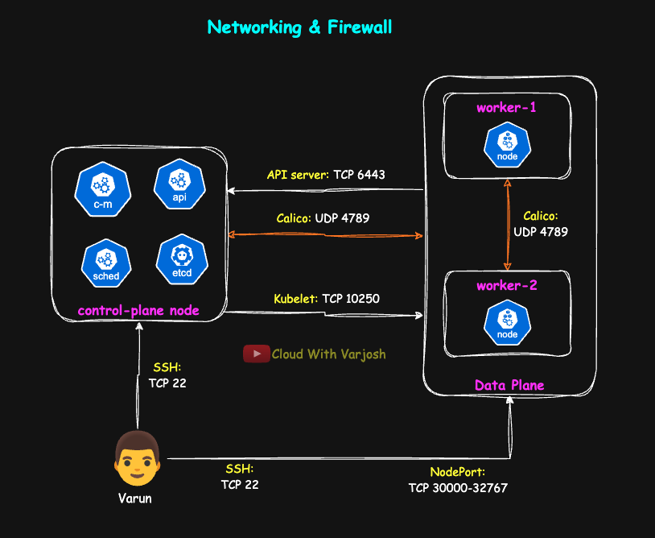

# 75 · Building a Multi-Node Cluster with kubeadm (containerd + Calico)

> **Level:** ★★★ advanced
>
> **You will learn:** to build a real cluster on VMs, one control plane and two workers: firewall/security-group ports and why each exists; node prerequisites (swap, kernel modules, sysctls); containerd with the **systemd cgroup driver** and the right pause image; installing version-pinned kubeadm/kubelet/kubectl from `pkgs.k8s.io`; what **`kubeadm init`** actually does (phases: preflight, certs, kubeconfigs, static Pods, bootstrap tokens, add-ons); installing **Calico** with the Tigera operator (VXLAN, BGP off, Typha); joining workers; verifying; troubleshooting Calico; and resetting cleanly.
>
> **You need:** topics 04 (Linux under Kubernetes: cgroups, namespaces, netfilter), 06–09 (architecture, components, plugins), 29 (CNI), 42 (static Pods), 51–53 (certificates).

---

## ⚡ Core: the 10-minute version

**The idea.** **kubeadm** builds a real cluster on machines you provide. You prepare each node:
- turn off swap;
- load the `overlay` and `br_netfilter` kernel modules and enable IP forwarding;
- install containerd with the **systemd cgroup driver**, and **restart** it after editing its config;
- install pinned kubeadm, kubelet and kubectl.

Then `kubeadm init` creates certificates, kubeconfigs and the control plane as static Pods. You install a CNI (Calico), and workers join with a token.

**Picture it.** A prefab house kit: you pour the foundation and connect the utilities; kubeadm's crew puts up the frame and hands out the keys.

**The one thing to know.**

```bash
sudo kubeadm init --control-plane-endpoint=<cp-ip-or-lb>:6443 --pod-network-cidr=192.168.0.0/16
mkdir -p ~/.kube && sudo cp /etc/kubernetes/admin.conf ~/.kube/config && sudo chown $(id -u):$(id -g) ~/.kube/config
# install the CNI (Calico operator + Installation), then on each worker:
kubeadm token create --print-join-command        # run its output with sudo on the worker
```

**Try it now:** build 1 control plane + 2 workers on VMs (Multipass/Vagrant locally, or cloud VMs) following the steps, then deploy nginx on a NodePort and curl both workers.

**You've got it if you can:** list the node prerequisites and the main phases of `kubeadm init`.

> 📖 **That's the core.** On a first pass, do the mini-lab and move on to the next topic. Everything below is the **full reference**: come back for the details, the edge cases, interview answers and exam-level depth.

---

## What it is

**kubeadm** is the official tool that **bootstraps** a conformant Kubernetes cluster on machines you provide. It doesn't create VMs, install a container runtime or a CNI: it sets up the **control plane** (as static Pods), **certificates**, **kubeconfig files**, and the **join** process for nodes.

The demo: Ubuntu VMs (cloud, on-prem or a laptop hypervisor, anything that can reach each other and that you can SSH into), **containerd** as the runtime, **Calico** as the CNI. Every command block says where to run it: **[ALL NODES]**, **[CONTROL PLANE ONLY]** or **[WORKER ONLY]**.

**5-minute checklist:** you should know the control-plane components (API server, etcd, controller manager, scheduler), node components (kubelet, kube-proxy, container runtime), and why Pods and Services need a **CNI** (topics 06–09, 29).

> ℹ️ **Note:** Day 54 installs **v1.32**. The current release is **v1.37**; the steps are identical with `v1.37` in the package repository path. For upgrades between versions see topic 76.

---

## Why it exists

Managed services (EKS, GKE, AKS) hide the control plane. kubeadm is how you build **self-managed** clusters (on-prem, edge, labs), and it's what the **CKA exam** uses: you'll be asked to join nodes, upgrade with kubeadm, fix static Pod manifests, and back up etcd on kubeadm clusters. Building one by hand shows you every moving part that kind hides.

---

## Analogy

Building a house with a prefab kit: **you** pour the foundation and connect utilities (VMs, network, firewall, swap/kernel settings, container runtime); **kubeadm** is the kit's assembly crew that erects the frame (control plane), installs the locks and issues keys (certificates, kubeconfigs), and hands out **visitor passes** (bootstrap tokens) so new rooms (workers) can be attached. Plumbing between rooms (Pod networking) is a separate contractor: **Calico**.

---

## How it works inside

### What `kubeadm init` does (phases)

`kubeadm init` runs these phases in order (each can be run alone: `kubeadm init phase <name>`):
1. **preflight**: checks (≥2 CPUs, ≥1.7 GB RAM, swap, ports 6443/10250/2379… free, runtime reachable, required kernel settings); pulls images.
2. **certs**: creates a **CA** and all certificates in `/etc/kubernetes/pki/` (API server, kubelet client, front-proxy, etcd CA and peers, `sa.key`/`sa.pub`; topic 53).
3. **kubeconfig**: `admin.conf`, `super-admin.conf`, `controller-manager.conf`, `scheduler.conf`, `kubelet.conf` in `/etc/kubernetes/`.
4. **kubelet-start**: writes the kubelet config (`/var/lib/kubelet/config.yaml`) and starts the kubelet.
5. **control-plane** + **etcd**: writes **static Pod manifests** to `/etc/kubernetes/manifests/` (kube-apiserver, kube-controller-manager, kube-scheduler, etcd); the kubelet starts them (topic 42).
6. **upload-config / upload-certs**: stores the cluster configuration in ConfigMaps (`kubeadm-config`, `kubelet-config`).
7. **mark-control-plane**: label `node-role.kubernetes.io/control-plane` + taint `node-role.kubernetes.io/control-plane:NoSchedule` (topic 43).
8. **bootstrap-token**: creates a **join token** (valid 24 h) and the RBAC for **TLS bootstrapping** (new kubelets submit a CSR that's auto-approved; topic 53).
9. **addon**: installs **CoreDNS** (Deployment) and **kube-proxy** (DaemonSet). CoreDNS stays `Pending` until a CNI is installed.

`kubeadm join` (on a worker): discovers the cluster through the API server, **verifies the CA** with `--discovery-token-ca-cert-hash` (so it can't be tricked by a fake API server), uses the token to bootstrap the kubelet's client certificate, and registers the Node.

### The node prerequisites, explained

- **Swap off**: by default the kubelet refuses to start if swap is on (`failSwapOn: true`); its memory accounting and eviction assume no swap. (Swap support for Pods, `LimitedSwap`, has matured in recent releases, but kubeadm's defaults still expect swap off. Keep it off unless you deliberately configure it.)
- **`overlay` module**: the overlay filesystem container images use (Docker notes: image layers, topic [07](../../Docker/notes/07-image-layers-and-overlayfs.md)).
- **`br_netfilter` + `net.bridge.bridge-nf-call-iptables=1`**: lets iptables/nftables see traffic crossing Linux **bridges**, so Service NAT and NetworkPolicies work for bridged Pod traffic.
- **`net.ipv4.ip_forward=1`**: the node must **route** packets between Pods, other nodes and the outside world (Linux notes: routing, topic [061](../../linux-mastery-rhel/notes/061-routing.md)).
- **cgroup driver = systemd** for both kubelet and containerd: two different cgroup managers fighting over the same cgroups leads to instability (topic 04). kubeadm configures the kubelet with `systemd` by default (since v1.22); containerd must match.

### Calico with the operator

- **Tigera operator** (a Deployment) + an **`Installation`** CR named `default` describing the network (pod CIDR, encapsulation, BGP) → the operator creates `calico-system`: **calico-node** (DaemonSet: Felix programs routes/iptables/eBPF; BIRD speaks BGP when enabled), **calico-typha** (a fan-out cache between the API server and many Felix agents, port **5473**), **calico-kube-controllers**, and the CSI driver.
- **Encapsulation**: **VXLAN** (UDP **4789**) wraps Pod packets so the underlying network doesn't need to know Pod IPs; `VXLANCrossSubnet` encapsulates only between subnets. **BGP** (TCP **179**) instead advertises Pod routes to peers (no overlay, needs a cooperative network). For VXLAN-only clusters, **BGP should be Disabled**.

---

## Commands / YAML

### Demo prerequisites

**1) Networking and security groups** (AWS terms; on Azure/GCP use NSGs/firewall rules with the same ports)



Two SGs in the same VPC: **control-plane-sg** and **data-plane-sg**, **all egress allowed** on both.

**control-plane-sg (inbound)**

| Purpose | Port | Source | When |
|---|---|---|---|
| SSH | TCP 22 | Your IP | Always |
| Kubernetes API | TCP 6443 | data-plane-sg (+ your IP to use kubectl from your laptop) | Always |
| Kubelet API | TCP 10250 | data-plane-sg | When something on workers calls the CP kubelet (e.g. **metrics-server** scraping all nodes) |
| Calico Typha | TCP 5473 | data-plane-sg | If Typha Pods can land on CP nodes |
| VXLAN overlay | UDP 4789 | data-plane-sg | Recommended (calico-node runs on CP nodes too) |

**data-plane-sg (inbound)**

| Purpose | Port | Source | When |
|---|---|---|---|
| SSH | TCP 22 | Your IP | Always |
| Kubelet API | TCP 10250 | control-plane-sg (and data-plane-sg for metrics-server) | Always |
| VXLAN | UDP 4789 | data-plane-sg | Always (worker ↔ worker) |
| VXLAN | UDP 4789 | control-plane-sg | Always (CP ↔ worker) |
| Calico Typha | TCP 5473 | data-plane-sg | If Typha can land on workers |
| Calico Typha | TCP 5473 | control-plane-sg | If CP nodes must reach Typha on workers |
| NodePort (demo) | TCP 30000–32767 | Your IP | Optional, for testing NodePorts |

> ℹ️ **Note:** the **kubelet port 10250** must also be reachable **on the control-plane nodes** from wherever **metrics-server** runs (it scrapes every node's kubelet, topic 48), otherwise `kubectl top nodes` shows the control plane as `<unknown>`.

**Why the Typha rows:** the video didn't open **TCP 5473**. With the operator, **Typha** is usually enabled and runs with **hostNetwork**, and each `calico-node` (Felix) connects to it on 5473. Without the rule, `calico-node` sits at **Running 0/1** with Typha timeouts.

**Note (self-managed clusters):** the `calico-node` DaemonSet **tolerates the control-plane taint**, so it runs on CP nodes too: keep **4789** and **5473** open on the CP SG, unless you deliberately keep Calico off CP nodes and Typha on workers only.

Also: nodes need **outbound internet** (NAT gateway or public IP) to pull images. **HA (multi-CP)** also needs **2379–2380** (etcd), **10257** (controller manager), **10259** (scheduler) between control-plane nodes (topic 78).

**2) SSH key pair**: easiest is to **create it in the cloud console** (AWS: EC2 → Key Pairs → ED25519 → download `.pem`); the provider injects the public key at boot.

```bash
chmod 400 ~/Downloads/kubeadm-demo.pem
ssh -i ~/Downloads/kubeadm-demo.pem ubuntu@<PUBLIC_IP_OR_DNS>
```

Alternative: generate locally and import the public key (or copy it into each VM's `~/.ssh/authorized_keys`):

```bash
ssh-keygen -t ed25519 -C "kubeadm-demo" -f ~/.ssh/kubeadm-demo
chmod 400 ~/.ssh/kubeadm-demo
ssh-copy-id -i ~/.ssh/kubeadm-demo.pub ubuntu@<PUBLIC_IP_OR_DNS>    # needs existing SSH access
ssh -i ~/.ssh/kubeadm-demo ubuntu@<PUBLIC_IP_OR_DNS>
```

(Linux notes: SSH keys, topic [065](../../linux-mastery-rhel/notes/065-ssh.md).)

**3) Instances**: Ubuntu **22.04 or 24.04** LTS (amd64). Control plane **2 vCPU, 4–8 GB RAM, 20 GB disk**; workers **1–2 vCPU, 2–4 GB, 8–20 GB**. Same VPC, routable subnets. kubeadm requires **≥2 vCPU** on the control plane (`--ignore-preflight-errors=NumCPU` bypasses the check, at the cost of stability).

**4) Hostnames (clarity only)**

```bash
sudo hostnamectl set-hostname control-plane      # or worker-1 / worker-2
exec bash                                        # reload the shell so the prompt shows it (or reboot)
```

Optional `/etc/hosts` entries for pinging by name; Kubernetes doesn't need them. Node names **must be unique** (they become the Node object names).

**5) How to follow**: run each block **only where labelled**; finish the **control plane** (and its check) before the workers; one terminal tab per node; replace placeholders like `<CP_PRIVATE_IP>`; use `sudo` where shown; don't skip steps.

### Step 1: swap and kernel networking [ALL NODES]

```bash
sudo swapoff -a                                    # now
sudo sed -i '/ swap / s/^/#/' /etc/fstab           # and after reboots

echo -e "overlay\nbr_netfilter" | sudo tee /etc/modules-load.d/k8s.conf
sudo modprobe overlay && sudo modprobe br_netfilter

cat <<'EOF' | sudo tee /etc/sysctl.d/99-kubernetes-cri.conf
net.bridge.bridge-nf-call-iptables=1
net.bridge.bridge-nf-call-ip6tables=1
net.ipv4.ip_forward=1
EOF
sudo sysctl --system
```

Check: `swapon --show` (empty), `lsmod | grep -E 'overlay|br_netfilter'`, `sysctl net.ipv4.ip_forward` → `= 1`.

### Step 2: containerd [ALL NODES]

```bash
sudo apt-get update && sudo apt-get install -y containerd
sudo mkdir -p /etc/containerd
containerd config default | sudo tee /etc/containerd/config.toml >/dev/null
sudo sed -i 's/SystemdCgroup = false/SystemdCgroup = true/' /etc/containerd/config.toml     # match kubelet's cgroup driver
sudo sed -i 's#sandbox_image = ".*"#sandbox_image = "registry.k8s.io/pause:3.10"#' /etc/containerd/config.toml
sudo systemctl restart containerd                   # APPLY the new config
sudo systemctl enable containerd
grep -E 'SystemdCgroup|sandbox' /etc/containerd/config.toml
sudo systemctl status containerd --no-pager
```

- **containerd** is the runtime the kubelet talks to via CRI (topic 08).
- **`SystemdCgroup = true`**: same cgroup driver as the kubelet.
- **Pause image**: the "sandbox" container holding each Pod's namespaces; keep it consistent with what kubeadm expects.

> ⚠️ **Fix to the original** ([C1](#c1)): the original ran `sudo systemctl daemon-reload` + `sudo systemctl enable --now containerd`. On Ubuntu, `apt install containerd` **already started** the service, and `enable --now` **doesn't restart** a running service, so the edited `config.toml` (SystemdCgroup, pause image) was **never loaded**. The runtime then kept using the cgroupfs driver while the kubelet used systemd: a classic cause of control-plane Pods restarting randomly ("flapping"), which the original works around with reboots. **`systemctl restart containerd`** applies the config. (`daemon-reload` is only for changed unit files.)

> ⚠️ **Fix to the original** ([C2](#c2)): the pause image was pinned to **`pause:3.9`**. Recent kubeadm versions use a newer pause (3.10 for v1.32; check yours with `kubeadm config images list | grep pause`), and preflight warns `detected that the sandbox image "registry.k8s.io/pause:3.9" of the container runtime is inconsistent with that used by kubeadm`. Set the version kubeadm lists. On **containerd 2.x** the config layout changed (the key moved to `[plugins.'io.containerd.cri.v1.images'.pinned_images] sandbox = …`), so the `sed` won't match: edit that key instead and check with `containerd config dump | grep -E 'sandbox|SystemdCgroup'`.

### Step 3: kubeadm, kubelet, kubectl [ALL NODES]

```bash
K8S_MINOR=v1.37                                    # Day 54 used v1.32
sudo mkdir -p /etc/apt/keyrings
curl -fsSL https://pkgs.k8s.io/core:/stable:/${K8S_MINOR}/deb/Release.key \
  | sudo gpg --dearmor -o /etc/apt/keyrings/kubernetes-apt-keyring.gpg
echo "deb [signed-by=/etc/apt/keyrings/kubernetes-apt-keyring.gpg] https://pkgs.k8s.io/core:/stable:/${K8S_MINOR}/deb/ /" \
  | sudo tee /etc/apt/sources.list.d/kubernetes.list
sudo apt-get update && sudo apt-get install -y kubelet kubeadm kubectl
sudo apt-mark hold kubelet kubeadm kubectl          # no accidental upgrades (topic 76 unholds deliberately)
sudo systemctl enable kubelet

kubeadm version -o short; kubelet --version; kubectl version --client
```

- **pkgs.k8s.io** has **one repository per minor version** (the old `apt.kubernetes.io` repos are gone): to upgrade later you change the repo path first (topic 76).
- Until `init`/`join`, the kubelet **crash-loops** every few seconds (no config yet): **normal**.

**Bash completion (optional, Day 54):**

```bash
sudo apt-get install -y bash-completion
echo 'source /usr/share/bash-completion/bash_completion' >> ~/.bashrc
echo 'source <(kubectl completion bash)' >> ~/.bashrc
echo 'alias k=kubectl' >> ~/.bashrc
echo 'complete -o default -F __start_kubectl k' >> ~/.bashrc
source ~/.bashrc
```

**kubectl on workers:** workers have no kubeconfig. For a lab you can copy the admin one:

```bash
# control plane
sudo cp /etc/kubernetes/admin.conf /tmp/kubeconfig && sudo chown $USER:$USER /tmp/kubeconfig
scp /tmp/kubeconfig ubuntu@worker-1:/tmp/kubeconfig && rm /tmp/kubeconfig
# worker-1
mkdir -p ~/.kube && mv /tmp/kubeconfig ~/.kube/config && chmod 600 ~/.kube/config
kubectl get nodes
```

That's **cluster-admin** on the worker: fine for demos, never in production (topic 54 for proper user access).

> ⚠️ **Fix to the original** ([C3](#c3)): the original `scp`'d straight to `~/.kube/config` on the worker **before** creating `~/.kube` there (scp fails: `No such file or directory`), and left a copy of the admin credentials in `/tmp` on the control plane. Create the directory first and clean up.

### Step 4: initialise the control plane [CONTROL PLANE ONLY]

```bash
sudo kubeadm init \
  --control-plane-endpoint=<CP_PRIVATE_IP>:6443 \
  --apiserver-advertise-address=<CP_PRIVATE_IP> \
  --pod-network-cidr=192.168.0.0/16
```

```
[init] Using Kubernetes version: v1.37.x
[preflight] Running pre-flight checks
[certs] Generating "ca" certificate and key
[certs] apiserver serving cert is signed for DNS names [control-plane kubernetes kubernetes.default …] and IPs [10.96.0.1 10.0.1.10]
…
[control-plane] Creating static Pod manifest for "kube-apiserver"
[etcd] Creating static Pod manifest for local etcd in "/etc/kubernetes/manifests"
[wait-control-plane] Waiting for the kubelet to boot up the control plane as static Pods …
[mark-control-plane] Marking the node control-plane as control-plane by adding the taints [node-role.kubernetes.io/control-plane:NoSchedule]
[bootstrap-token] Using token: abcdef.0123456789abcdef
[addons] Applied essential addon: CoreDNS
[addons] Applied essential addon: kube-proxy

Your Kubernetes control-plane has initialized successfully!
…
You can now join any number of control-plane nodes … kubeadm join <CP_PRIVATE_IP>:6443 --token … --discovery-token-ca-cert-hash sha256:… --control-plane
Then you can join any number of worker nodes by running the following on each as root:
kubeadm join <CP_PRIVATE_IP>:6443 --token abcdef.0123456789abcdef --discovery-token-ca-cert-hash sha256:…
```

```bash
mkdir -p $HOME/.kube
sudo cp /etc/kubernetes/admin.conf $HOME/.kube/config
sudo chown $(id -u):$(id -g) $HOME/.kube/config
kubectl get nodes
kubectl -n kube-system get pods
```

```
NAME            STATUS     ROLES           AGE   VERSION
control-plane   NotReady   control-plane   1m    v1.37.x
coredns-…       0/1   Pending   …        ← waits for the CNI
etcd-control-plane, kube-apiserver-…, kube-controller-manager-…, kube-scheduler-…   Running
kube-proxy-…    Running
```

`NotReady` + Pending CoreDNS = **no CNI yet** (expected).

**Flags:**
- `--control-plane-endpoint`: the address **everyone** (nodes, clients) uses for the API. For a future **HA** cluster, make this a **DNS name or load-balancer address**, not one node's IP: it's baked into every kubeconfig and certificate and hard to change later (topic 78).
- `--apiserver-advertise-address`: the local IP this API server binds/advertises.
- `--pod-network-cidr`: must match the CNI's IP pool (192.168.0.0/16 for Calico here). **It must not overlap** your VPC/node network or the Service CIDR (default `10.96.0.0/12`). If your VMs are in 192.168.x.x, pick e.g. `10.244.0.0/16` and use the same in Calico.

Production tip: put these settings in a **kubeadm config file** (`kubeadm config print init-defaults > kubeadm.yaml`, edit `ClusterConfiguration`/`InitConfiguration`, `kubeadm init --config kubeadm.yaml`) so the build is reviewable and repeatable.

**1-vCPU VMs:** add `--ignore-preflight-errors=NumCPU` (skips the check; start-up slower and less stable). Prefer 2 vCPU for the control plane.

### Step 5: Calico via the operator [CONTROL PLANE ONLY]

```bash
kubectl create -f https://raw.githubusercontent.com/projectcalico/calico/v3.30.2/manifests/operator-crds.yaml
kubectl create -f https://raw.githubusercontent.com/projectcalico/calico/v3.30.2/manifests/tigera-operator.yaml

cat <<'EOF' | kubectl apply -f -
apiVersion: operator.tigera.io/v1
kind: Installation
metadata:
  name: default                          # must be 'default' (singleton)
spec:
  calicoNetwork:
    bgp: Disabled                        # VXLAN-only: no BGP (see troubleshooting)
    ipPools:
    - cidr: 192.168.0.0/16               # = kubeadm --pod-network-cidr
      natOutgoing: Enabled               # SNAT Pod → outside traffic at the node
      blockSize: 26                      # each node gets /26 blocks (64 Pod IPs each)
      encapsulation: VXLANCrossSubnet    # VXLAN only between subnets
      nodeSelector: all()
EOF
kubectl get tigerastatus
kubectl -n calico-system get pods -o wide
```

```
NAME      AVAILABLE   PROGRESSING   DEGRADED   SINCE
calico    True        False         False      2m
ippools   True        False         False      2m
```

`kubectl create` (not `apply`) because the CRDs are too large for client-side apply's annotation. Once Calico is Ready, the node becomes **Ready** and CoreDNS **Running**.

> ℹ️ **Note:** the "Why" text says "the provided **`custom-resources.yaml`** applies sensible defaults… so **no customization is required**", but the demo applies its **own inline `Installation`** (with `bgp: Disabled`, added after the Day 55 troubleshooting). Calico's sample `custom-resources.yaml` also creates an `APIServer` CR and leaves BGP **enabled**, which causes the readiness errors below on VXLAN clusters. Use the inline version.

### Step 6: join the workers [WORKER ONLY]

```bash
# on the control plane: a fresh command (tokens expire after 24 h)
kubeadm token create --print-join-command
# on each worker (after Steps 1–3):
sudo kubeadm join <CP_PRIVATE_IP>:6443 --token <TOKEN> --discovery-token-ca-cert-hash sha256:<HASH>
```

```
[preflight] Running pre-flight checks
[kubelet-start] Starting the kubelet
[kubelet-start] Waiting for the kubelet to perform the TLS Bootstrap
This node has joined the cluster:
* Certificate signing request was sent to apiserver and a response was received.
* The Kubelet was informed of the new secure connection details.
```

The worker authenticated with the bootstrap token, verified the CA hash, got its kubelet certificate via an auto-approved CSR, and registered.

### Step 7: verify and a quick demo [any node with kubeconfig]

```bash
kubectl get nodes -o wide
kubectl -n kube-system get pods -o wide
kubectl create deploy web --image=nginx --replicas=3
kubectl expose deploy/web --port=80 --type=NodePort
kubectl get svc web -o wide
kubectl get svc web -o jsonpath='{.spec.ports[0].nodePort}'; echo
curl -I http://<worker-1-ip>:<nodeport>
curl -I http://<worker-2-ip>:<nodeport>
```

```
NAME            STATUS   ROLES           AGE   VERSION    INTERNAL-IP
control-plane   Ready    control-plane   20m   v1.37.x    10.0.1.10
worker-1        Ready    <none>          5m    v1.37.x    10.0.2.21
worker-2        Ready    <none>          5m    v1.37.x    10.0.2.22

HTTP/1.1 200 OK
Server: nginx/1.27.x
```

Both workers answer on the NodePort even if a Pod isn't local: cross-node Pod networking (VXLAN) and kube-proxy work. Label workers for readability: `kubectl label node worker-1 node-role.kubernetes.io/worker=`.

### Calico troubleshooting

**Why:** during the Day 55 upgrade, some `calico-node` Pods wouldn't become Ready.

**Symptom:** `calico-node` **Running 0/1**; readiness fails with **"Error querying BIRD"** or **"BGP not established"**, although the cluster uses VXLAN.

**Root cause:** with the operator install, **BGP defaults to enabled** unless set. In a VXLAN setup, BIRD/BGP readiness checks fail (TCP 179 isn't open and peers aren't configured). After disabling BGP, some nodes may still report **Felix not ready** if they can't reach **Typha** on 5473.

**Fix (VXLAN clusters):**

```bash
# 1) is BGP enabled? (empty or "Enabled" = on)
kubectl get installation.operator.tigera.io default -o jsonpath='{.spec.calicoNetwork.bgp}{"\n"}'
# 2) disable it
kubectl patch installation.operator.tigera.io default --type=merge -p '{"spec":{"calicoNetwork":{"bgp":"Disabled"}}}'
# 3) restart calico-node and wait
kubectl -n calico-system rollout restart ds/calico-node
kubectl -n calico-system rollout status ds/calico-node
# 4) still Felix/Typha errors?
kubectl -n calico-system get deploy,svc,endpointslices -l k8s-app=calico-typha
kubectl -n calico-system logs ds/calico-node -c calico-node | grep -i typha
```

Open **TCP 5473** between nodes and wherever `calico-typha` runs; keep **UDP 4789** for VXLAN; **TCP 179 isn't needed** with BGP disabled. If you **do** want BGP (no overlay, routed fabric), keep it enabled, open **179** between peers and configure node-to-node mesh or route reflectors. References: Tigera docs on operator installs and VXLAN configuration options.

### Reboots and clean-slate reset

Day 54 recommends rebooting the control plane after Step 5 (wait 10–15 min, check `systemctl status containerd kubelet`, nodes, system Pods), then each worker after joining (5–10 min). A healthy kubeadm cluster **doesn't need reboots**; they mostly masked the containerd config not being reloaded (corrected above). Rebooting once is still a good **test** that everything comes back by itself (swap stays off, modules load, services enabled).

**Clean-slate reset** (workers first, then control plane):

```bash
# WORKERS
sudo kubeadm reset -f
sudo rm -rf /etc/cni/net.d /var/lib/cni /var/lib/kubelet/pki ~/.kube
for i in cni0 vxlan.calico tunl0; do sudo ip link del "$i" 2>/dev/null || true; done
sudo systemctl restart containerd

# CONTROL PLANE
sudo kubeadm reset -f
sudo rm -rf /etc/kubernetes /var/lib/etcd /etc/cni/net.d /var/lib/cni /var/lib/kubelet/pki ~/.kube
for i in cni0 vxlan.calico tunl0; do sudo ip link del "$i" 2>/dev/null || true; done
sudo systemctl restart containerd
```

`kubeadm reset` doesn't clean CNI config, interfaces or iptables rules, hence the extra steps (add `sudo iptables -F && sudo iptables -t nat -F` or `nft flush ruleset` for a truly clean slate). Before resetting a worker in a live cluster: `kubectl drain <node> --ignore-daemonsets` and `kubectl delete node <node>`.

**Conclusion:** a clean, repeatable multi-node cluster with containerd and Calico: control plane first and verified, workers joined, cross-node traffic validated with a NodePort; containerd's cgroup driver aligned with the kubelet; kernel networking set; Calico in your chosen encapsulation (VXLAN here, or IP-in-IP) with matching firewall rules.

---

## Hands-on lab

1. Build the 3-node cluster (cloud VMs or local VMs with Multipass/Vagrant/VirtualBox).
2. After `init`, explore: `ls /etc/kubernetes/{,pki,manifests}`, `sudo crictl ps`, `kubectl get cm -n kube-system kubeadm-config -o yaml`, `openssl x509 -in /etc/kubernetes/pki/apiserver.crt -noout -text | grep -A1 'Subject Alternative'`.
3. Deliberately misconfigure: skip `br_netfilter` on one worker, or leave `SystemdCgroup=false` without restart, and observe symptoms; fix them.
4. Generate a new join token later (`kubeadm token list`, `kubeadm token create --print-join-command`) and add a third worker.
5. Remove a worker properly: drain, delete node, `kubeadm reset` on it.
6. Rebuild with a kubeadm **config file** instead of flags.

---

## Where you'll use it

- **On-prem/edge/self-managed clusters** and **labs**.
- **CKA**: joining nodes, kubeadm flags, static Pod manifests, certificates, `kubeadm token`, reset.
- **Understanding managed services** (EKS/GKE/AKS run the same components; you just don't see them).

---

## When it breaks

| Symptom | Cause | Fix |
|---|---|---|
| Preflight: `[ERROR NumCPU]` / `[ERROR Mem]` | VM too small | Bigger VM or `--ignore-preflight-errors` (lab only) |
| Preflight: `/proc/sys/net/ipv4/ip_forward contents are not set to 1` | Step 1 skipped | Set sysctls |
| kubelet: `running with swap on is not supported` | Swap on | `swapoff -a` + fstab |
| Control-plane Pods restart every few minutes | cgroup driver mismatch (containerd not restarted with SystemdCgroup) | Fix config, `systemctl restart containerd` |
| `init` hangs at `wait-control-plane` | Runtime/kubelet problems, wrong pause image, firewall | `journalctl -u kubelet -f`; `crictl ps -a`; `crictl logs` |
| Nodes `NotReady`, CoreDNS Pending | No CNI, or CNI Pods failing | Install/fix Calico (`kubectl get tigerastatus`) |
| `calico-node 0/1` "BIRD/BGP not established" | BGP on in a VXLAN cluster | Disable BGP |
| `calico-node 0/1` Typha timeouts | TCP 5473 blocked | Open it |
| `kubeadm join`: `token not found` / `unauthorized` | Token expired (24 h) | `kubeadm token create --print-join-command` |
| `join` fails: `couldn't validate the identity of the API Server` | Wrong CA hash or endpoint | Use the printed command; check `--control-plane-endpoint` |
| Pods on different nodes can't talk | UDP 4789 blocked, overlapping CIDRs | Open VXLAN; non-overlapping Pod CIDR |
| `kubectl top nodes` unknown for CP | 10250 on CP blocked from metrics-server | Open it |

---

## Quick recap

- You provide VMs, network rules, kernel settings, a runtime (containerd with **SystemdCgroup** and the matching **pause** image, **restarted**) and packages from **pkgs.k8s.io** (per-minor repos, held).
- `kubeadm init` = preflight → certs → kubeconfigs → kubelet → **static Pod** control plane → taint → bootstrap token → CoreDNS + kube-proxy.
- Install a CNI (Calico operator: `Installation` with matching pod CIDR, VXLAN, **BGP Disabled**; open 4789/5473) → nodes Ready.
- Join workers with a fresh token and CA hash (TLS bootstrapping). Verify with a NodePort test.
- Use a stable `--control-plane-endpoint` (DNS/LB) for future HA; reset cleanly with `kubeadm reset` + CNI cleanup.

### Interview questions

1. **Q: What does `kubeadm init` do?**
   A: Runs preflight checks, generates the cluster CA and component certificates, writes kubeconfig files, starts the kubelet, creates static Pod manifests for the API server, controller manager, scheduler and etcd, taints/labels the control-plane node, creates a bootstrap token and RBAC for joining, and installs CoreDNS and kube-proxy.
2. **Q: Why must containerd and the kubelet use the same cgroup driver?**
   A: Both manage the cgroups of containers; with different drivers (systemd vs cgroupfs) two managers create conflicting views of resources, causing instability, especially under memory pressure. Kubeadm defaults the kubelet to systemd, so containerd's runc must use `SystemdCgroup = true`.
3. **Q: A worker's join command fails with "token not found". Why and how do you fix it?**
   A: Bootstrap tokens expire after 24 hours by default; create a new one on the control plane with `kubeadm token create --print-join-command` and rerun the join.

---

## Appendix: notes on the original course material

This topic was rebuilt from the original CKA course notes. This appendix keeps the audit trail out of your way while you learn.

### Sources

Day 54 (lecture prerequisites and the 5-minute checklist; demo prerequisites: networking and security groups updated for Calico Typha, both SG tables, Azure/GCP and HA notes; SSH key pairs; instances; hostnames; how to follow the steps; steps 1–7; Calico troubleshooting: symptom, root cause, fix steps 1–4, BGP note; post-install reboots and clean-slate reset; conclusion; references).

### Corrections to the original notes

Each entry shows what the original said and what's true now. In the topic above, each correction appears as a ✅ **Correct today** line or a ⚠️ **Fix to the original** box, linked to its entry here.

<a id="c1"></a>**C1 · Corrected (Day 54).** the original ran `sudo systemctl daemon-reload` + `sudo systemctl enable --now containerd`. On Ubuntu, `apt install containerd` **already started** the service, and `enable --now` **doesn't restart** a running service, so the edited `config.toml` (SystemdCgroup, pause image) was **never loaded**. The runtime then kept using the cgroupfs driver while the kubelet used systemd: a classic cause of control-plane Pods restarting randomly ("flapping"), which the original works around with reboots. **`systemctl restart containerd`** applies the config. (`daemon-reload` is only for changed unit files.)

<a id="c2"></a>**C2 · Corrected (Day 54).** the pause image was pinned to **`pause:3.9`**. Recent kubeadm versions use a newer pause (3.10 for v1.32; check yours with `kubeadm config images list | grep pause`), and preflight warns `detected that the sandbox image "registry.k8s.io/pause:3.9" of the container runtime is inconsistent with that used by kubeadm`. Set the version kubeadm lists. On **containerd 2.x** the config layout changed (the key moved to `[plugins.'io.containerd.cri.v1.images'.pinned_images] sandbox = …`), so the `sed` won't match: edit that key instead and check with `containerd config dump | grep -E 'sandbox|SystemdCgroup'`.

<a id="c3"></a>**C3 · Corrected (Day 54).** the original `scp`'d straight to `~/.kube/config` on the worker **before** creating `~/.kube` there (scp fails: `No such file or directory`), and left a copy of the admin credentials in `/tmp` on the control plane. Create the directory first and clean up.
