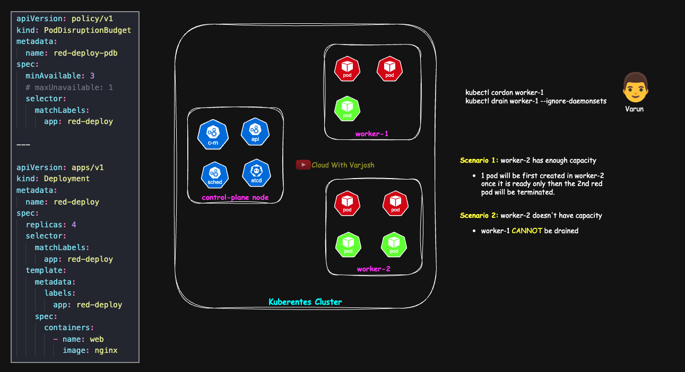

# 76 · Versions, Version Skew and Upgrading a kubeadm Cluster

> **Level:** ★★★ advanced
>
> **You will learn:** Kubernetes versioning (`MAJOR.MINOR.PATCH`), release cadence and support windows (upstream vs EKS/AKS/GKE); a patch-management policy (N / N-1 / N-2); why you can't skip minors; the **version skew policy** for every component; why upgrades matter (and **API removals**); the production upgrade flow and strategies (all-at-once, rolling, blue/green); the full **kubeadm upgrade** procedure for control-plane and worker nodes (HA notes included); **cordon/drain** and **PodDisruptionBudgets**; and what to check afterwards.
>
> **You need:** topics 25 (rolling updates), 42 (static Pods), 47 (priority/eviction), 75 (the kubeadm cluster).

---

## ⚡ Core: the 10-minute version

**The idea.** Kubernetes releases a minor version about every **4 months**, and supports the **newest three** for about 14 months each.
- Upgrade **one minor at a time**: never skip.
- Upgrade the **control plane first**, then nodes one by one.
- No component may be **newer** than the API server; kubelets may lag by up to **3 minors**.
- On kubeadm: upgrade the package → `kubeadm upgrade plan` → `kubeadm upgrade apply` → then per node: **drain** → upgrade the kubelet → **uncordon**.

**PodDisruptionBudgets** keep enough replicas running while nodes drain.

**Picture it.** Renovating a hospital one ward at a time: management moves first, and a ward closes only after its patients have moved safely.

**The one thing to know.**

```bash
sudo kubeadm upgrade plan
sudo kubeadm upgrade apply v1.37.x                       # first control plane
kubectl drain <node> --ignore-daemonsets --delete-emptydir-data
# upgrade kubelet + kubectl packages, then:
sudo systemctl daemon-reload && sudo systemctl restart kubelet
kubectl uncordon <node>
```

**Try it now:**
1. On a VM cluster built one minor behind, do the full upgrade.
2. Deploy `Day 55/pdb.yaml` first and watch the drain respect it.

**You've got it if you can:** state the upgrade order, the skew rules, and how a PDB affects a drain.

> 📖 **That's the core.** On a first pass, do the mini-lab and move on to the next topic. Everything below is the **full reference**: come back for the details, the edge cases, interview answers and exam-level depth.

---

## What it is

**Upgrading a cluster** means moving its control plane and nodes to a newer Kubernetes version **safely**: one **minor** version at a time, control plane first, nodes one by one, without dropping application traffic.

### Versioning and cadence

- **`MAJOR.MINOR.PATCH`**: `1.33.4` → major 1, minor 33, patch 4.
- **Minor releases** roughly every **4 months** (~3 per year): new features, GA promotions, deprecations/removals.
- **Patch releases** about **monthly** per supported branch (often every 1–2 weeks right after a new minor while early issues are fixed): bug and security fixes only.

So plan an upgrade window about once per minor (or every other minor), and expect early patches soon after moving to a new minor.

### Support windows

- **Upstream**: the **three newest minors** (N, N-1, N-2) get patches. When 1.33 was current, 1.33/1.32/1.31 were patched and 1.30 was out. Today (v1.37 current): **1.37, 1.36, 1.35**.

  > ✅ **Correct today** ([C1](#c1)): each minor gets about **14 months** of patch support (12 months of full support + a 2-month upgrade period), a policy in place since v1.19.

- **Managed Kubernetes** (vendor-tuned; support comes from **your provider**, not upstream):
  - **Amazon EKS**: ~**14 months standard** + **12 months extended** (paid) → up to ~**26 months** per minor.
  - **AKS / GKE**: typically keep you within N-2; LTS options, release channels and **auto-upgrades** vary. Check the provider docs.

---

## Why it exists

**Why upgrades matter:**
- **Security and compliance**: CVEs and critical bugs are fixed **only** on supported branches.
- **Features and APIs**: new capabilities and GA promotions arrive in minors, along with **deprecations and removals**.
- **Ecosystem compatibility**: CNIs, CSI drivers, ingress/gateway controllers and operators test against currently supported minors. New add-on features may need newer API fields; on an old minor they can break or fail to start.

**API removals:** when an API version is **removed** (e.g. `extensions/v1beta1` Ingress in 1.22, `policy/v1beta1` PodSecurityPolicy in 1.25, `flowcontrol…/v1beta2` in 1.29), manifests and Helm charts still using it **fail to apply after the upgrade**. Finding them is a mandatory pre-check (see the commands below).

---

## Analogy

Upgrading a cluster is like **renovating a busy hospital one ward at a time**: the **management office** (control plane) moves into its new rooms first, because every ward must understand the new procedures; then each **ward** (node) is emptied by moving patients elsewhere (**drain**), renovated, and reopened (**uncordon**) before the next one closes. **PodDisruptionBudgets** are the rule "at least 3 ICU beds must stay staffed at all times", so a ward can't close if that would break the rule. You never skip a building code version: you apply each one in turn.

---

## How it works inside

### Patch-management guideline

**N** = your current production minor (e.g. 1.33); **N-1/N-2** = the previous supported minors.
- **N-1 and N-2 clusters**: run the **latest patch** of their minor (maximum fixes).
- **N (prod)**: **pin a known-good patch**; promote newer patches only after **staging/canary soak**, so prod may deliberately lag the very latest for a short validation window.

Example: prod on N = **1.33.3** (vetted); others on **1.32.latest**, **1.31.latest**.

**Production insight:** many teams upgrade **every other minor** (~6–8 months) with **monthly patches** in between, staying within N/N-1/N-2. Prod rarely jumps to a brand-new N on day zero, and even on N it's rarely the day-zero patch. Exceptions: urgent CVEs, auto-upgrade channels, greenfield clusters.

### Never skip minors; order matters

- **Don't skip minor versions**: 1.31 → 1.33 directly is **unsupported**. Go 1.31 → 1.32 → 1.33. (Each step can run storage migrations and depends on the previous minor's API versions.)
- **Control plane first, then workers**; within each tier, **one node at a time** in production.

### Version skew policy

During a rolling upgrade, components run different versions for a while. The rules, relative to **kube-apiserver**:

| Component | Allowed skew |
|---|---|
| **kube-apiserver** (HA) | Instances within **1 minor** of each other while rolling |
| **kube-controller-manager, kube-scheduler, cloud-controller-manager** | **Never newer** than the API server; up to **1 minor older** |
| **kubelet** | **Never newer** than the API server; up to **3 minors older** |
| **kube-proxy** | Never newer than the API server; up to **3 minors older**, and within 3 minors of its node's kubelet |
| **kubectl** | Within **±1 minor** of the API server |

> ✅ **Correct today** ([C2](#c2)): since **v1.28**, the kubelet (and kube-proxy) may be up to **three** minor versions older than the API server. That lets you upgrade the control plane through two minors (e.g. 1.35 → 1.36 → 1.37) and then upgrade the nodes once. It's still best to converge everything to the same minor promptly.

**Safe rule of thumb:** never run a component **newer** than the API server; converge to the same minor quickly.

**Several kubectl versions on one machine:** keep the client within ±1 minor of each cluster you manage:
- **best**: a version manager like **asdf** (auto-switches per directory/project);
- **simple**: multiple binaries (`kubectl-1.36`, `kubectl-1.37`) with aliases/symlinks;
- **zero-install**: run a pinned kubectl container image (e.g. `registry.k8s.io/kubectl:v1.37.x`).

Name contexts with their minor (`prod-1.37`) and check with `kubectl version`.

### Production upgrade flow

1. **Pre-checks**
   - control-plane and etcd **health**;
   - **capacity headroom** (or temporarily scale up/add a node);
   - **PDBs**, **readiness probes** and enough **replicas** on critical apps;
   - **deprecated/removed APIs** in use (manifests, Helm releases, operators);
   - add-on compatibility (CNI, CSI, ingress/gateway controllers, operators, containerd);
   - **backups**: an **etcd snapshot** (topic 77) and `/etc/kubernetes` (manifests + PKI).
2. **Control plane, one node at a time**: upgrade **kubeadm** → `kubeadm upgrade plan` → `kubeadm upgrade apply <target>` on the **first** control-plane node → `kubeadm upgrade node` on the others → upgrade **kubelet/kubectl** and restart the kubelet on each.
3. **Workers, one at a time**: **cordon + drain** (respecting PDBs) → `kubeadm upgrade node` → upgrade kubelet/kubectl → restart kubelet → **uncordon**.
4. **Add-ons**: CoreDNS and kube-proxy are upgraded by kubeadm; confirm **CNI/CSI/CRI** compatibility (upgrade them if needed).
5. **Post-validation**: versions (server/client/nodes), component health and logs, synthetic traffic probes; remove temporary scale-outs.

### Upgrade strategies

- **All at once**: fine for dev/test clusters without SLOs.
- **Rolling, one node at a time**: **best practice for production**, with spare capacity so latency stays stable.
- **Blue/green**: build new ("green") nodes or a whole new cluster alongside the current ("blue"), validate, shift traffic (DNS/LB/Gateway), retire blue. For tight SLOs or risky OS/runtime/CNI changes: more cost and work, but **instant rollback**. (Managed node groups often do this per node pool: new nodes on the new version, drain old ones.)

### What `kubeadm upgrade` does

- `kubeadm upgrade plan`: checks the cluster can be upgraded and shows target versions for each component (a "terraform plan" for kubeadm).
- `kubeadm upgrade apply vX.Y.Z` (first control-plane node): checks health, **pre-pulls images**, **rewrites the static Pod manifests** in `/etc/kubernetes/manifests/` with the new image tags/flags (the kubelet restarts each component), upgrades **etcd** if needed, updates the `kubeadm-config`/`kubelet-config` ConfigMaps and RBAC, upgrades **CoreDNS** and **kube-proxy**, and **renews the certificates** it manages (opt out: `--certificate-renewal=false`). It backs up old manifests to `/etc/kubernetes/tmp/`.
- `kubeadm upgrade node` (other control planes and workers): upgrades that node's local static Pods (on control planes) and its **kubelet configuration**. The kubelet **binary** comes from your package manager.

### Cordon, drain and PodDisruptionBudgets

- **`kubectl cordon <node>`**: marks the node **unschedulable** (`spec.unschedulable: true`, taint `node.kubernetes.io/unschedulable:NoSchedule`); running Pods stay.
- **`kubectl drain <node>`**: cordons (if not already), then **evicts** Pods through the **Eviction API**, which **honours PodDisruptionBudgets**. DaemonSet Pods are skipped with `--ignore-daemonsets`; Pods using `emptyDir` need `--delete-emptydir-data` (their data is lost); bare Pods without a controller need `--force` (they won't come back).
- **`kubectl uncordon <node>`**: schedulable again.

**Tip: cordon first, then drain.** Drain cordons anyway, but cordoning first lets you: look at what's still running on the node, check/adjust PDBs, let Jobs or long sessions finish, and easily back out (`uncordon`) if maintenance is postponed.

A **PodDisruptionBudget (PDB)** limits **voluntary** disruptions (drains, evictions by autoscalers/upgrades) for Pods matching a selector: `minAvailable: N` (or %) or `maxUnavailable: N` (or %). The Eviction API refuses an eviction (HTTP **429 Too Many Requests**) that would break it; `kubectl drain` keeps retrying.

### Draining with a PDB



`red-deploy` has **4 replicas** and a PDB with **`minAvailable: 3`**, so at least 3 Pods must be **Ready** during voluntary disruptions. We drain **worker-1**:
- **Cordon → drain**: no new Pods land on worker-1; drain evicts workload Pods via the Eviction API (DaemonSets skipped).
- **Scenario 1: capacity exists (worker-2 has room).** The first red Pod is evicted (Ready 4 → 3, still ≥ 3); a replacement is scheduled elsewhere and becomes **Ready** (3 → 4); only **then** may the next eviction proceed. Repeat until worker-1 is empty.
- **Scenario 2: capacity is tight.** The first eviction succeeds (4 → 3), but the **next is blocked** by the PDB because Ready would drop below 3, and the replacement can't be scheduled. The drain **stalls/retries** until capacity frees up, you **scale** the Deployment or add nodes, or you **relax the PDB**.

**Heads-up:** a PDB counts **Ready** Pods (terminating/NotReady don't count), so a replacement must become **Ready**, not just scheduled.

**Priority vs drain:** **PodPriority** affects **scheduling and preemption** (topic 47), **not** `kubectl drain`: drain uses the Eviction API and honours **PDBs** only, so priority won't protect a Pod from a voluntary eviction. (Under **node resource pressure**, the kubelet's involuntary evictions **do** consider priority: lower-priority Pods first. That's a different mechanism.) For maintenance safety, use **PDBs** + cordon/drain.

**PDB pitfalls:**
- `minAvailable` equal to the replica count (or `maxUnavailable: 0`) **blocks every drain forever**.
- A PDB on a single-replica Deployment with `minAvailable: 1` also blocks drains: scale to 2+ or use `maxUnavailable: 1`.
- `unhealthyPodEvictionPolicy: AlwaysAllow` lets already-unhealthy Pods be evicted, so crash-looping Pods don't block maintenance.

---

## Commands / YAML

### Pre-checks

```bash
kubectl get nodes -o wide                                   # versions, readiness
kubectl get --raw='/readyz?verbose' | tail -3
kubectl -n kube-system get pods
kubectl get pdb -A
containerd --version                                        # runtime supports the target? (containerd release notes)
kubectl get --raw /metrics | grep apiserver_requested_deprecated_apis   # deprecated APIs actually being called
# third-party scanners: pluto detect-all-in-cluster / kubent
sudo ETCDCTL_API=3 etcdctl snapshot save /var/backups/etcd-$(date +%F).db \
  --endpoints=https://127.0.0.1:2379 --cacert=/etc/kubernetes/pki/etcd/ca.crt \
  --cert=/etc/kubernetes/pki/etcd/server.crt --key=/etc/kubernetes/pki/etcd/server.key   # topic 77
sudo tar czf /var/backups/etc-kubernetes-$(date +%F).tgz /etc/kubernetes
```

### Demo: upgrade 1.32.8 → 1.33.4

**Scope:** Ubuntu/Debian, **containerd 1.7.27** with `SystemdCgroup=true`, **Calico v3.30** (supports K8s 1.31–1.33), current **v1.32.8**, target **v1.33.4** (package revision **`1.33.4-1.1`**), single or HA control plane. (The same steps apply to any minor: e.g. today 1.36.x → 1.37.y.)

**Prerequisites:**
- **CNI compatibility**: check Calico's Kubernetes requirements page for the target minor.
- **CRI compatibility**: check containerd's "Kubernetes support" table (`containerd --version`).
- **Capacity headroom**; **PDBs and readiness probes** on critical workloads.
- **Backups**: etcd snapshot (stacked etcd from a control-plane node; external etcd from its own cluster); a tarball of `/etc/kubernetes` on each control-plane node.
- **HA**: `kubeadm upgrade apply` on **one** control-plane node only; others use `kubeadm upgrade node`; the API load balancer health-checks **`/readyz`** so it removes a control plane while its API server restarts; with stacked etcd upgrade **one control plane at a time** to keep quorum.

#### Control-plane node

**Step 1: point APT at the new minor's repository** (pkgs.k8s.io has one repo per minor)

```bash
pager /etc/apt/sources.list.d/kubernetes.list
sudo sed -i 's#/v1.32/#/v1.33/#' /etc/apt/sources.list.d/kubernetes.list     # Day 55 edits it in vim
cat /etc/apt/sources.list.d/kubernetes.list
```

```
deb [signed-by=/etc/apt/keyrings/kubernetes-apt-keyring.gpg] https://pkgs.k8s.io/core:/stable:/v1.33/deb/ /
```

Remove any legacy `apt.kubernetes.io` entries (that repository is gone).

**Step 2: find the exact target version**

```bash
sudo apt-get update
sudo apt-cache madison kubeadm
```

```
   kubeadm | 1.33.4-1.1 | https://pkgs.k8s.io/core:/stable:/v1.33/deb  Packages
   kubeadm | 1.33.3-1.1 | https://pkgs.k8s.io/core:/stable:/v1.33/deb  Packages
   …
   kubeadm | 1.33.0-1.1 | https://pkgs.k8s.io/core:/stable:/v1.33/deb  Packages
```

No 1.33 listed? Re-check the repo file and run `apt-get update` again.

**Step 3: upgrade kubeadm**

```bash
sudo apt-mark unhold kubeadm
sudo apt-get update && sudo apt-get install -y kubeadm=1.33.4-1.1
sudo apt-mark hold kubeadm
kubeadm version -o short                 # v1.33.4
sudo kubeadm config images pull          # optional: pre-pull to shorten restarts
```

**Unhold → install exact → hold** prevents accidental drift during and after the change window.

**Step 4: plan (dry run)**

```bash
sudo kubeadm upgrade plan
```

```
Components that must be upgraded manually after you have upgraded the control plane with 'kubeadm upgrade apply':
COMPONENT   NODE            CURRENT   TARGET
kubelet     control-plane   v1.32.8   v1.33.4
kubelet     worker-1        v1.32.8   v1.33.4

Upgrade to the latest stable version:
COMPONENT                 NODE            CURRENT    TARGET
kube-apiserver            control-plane   v1.32.8    v1.33.4
kube-controller-manager   control-plane   v1.32.8    v1.33.4
kube-scheduler            control-plane   v1.32.8    v1.33.4
kube-proxy                                1.32.8     v1.33.4
CoreDNS                                   v1.11.3    v1.12.0
etcd                      control-plane   3.5.16-0   3.5.21-0

You can now apply the upgrade by executing the following command:
	kubeadm upgrade apply v1.33.4
```

It lists what kubeadm will upgrade and what you must upgrade **manually** (kubelets). Optional: `sudo kubeadm upgrade diff v1.33.4` shows the manifest changes.

**Step 5: apply**

```bash
sudo kubeadm upgrade apply v1.33.4
```

```
[upgrade/staticpods] Writing new Static Pod manifests to "/etc/kubernetes/tmp/kubeadm-upgraded-manifests…"
[upgrade/staticpods] Moving new manifest to "/etc/kubernetes/manifests/kube-apiserver.yaml" and backing up old manifest …
…
[upgrade] SUCCESS! A control plane node of your cluster was upgraded to "v1.33.4".
[upgrade] Now please proceed with upgrading the rest of the nodes by following the right order.
```

It rewrites the **static Pod manifests** (the kubelet restarts the components with new images) and renews certificates by default.

**Step 6: verify the skew**

```bash
kubectl version
kubectl get nodes
```

```
Client Version: v1.32.8
Server Version: v1.33.4          ← control plane upgraded
NAME            STATUS   ROLES           AGE   VERSION
control-plane   Ready    control-plane   30d   v1.32.8      ← VERSION = kubelet version, not yet upgraded
worker-1        Ready    <none>          30d   v1.32.8
worker-2        Ready    <none>          30d   v1.32.8
```

**Step 7: upgrade the control-plane node's kubelet and kubectl**

```bash
kubectl drain control-plane --ignore-daemonsets            # see the correction below
sudo apt-mark unhold kubelet kubectl
sudo apt-get install -y kubelet=1.33.4-1.1 kubectl=1.33.4-1.1
sudo systemctl daemon-reload && sudo systemctl restart kubelet
sudo apt-mark hold kubeadm kubelet kubectl
kubectl uncordon control-plane
kubectl version; kubectl get nodes
```

```
Client Version: v1.33.4
Server Version: v1.33.4
control-plane   Ready    control-plane   …   v1.33.4
worker-1        Ready    <none>          …   v1.32.8
worker-2        Ready    <none>          …   v1.32.8
```

> ⚠️ **Fix to the original** ([C3](#c3)): the demo upgrades the control-plane node's kubelet **without draining it first**. The official kubeadm procedure **drains each node, including control-plane nodes, before upgrading its kubelet**, and uncordons it afterwards: restarting the kubelet with a new minor can restart containers, so workloads running there (CoreDNS replicas, operators, anything tolerating the control-plane taint) should be moved off first.

**Recommendation:** after upgrading, **reboot** the control-plane node to force clean restarts (kubelet, containerd, networking) and surface problems early. (The demo reboots after finishing the workers.)

**HA clusters:**

```bash
# on EXACTLY ONE control-plane node: the cluster-level upgrade
sudo kubeadm upgrade apply v1.33.4

# on EACH remaining control-plane node, one at a time:
sudo apt-mark unhold kubeadm
sudo apt-get install -y kubeadm=1.33.4-1.1
sudo apt-mark hold kubeadm
sudo kubeadm upgrade node                       # align this node (no 'apply')
kubectl drain <this-cp-node> --ignore-daemonsets
sudo apt-mark unhold kubelet kubectl
sudo apt-get install -y kubelet=1.33.4-1.1 kubectl=1.33.4-1.1
sudo systemctl daemon-reload && sudo systemctl restart kubelet
sudo apt-mark hold kubeadm kubelet kubectl
kubectl uncordon <this-cp-node>
```

Roll **one control plane at a time**; the API load balancer takes an upgrading control plane out of rotation until its `/readyz` is healthy.

#### Worker nodes (one at a time)

**Step 1: cordon, then drain** (from an admin shell)

```bash
kubectl cordon worker-1
kubectl get pods -A -o wide --field-selector spec.nodeName=worker-1      # what's still there?
kubectl drain worker-1 --ignore-daemonsets --delete-emptydir-data --grace-period=60 --timeout=10m
```

```
node/worker-1 already cordoned
Warning: ignoring DaemonSet-managed Pods: calico-system/calico-node-x7k2p, kube-system/kube-proxy-9fz4d
evicting pod default/red-deploy-6d8f9c7b5-abcde
evicting pod default/red-deploy-6d8f9c7b5-fghij
error when evicting pods/"red-deploy-6d8f9c7b5-fghij" -n "default" (will retry after 5s): Cannot evict pod as it would violate the pod's disruption budget.
pod/red-deploy-6d8f9c7b5-abcde evicted
pod/red-deploy-6d8f9c7b5-fghij evicted
node/worker-1 drained
```

The "would violate the pod's disruption budget … will retry" line is the PDB at work (Scenario 1: it succeeded once the replacement became Ready).

**Step 2: upgrade the worker** (on the worker)

```bash
sudo sed -i 's#/v1.32/#/v1.33/#' /etc/apt/sources.list.d/kubernetes.list
sudo apt-mark unhold kubeadm kubelet kubectl
sudo apt-get update
sudo apt-get install -y kubeadm=1.33.4-1.1
sudo kubeadm upgrade node                         # updates this node's kubelet config
sudo apt-get install -y kubelet=1.33.4-1.1 kubectl=1.33.4-1.1
sudo systemctl daemon-reload && sudo systemctl restart kubelet
sudo apt-mark hold kubeadm kubelet kubectl
```

**Step 3: uncordon and verify**

```bash
kubectl uncordon worker-1
kubectl get nodes -o wide
```

**Recommendation:** after any maintenance (OS patching, runtime updates, Kubernetes upgrades) do a **controlled reboot** before signing off: it applies kernel/module changes, gives a clean baseline, confirms everything starts together, and stops a **pending reboot** from an earlier change confusing the next incident.

**Repeat for worker-2** and the rest, one by one.

#### Post-upgrade

```bash
kubectl get nodes                                         # all v1.33.4, Ready
kubectl -n kube-system get pods -o wide                   # CoreDNS, kube-proxy at new versions
kubectl -n calico-system get pods                         # CNI healthy (topic 75's Calico troubleshooting if 0/1)
kubectl get --raw='/readyz?verbose' | tail -2
sudo kubeadm certs check-expiration                       # renewed during the upgrade
```

**Calico after the upgrade:** the same `calico-node 0/1` issue (BGP enabled in a VXLAN cluster, or Typha port 5473 blocked) and the same fix as in topic 75's troubleshooting section.

### The PDB demo (`Day 55/pdb.yaml`)

```yaml
apiVersion: policy/v1
kind: PodDisruptionBudget
metadata:
  name: red-deploy-pdb
spec:
  minAvailable: 3              # or: maxUnavailable: 1
  selector:
    matchLabels:
      app: red-deploy
---
apiVersion: apps/v1
kind: Deployment
metadata:
  name: red-deploy
spec:
  replicas: 4
  selector:
    matchLabels:
      app: red-deploy
  template:
    metadata:
      labels:
        app: red-deploy
    spec:
      containers:
        - name: web
          image: nginx
```

```bash
kubectl apply -f "Day 55/pdb.yaml"
kubectl get pdb red-deploy-pdb
```

```
NAME             MIN AVAILABLE   MAX UNAVAILABLE   ALLOWED DISRUPTIONS   AGE
red-deploy-pdb   3               N/A               1                     10s
```

`ALLOWED DISRUPTIONS: 1` = 4 Ready − 3 required. During a drain this drops to 0 until a replacement is Ready.

**Conclusion:** upgrades are an operational necessity: staying on supported versions gives security fixes, compliance and add-on compatibility. With structured flows, skew rules and phased rollouts you can upgrade **without downtime**. **Plan upgrades proactively** (every minor or every other minor) and **never skip versions**.

---

## Hands-on lab

1. On the topic 75 cluster (built one minor behind the latest), do the full upgrade: pre-checks, backup, control plane, then workers with the PDB demo deployed.
2. Reproduce **Scenario 2**: make worker-2 too small (or cordon it) and drain worker-1 with the PDB: watch the drain stall; fix by uncordoning or scaling.
3. Set `minAvailable: 4` and see a drain that can never finish (Ctrl-C), then fix the PDB.
4. Check skew rules: after upgrading only the control plane, `kubectl get nodes` shows old kubelets still Ready.
5. Find deprecated API use: create an object with a soon-deprecated API (if your version still serves one) and look at the `apiserver_requested_deprecated_apis` metric and the `Warning:` kubectl prints.
6. On kind you can't upgrade in place: create a cluster with an older `kindest/node` image to practise drain/PDB behaviour, and use a VM cluster for kubeadm upgrades.

---

## Where you'll use it

- **Every self-managed cluster**, at least every few months.
- **Managed clusters**: control-plane upgrade by the provider + node-pool upgrades (same drain/PDB mechanics).
- **CKA**: "upgrade the control plane and worker to version X" with kubeadm, `drain`/`uncordon`, PDB behaviour; a very common task.

---

## When it breaks

| Symptom | Cause | Fix |
|---|---|---|
| `apt-cache madison` shows no new versions | Repo still points to the old minor | Edit the repo file; `apt-get update` |
| `kubeadm upgrade plan`: `Specified version to upgrade to … is higher than the kubeadm version` | kubeadm not upgraded first | Upgrade kubeadm |
| `upgrade apply` fails: preflight `CoreDNS` / `etcd` / unsupported skip | Skipping a minor, or unhealthy components | One minor at a time; fix health first |
| API server down after upgrade | Bad flag removed in the new version, or custom manifest edits | Check `crictl logs`, restore from `/etc/kubernetes/tmp/` backup (topic 82) |
| Drain hangs: `Cannot evict pod as it would violate the pod's disruption budget` | PDB + not enough capacity | Add capacity, scale up, or relax the PDB |
| Drain refuses: `cannot delete Pods not managed by a controller` / `with local storage` | Bare Pods / emptyDir | `--force` / `--delete-emptydir-data` (data lost) |
| Workloads fail after upgrade: `no matches for kind … in version …` | Removed API versions | Migrate manifests/Helm charts (`kubectl convert`, chart upgrades) |
| `calico-node 0/1` after upgrade | BGP/Typha (topic 75) | Disable BGP; open 5473 |
| Node `NotReady` after kubelet upgrade | kubelet config/flags incompatible, cgroup driver mismatch | `journalctl -u kubelet`; `kubeadm upgrade node` run? |

---

## Quick recap

- `MAJOR.MINOR.PATCH`; minors ~every 4 months; **3 minors supported** (~14 months each); managed services differ (EKS up to ~26 months with extended support).
- Policy: N on a vetted patch, N-1/N-2 on latest patches; **never skip minors**; control plane first, nodes one at a time.
- **Skew**: nothing newer than the API server; controller-manager/scheduler ≤1 minor older; **kubelet/kube-proxy ≤3 minors older**; kubectl ±1.
- kubeadm flow: repo → kubeadm (unhold/install/hold) → `upgrade plan` → `upgrade apply` (first CP) / `upgrade node` (others) → drain → kubelet + kubectl → restart kubelet → uncordon.
- **Drain** uses the Eviction API and honours **PDBs** (priority doesn't matter for drains); PDBs count Ready Pods; avoid PDBs that block all evictions.
- Back up etcd and `/etc/kubernetes` first; check removed APIs and add-on compatibility.

### Interview questions

1. **Q: Walk through upgrading a kubeadm cluster from 1.36 to 1.37.**
   A: Back up etcd and `/etc/kubernetes`, check deprecated APIs and add-on compatibility; on the first control plane switch the package repo to v1.37, upgrade kubeadm, run `kubeadm upgrade plan` then `kubeadm upgrade apply v1.37.x`; on other control planes `kubeadm upgrade node`; on each node drain, upgrade kubelet and kubectl, restart the kubelet, uncordon; workers one at a time with `kubeadm upgrade node`; then verify versions and health.
2. **Q: What's the version skew policy for kubelets?**
   A: A kubelet must never be newer than the API server and may be up to three minor versions older (since 1.28), which allows upgrading the control plane ahead of nodes.
3. **Q: A `kubectl drain` is stuck. What could be the cause?**
   A: Usually a PodDisruptionBudget that would be violated, because replacements can't be scheduled or become Ready (no capacity), or because the PDB allows zero disruptions. Also bare Pods or emptyDir Pods without the right flags. Fix capacity, scale, adjust the PDB, or use the appropriate flags.

---

## Appendix: notes on the original course material

This topic was rebuilt from the original CKA course notes. This appendix keeps the audit trail out of your way while you learn.

### Sources

Day 55 (introduction; versioning and release cadence; support window and real-world practice; patch-management guideline and production insight; skipping versions and sequencing; version skew and running several kubectl versions; why upgrades matter; high-level production upgrade flow; upgrade strategies; demo 1.32.8 → 1.33.4: scope, prerequisites, control-plane steps 1–7, HA differences, worker steps 1–3 with the cordon/drain tip, Calico post-upgrade troubleshooting (same as Day 54, topic 75), draining with a PDB (image 55a, two scenarios, priority vs drain); conclusion; references), file `Day 55/pdb.yaml`. Rolling-update `maxSurge`/`maxUnavailable` details are in topic 25.

### Corrections to the original notes

Each entry shows what the original said and what's true now. In the topic above, each correction appears as a ✅ **Correct today** line or a ⚠️ **Fix to the original** box, linked to its entry here.

<a id="c1"></a>**C1 · Corrected (Day 55).** "≈**12 months** per minor". **Now:** each minor gets about **14 months** of patch support (12 months of full support + a 2-month upgrade period), a policy in place since v1.19.

<a id="c2"></a>**C2 · Corrected (Day 55).** the kubelet was described as tolerated "up to **two minors older**". **Now:** since **v1.28**, the kubelet (and kube-proxy) may be up to **three** minor versions older than the API server. That lets you upgrade the control plane through two minors (e.g. 1.35 → 1.36 → 1.37) and then upgrade the nodes once. It's still best to converge everything to the same minor promptly.

<a id="c3"></a>**C3 · Corrected (Day 55).** the demo upgrades the control-plane node's kubelet **without draining it first**. The official kubeadm procedure **drains each node, including control-plane nodes, before upgrading its kubelet**, and uncordons it afterwards: restarting the kubelet with a new minor can restart containers, so workloads running there (CoreDNS replicas, operators, anything tolerating the control-plane taint) should be moved off first.
