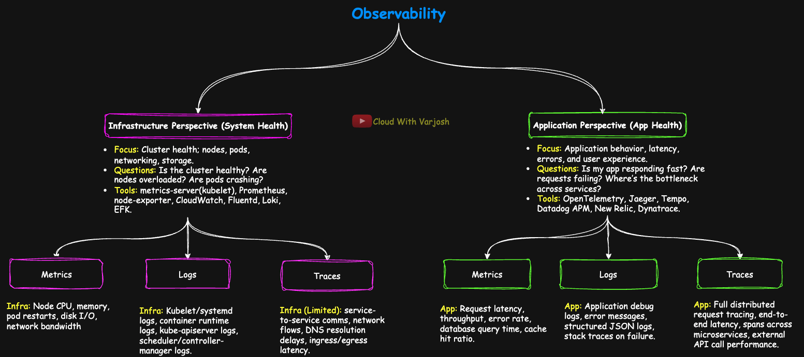
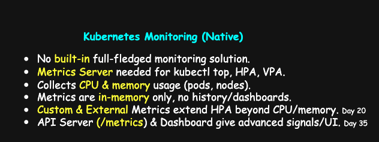
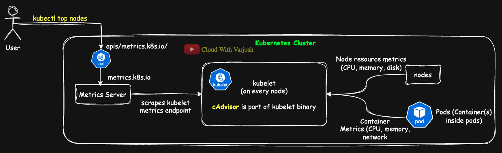
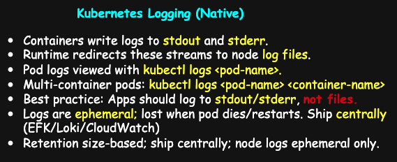

# 79 · Monitoring and Logging Basics

> **Level:** ★★ intermediate
>
> **You will learn:** what observability is; the **infrastructure** and **application (APM)** perspectives and their tools; the **three pillars** (metrics, logs, traces); observability with AWS-native services; what Kubernetes gives you out of the box (and what it doesn't); the **metrics-server** architecture behind `kubectl top` (aggregated API → metrics-server → kubelet Summary API → cAdvisor); resource vs custom vs external metrics; kube-state-metrics, component `/metrics` and the Dashboard; **where logs live**: systemd services in **journald**, Pods in `/var/log/pods` and `kubectl logs`; and why logs must be centralised.
>
> **You need:** topics 04 (systemd/journald), 08 (kubelet, runtime), 14 (API aggregation), 21 (debugging Pods), 48 (metrics-server install, HPA).

---

## ⚡ Core: the 10-minute version

**The idea.** Observability is understanding a system from its **metrics** (numbers over time), **logs** (events) and **traces** (a request's path). Out of the box, Kubernetes gives you:
- **metrics-server**: current CPU and memory, for `kubectl top` and the HPA;
- **kube-state-metrics** (an add-on): object health;
- component `/metrics` endpoints.

Logs live in two places:
- node services (kubelet, containerd) → **journald**;
- containers' **stdout/stderr** → `kubectl logs` and `/var/log/pods`. These are lost with the Pod or node unless shipped to a central system.

**Picture it.** A doctor reading vital signs (metrics), nurse's notes (logs) and the patient's route through the hospital (traces).

**The one thing to know.**

```bash
kubectl top nodes; kubectl top pods -A --sort-by=memory
kubectl logs <pod> -c <container> --previous
docker exec lab-worker journalctl -u kubelet -n 20
docker exec lab-worker ls /var/log/pods
```

**Try it now:**
1. Apply `Day 56/01-demo-pod.yaml` and read each container's logs.
2. Delete the Pod and notice its logs are gone. That's why centralised logging exists.

**You've got it if you can:** say where kubelet logs vs container logs live, and how `kubectl top` gets its data.

> 📖 **That's the core.** On a first pass, do the mini-lab and move on to the next topic. Everything below is the **full reference**: come back for the details, the edge cases, interview answers and exam-level depth.

---

## What it is

**Observability** is the ability to understand a system's **internal state from the signals it emits**: **metrics, logs and traces**. Kubernetes workloads are **dynamic and ephemeral** (Pods come and go, move between nodes, get new IPs), so you can't rely on SSH-ing into machines; you need signals collected centrally.

**Analogy:** a doctor diagnoses a patient without opening them up, using external signals (pulse, blood pressure, temperature). We read a cluster through its metrics, logs and traces.

**Monitoring** is the part of observability that watches **known** signals and alerts on them (CPU > 90%, error rate > 1%); **observability** also lets you ask **new** questions during incidents.

---

## Why it exists

You can't fix what you can't see: is the cluster healthy? Are nodes overloaded? Why is checkout slow? Which deploy broke it? Without collected signals you're guessing, and once a Pod is gone its local logs may be gone too.

---

## Analogy

Day 56's doctor analogy, extended: **metrics** are the vital-signs monitor (numbers over time); **logs** are the nurse's notes (what happened, in words, with timestamps); **traces** are the record of a patient's whole journey through the hospital (reception → X-ray → ward), showing where time was spent.

---

## How it works inside

### Two perspectives



**1. Infrastructure observability**: cluster health: nodes, Pods, networking, storage. *Is the cluster healthy? Are nodes overloaded? Are Pods crashing?*

| Tool | What it does | Production use |
|---|---|---|
| **kubelet** | Exposes Pod/container stats (via built-in cAdvisor) and container logs on each node | The base signal source for metrics and logs |
| **metrics-server** | Collects current CPU/memory from kubelets; powers `kubectl top` and HPA/VPA | Lightweight, **no history** |
| **Prometheus** | Scrapes, stores and queries metrics (a time-series database) | Core monitoring, with **Alertmanager** + **Grafana** |
| **node-exporter** | Host metrics (disk I/O, network, filesystem, CPU) | DaemonSet feeding Prometheus |
| **Fluentd / Fluent Bit** | Collect and forward logs (to Elasticsearch, Loki, Splunk…) | Cluster-wide log shipping (Fluent Bit = lightweight agent) |
| **Loki** | Log store that indexes **labels**, not full text: cheap storage | Often with Grafana + Prometheus |
| **EFK stack** | Elasticsearch (store/search) + Fluentd (collect) + Kibana (view) | Classic enterprise log pipeline |

**2. Application observability (APM: Application Performance Monitoring)**: app behaviour, latency, errors, user experience. *Is my app fast? Are requests failing? Where's the bottleneck across services?*

| Tool | What it does | Production use |
|---|---|---|
| **OpenTelemetry (OTel)** | Vendor-neutral standard + SDKs + Collector for metrics, logs and traces | Instrument apps once, export anywhere |
| **Jaeger** | Open-source distributed tracing | Visualise request flows, debug latency |
| **Tempo** | Grafana's scalable trace store | Cheap trace storage, linked with Loki/Prometheus |
| **Datadog APM** | SaaS full observability | Automatic traces/metrics/logs at scale |
| **New Relic** | SaaS APM (transactions, errors, UX) | Hybrid and enterprise apps |
| **Dynatrace** | Enterprise platform with AI-assisted root-cause analysis | Regulated industries |

**Enterprise note:** Datadog, Dynatrace and similar offer **one platform for both** infra and APM, so many enterprises avoid running separate stacks. Both perspectives use the **same three pillars**: infra checks **system** health, APM checks **application and user** health.

### Observability on AWS

CloudWatch is the hub; **Amazon Managed Service for Prometheus (AMP)** and **Amazon Managed Grafana (AMG)** serve Kubernetes-native workflows.
- **Infrastructure**: metrics (CloudWatch Metrics, **Container Insights**, AMP); logs (CloudWatch Logs + Logs Insights, Container Insights, **CloudTrail** for API audit/security events); network telemetry (**VPC Flow Logs**); traces via **ADOT** (AWS Distro for OpenTelemetry).
- **Applications**: metrics (CloudWatch, **Application Signals**, AMP); logs (CloudWatch Logs from EKS/ECS/Lambda); traces and user experience (**X-Ray**, **CloudWatch RUM** (real user monitoring), **Synthetics** (scripted probes), Application Signals, ADOT).

> ℹ️ **Note:** VPC Flow Logs were listed under infrastructure **traces**. They're **network flow records** (who talked to whom, bytes, accept/reject), closer to logs; they don't follow a request through services. And CloudWatch **Application Signals**, marked "(preview)", has since become generally available.

### The three pillars

| Pillar | Infrastructure | Application |
|---|---|---|
| **Metrics** (numbers over time) | Node CPU/memory, Pod restarts, disk I/O, network bandwidth | Request latency, throughput, error rate, DB query time, cache hit ratio |
| **Logs** (timestamped events) | kubelet/systemd logs, runtime logs, API server/scheduler/controller-manager logs | App debug/error messages, structured JSON logs, stack traces |
| **Traces** (a request's path, as spans) | Limited: service-to-service hops, DNS delays, ingress/egress latency | Full distributed traces, end-to-end latency, spans across microservices, external API calls |

**Note:** just as DevOps is a culture, not a tool, **APM is not a fourth pillar**: it's the **practice of applying all three pillars to applications** (performance, dependencies, user experience).

### Out of the box



Kubernetes ships **no full monitoring solution**. Until we installed **metrics-server** (topic 48), `kubectl top` didn't work.

**What we want to monitor:**
- counts of nodes, Pods, Deployments, volumes;
- CPU, memory, storage, network utilisation;
- Pod restarts, crashes, Pending Pods;
- API server request latency and errors (advanced).

### metrics-server

**Recap:**
- Collects current **CPU and memory** from every kubelet (cAdvisor).
- Provides the **resource metrics** for **HPA**, **VPA** and `kubectl top`.
- Keeps only the **latest** values **in memory**: no history.
- Nearly always installed because resource-based autoscaling depends on it.

> ℹ️ **Note:** the original notes said "Without it, HPA and VPA cannot make scaling decisions" applies to **CPU/memory** (resource metrics). An HPA on **custom or external** metrics uses a different API (e.g. Prometheus Adapter, KEDA) and doesn't need metrics-server. And "once queried, they are gone" means metrics-server keeps only the **most recent scrape** (it's replaced each scrape interval, ~15 s); reading doesn't delete it, but there's no history to look back on.

**Architecture: what happens on `kubectl top`**



1. `kubectl top nodes/pods` calls the API server at **`/apis/metrics.k8s.io/v1beta1/…`**.
2. The **API aggregation layer** (an `APIService` object for `metrics.k8s.io`: `v1beta1` historically, plus `v1` since the API went GA in v1.37) **proxies** the request to the **metrics-server** Service (topic 14).
3. metrics-server returns the latest **NodeMetrics/PodMetrics** from memory, which it fills by scraping every node's **kubelet** over HTTPS **10250**, using the kubelet's resource-metrics endpoint (`/metrics/resource`; older versions used the **Summary API** `/stats/summary`).
4. The **kubelet** gets container and node stats from its built-in **cAdvisor** and the container runtime (via CRI stats).

**What you get:** current CPU and memory for Pods and nodes (no history), for `kubectl top` and HPA/VPA.

**Gotchas:**
- **Not a monitoring stack**: no storage, alerting or dashboards; pair it with Prometheus/Grafana or a SaaS.
- **Connectivity**: metrics-server must reach every kubelet on **10250** (and the API server must reach metrics-server's Pod). Labs often use `--kubelet-insecure-tls`; avoid it in production (use proper kubelet serving certificates; topic 53).
- **If `top` fails**: check the **`metrics.k8s.io` APIService** status (`kubectl get apiservice | grep metrics.k8s.io`), metrics-server logs, and reachability to 10250. (On Day 54's Calico cluster the fix was the `vxlanMode: Always` patch in topic 48.)

### Types of metrics for autoscaling

- **Resource metrics**: CPU and memory from kubelet/cAdvisor via metrics-server (`metrics.k8s.io`). Used directly by HPA and VPA.
- **Custom metrics**: app-defined (HTTP requests per second, queue length) via the **Custom Metrics API** (`custom.metrics.k8s.io`, served by adapters like Prometheus Adapter): scale on app KPIs.
- **External metrics**: from outside the cluster (SQS queue depth, Kafka lag) via the **External Metrics API** (`external.metrics.k8s.io`, e.g. **KEDA**): scale on external demand.

Custom and external metrics extend autoscaling **beyond CPU and memory**.

### Beyond metrics-server

| Component | Type | What it gives | Use it for | Watch-outs |
|---|---|---|---|---|
| **kube-state-metrics (KSM)** | Add-on | Kubernetes **object state** as Prometheus metrics: desired vs available replicas, rollout status, Pod phases/restarts, node conditions, HPA desired replicas | Availability/SLO alerts ("Deployment not fully available"), rollout dashboards, drift detection | Not CPU/memory usage; can create **high-cardinality** metrics (too many label combinations), so export only what you need |
| **API server and kubelet `/metrics`** | Native | Prometheus-format operational metrics: API request rate/latency/errors/throttling; kubelet Pod lifecycle, evictions, runtime stats | Control-plane and node health SLOs, capacity/saturation alerts; scraped by Prometheus, Datadog, New Relic… | Sensitive internals: scrape **in-cluster with RBAC**, never expose publicly; verbose, so tune intervals |
| **Kubernetes Dashboard** | Add-on (UI) | Web UI for objects, logs and basic Metrics-API data | Quick triage in dev/test, demos, teaching | **Security risk** if misconfigured: OIDC/RBAC, no public exposure, no broad tokens; prefer Grafana for production |

**Mental model:** **KSM = object health**, **`/metrics` = control-plane and node internals**, **Dashboard = convenience UI**.

### Kubernetes logging



**0) Services vs Pods**
- **systemd services on the node**: `kubelet`, `containerd` (or CRI-O), and on some old installs `kube-proxy`.
- **Pods (run by the kubelet)**: the kubeadm control plane (static Pods: API server, controller manager, scheduler, etcd), `kube-proxy` (usually a DaemonSet), CoreDNS, and your apps.

Even with journald you'll still find text logs under `/var/log/` (`syslog`, `kern.log`) and Kubernetes container logs under **`/var/log/containers`** and **`/var/log/pods`**.

**1) Services → journald** (Linux notes: systemd and journald, topics [037](../../linux-mastery-rhel/notes/037-systemd-services-and-targets.md) and [038](../../linux-mastery-rhel/notes/038-logging-journald-rsyslog-logrotate.md))

```bash
journalctl -u kubelet -f                       # follow kubelet
journalctl -u containerd -f
journalctl -u kubelet --since "1 hour ago"
journalctl -u containerd -p warning            # warning and worse
journalctl -u kubelet -b                       # since the last boot
```

- `-u` = systemd **unit**; `-f` = follow; `-p` = minimum priority.
- **Retention**: size/time-based. If `/var/log/journal/` exists, logs are **persistent**; otherwise **volatile** (lost on reboot). Limits in `/etc/systemd/journald.conf` (`SystemMaxUse=` etc.).
- If the **node** dies or is rebuilt, local service logs are **lost** unless shipped elsewhere.

**2) Pods → container logs**

**A) kubectl (preferred):**

```bash
kubectl logs <pod>                          # the only/first container
kubectl logs <pod> -c <container>           # a specific container (Day 56 writes it positionally: kubectl logs <pod> <container>)
kubectl logs -f <pod> -c <container>        # follow
kubectl logs <pod> -c <container> --previous     # the previous (crashed) instance
kubectl logs deploy/web --all-containers --since=10m --timestamps
kubectl logs -l app=web --prefix --max-log-requests=10      # all Pods with a label
```

`kubectl logs` shows **stdout and stderr** together. (It asks the API server, which proxies to the **kubelet**, which reads the log file.)

**B) On the node (files):**

```bash
ls -l /var/log/containers/                        # symlinks: <pod>_<ns>_<container>-<id>.log
ls -l /var/log/pods/<namespace>_<pod>_<uid>/<container>/    # the real files: 0.log, 1.log…
sudo tail -3 /var/log/pods/default_demo-pod_*/busybox-container/0.log
```

```
2026-11-18T10:20:01.123456789Z stdout F Busybox log: Wed Nov 18 10:20:01 UTC 2026 - processing data
2026-11-18T10:20:01.123987654Z stderr F Busybox error: Wed Nov 18 10:20:01 UTC 2026 - something went wrong
```

Each line: **timestamp**, **stream** (stdout/stderr), a tag (`F` = full line, `P` = partial), then the message.

> ✅ **Correct today** ([C1](#c1)): the CRI log format used by containerd and CRI-O is **plain text** lines (timestamp, stream, tag, message) as shown above. JSON log files (`{"log":…,"stream":…,"time":…}`) came from Docker's `json-file` driver, used before dockershim was removed (v1.24).

- **Best practice for developers**: log to **stdout/stderr**, not to files inside the container, so Kubernetes captures them and they can be shipped centrally. (Structured JSON log *messages* are great for searching.)
- **Rotation**: the kubelet rotates container logs by size and count (`containerLogMaxSize`, default 10 Mi; `containerLogMaxFiles`, default 5). `kubectl logs` only sees the current file. Files are **lost** when the Pod is deleted or the node dies.

**3) Why centralised logging:** node logs are **ephemeral** and **scattered** across nodes. Ship them off-node for search, alerting and retention:
- **SaaS/enterprise**: Datadog, Splunk, New Relic, Dynatrace;
- **cloud-managed**: Amazon CloudWatch, Google Cloud Logging, Azure Monitor;
- **open source**: **EFK/ELK** (Fluent Bit/Fluentd → Elasticsearch/OpenSearch → Kibana), **Loki** (Grafana Alloy/Fluent Bit → Loki → Grafana). (Promtail, Loki's original agent, is deprecated in favour of Grafana Alloy.)

**Typical pipeline:** a **DaemonSet** agent on every node tails `/var/log/containers/*.log` (adding Pod metadata like namespace and labels from the API) and reads **journald** for node services, then ships to the backend.

**4) Cheat-sheet:**
- Services → journald: `journalctl -u kubelet -f`, `journalctl -u containerd -f`
- Pods → kubectl: `kubectl logs [-f] <pod> [-c <container>]`
- On the node: `/var/log/containers` → symlinks to `/var/log/pods`
- Retention: journald size/time; containers size/count rotation; **lost on node failure**
- Production: ship to a **central** log system

✅ **Key takeaway:** always log to **stdout and stderr**.

---

## Commands / YAML

### The logging demo Pod (`Day 56/01-demo-pod.yaml`)

```yaml
apiVersion: v1
kind: Pod
metadata:
  name: demo-pod
  labels:
    app: logging-demo
spec:
  containers:
  - name: nginx-container
    image: nginx:1.25
    ports:
    - containerPort: 80
    # nginx's official image links its access/error logs to stdout/stderr
  - name: busybox-container
    image: busybox:1.36
    command: ["sh", "-c"]
    args:
      - |
        while true; do
          echo "Busybox log: $(date) - processing data" >&1          # stdout (file descriptor 1)
          echo "Busybox error: $(date) - something went wrong" >&2   # stderr (file descriptor 2)
          sleep 10
        done
```

```bash
kubectl apply -f "Day 56/01-demo-pod.yaml"
kubectl logs demo-pod -c busybox-container --tail=4
kubectl port-forward pod/demo-pod 8080:80 & curl -s localhost:8080 >/dev/null; kill %1
kubectl logs demo-pod -c nginx-container --tail=2
```

```
Busybox log: Wed Nov 18 10:20:01 UTC 2026 - processing data
Busybox error: Wed Nov 18 10:20:01 UTC 2026 - something went wrong
…
127.0.0.1 - - [18/Nov/2026:10:21:05 +0000] "GET / HTTP/1.1" 200 615 "-" "curl/8.5.0" "-"
```

(In the official nginx image, `/var/log/nginx/access.log` → `/dev/stdout` and `error.log` → `/dev/stderr` are symlinks: that's how a file-logging app is adapted.) The `>&1`/`>&2` redirections are shell file-descriptor syntax (Linux notes: redirection, topic [016](../../linux-mastery-rhel/notes/016-redirection-and-pipes.md)).

### metrics-server and the metrics APIs

```bash
kubectl get apiservice | grep metrics.k8s.io
kubectl top nodes
kubectl top pods -A --sort-by=memory | head
kubectl get --raw /apis/metrics.k8s.io/v1beta1/nodes | jq '.items[0].usage'
kubectl get --raw /api/v1/nodes/<node>/proxy/metrics/resource | head        # what metrics-server scrapes
```

```
NAME                     SERVICE                      AVAILABLE   AGE
v1beta1.metrics.k8s.io   kube-system/metrics-server   True        2d

NAME                CPU(cores)   CPU(%)   MEMORY(bytes)   MEMORY(%)
lab-control-plane   182m         4%       812Mi           10%
lab-worker          64m          1%       402Mi           5%
```

### Component metrics endpoints

```bash
kubectl get --raw /metrics | grep -E '^apiserver_request_total' | head -3
kubectl get --raw /api/v1/nodes/lab-worker/proxy/metrics | grep kubelet_running_pods
```

### kube-state-metrics (quick install)

```bash
helm repo add prometheus-community https://prometheus-community.github.io/helm-charts
helm install ksm prometheus-community/kube-state-metrics -n monitoring --create-namespace
kubectl -n monitoring port-forward svc/ksm-kube-state-metrics 8081:8080 &
curl -s localhost:8081/metrics | grep kube_deployment_status_replicas_available | head -3
```

---

## Hands-on lab

1. Apply the demo Pod; read each container's logs; use `--previous` after killing the busybox container (`kubectl exec demo-pod -c busybox-container -- kill 1`).
2. On a kind node (`docker exec -it lab-worker bash`): `journalctl -u kubelet -n 20`, `journalctl -u containerd -n 20`, `ls /var/log/containers`, read a raw CRI log file.
3. Break metrics-server (scale to 0) and run `kubectl top nodes` and `kubectl get apiservice`; restore it.
4. Install kube-state-metrics and find the metric showing unavailable Deployment replicas; scale a Deployment to an impossible size and watch it.
5. Delete the demo Pod and note that its logs are gone from both `kubectl logs` and the node: why centralised logging matters.

---

## Where you'll use it

- **Every incident**: logs (`kubectl logs`, journald) and metrics (`kubectl top`, dashboards).
- **Autoscaling** (metrics-server, custom/external metrics).
- **Designing a production stack** (topic 80): Prometheus/Grafana/Loki/OpenTelemetry or a SaaS.
- **CKA**: `kubectl logs` (incl. `--previous`, `-c`), `kubectl top`, `journalctl -u kubelet`, finding logs on nodes.

---

## When it breaks

| Symptom | Cause | Fix |
|---|---|---|
| `error: Metrics API not available` | metrics-server missing or APIService unavailable | Install/fix it (topic 48); check APIService status |
| `kubectl top` shows `<unknown>` for some nodes | metrics-server can't reach those kubelets (10250, TLS) | Firewall/SG, kubelet serving certs |
| `kubectl logs` empty | App logs to files, not stdout/stderr | Log to stdout; or a sidecar tails the file |
| `previous terminated container … not found` | Container hasn't restarted, or the Pod was recreated | Logs of deleted Pods only exist in central logging |
| `Error from server: Get https://<node>:10250/containerLogs/…: dial tcp … timeout` | API server can't reach the kubelet | Network/firewall between control plane and node |
| journald lost logs after reboot | Volatile journald | Create `/var/log/journal` (persistent) |
| Prometheus memory explodes | High-cardinality labels (Pod names, IDs) | Drop/relabel; limit KSM metrics |

---

## Quick recap

- Observability = metrics, logs, traces; two lenses: **infrastructure** and **application (APM)**. APM applies the pillars to apps; it isn't a fourth pillar.
- Kubernetes provides signals, not a stack: **metrics-server** (current CPU/memory → `kubectl top`, HPA/VPA, via the aggregated `metrics.k8s.io` API scraping kubelets on 10250), **kube-state-metrics** (object state), component **`/metrics`**.
- Metric types: resource (metrics-server), custom (`custom.metrics.k8s.io`), external (`external.metrics.k8s.io`).
- Logs: node services → **journald** (`journalctl -u kubelet`); Pods → `kubectl logs` / `/var/log/pods` (CRI text format, rotated, lost with the Pod/node). Log to **stdout/stderr** and **ship centrally**.

### Interview questions

1. **Q: What happens when you run `kubectl top pods`?**
   A: kubectl calls the aggregated `metrics.k8s.io` API on the API server, which proxies to metrics-server; metrics-server returns the latest CPU/memory it scraped from each kubelet's resource-metrics endpoint (fed by cAdvisor/CRI stats).
2. **Q: Where do you find the kubelet's logs vs a Pod's logs?**
   A: The kubelet is a systemd service, so `journalctl -u kubelet`; Pod container logs are available through `kubectl logs` and on the node under `/var/log/pods` (symlinked from `/var/log/containers`).
3. **Q: Why isn't metrics-server enough for monitoring?**
   A: It only holds current CPU/memory values in memory: no history, no alerting, no application metrics. Production needs a time-series system (Prometheus or a SaaS) plus kube-state-metrics, logs and traces.

---

## Appendix: notes on the original course material

This topic was rebuilt from the original CKA course notes. This appendix keeps the audit trail out of your way while you learn.

### Sources

Day 56 (introduction; what observability is and the doctor analogy; two perspectives: infrastructure and APM with tool tables and the enterprise note; observability in AWS; the 3 pillars and the APM note; out-of-the-box monitoring: what to monitor, metrics-server recap, architecture, what you get, gotchas; types of metrics; beyond metrics-server table; Kubernetes logging: services vs Pods, journald, container logs, centralised logging, cheat-sheet; key takeaway; conclusion; references), file `Day 56/01-demo-pod.yaml`. Day 56's metrics-server **install** steps and the **Calico `vxlanMode: Always`** fix are in topic 48.

### Corrections to the original notes

Each entry shows what the original said and what's true now. In the topic above, each correction appears as a ✅ **Correct today** line or a ⚠️ **Fix to the original** box, linked to its entry here.

<a id="c1"></a>**C1 · Corrected (Day 56).** the files under `/var/log/pods` were described as "**CRI JSON**". **Now:** the CRI log format used by containerd and CRI-O is **plain text** lines (timestamp, stream, tag, message) as shown above. JSON log files (`{"log":…,"stream":…,"time":…}`) came from Docker's `json-file` driver, used before dockershim was removed (v1.24).
